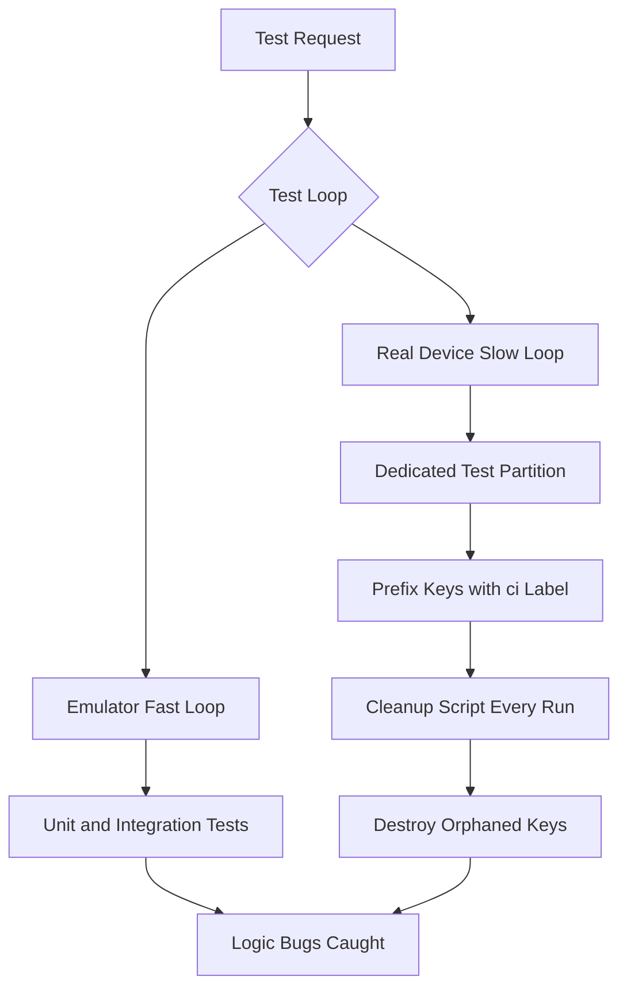

# Testing Against an HSM Without Breaking It

## English

HSMs are awkward to test against. You cannot spin one up in a unit test, you cannot reset it freely, and many devices have state (keys, sessions, usage counters, audit logs) that persists across restarts. Teams that treat the HSM like a database often discover, usually in staging, that their test suite has filled the device with thousands of orphaned keys, exhausted a usage counter, or locked an operator account. The discipline that prevents this is to treat the HSM as a shared, stateful, expensive resource with a lifecycle, not as a fixture.

The most important pattern is a software emulator for the fast inner loop and a real device for the slow outer loop. Emulators such as SoftHSM implement the PKCS#11 interface over a software keystore, which means your application code can be unit-tested and integration-tested without any hardware. The emulator will not reproduce timing, tamper behavior, or vendor-specific extensions, but it will catch the vast majority of logic bugs: wrong attributes, wrong mechanisms, mishandled sessions. Reserve the real device for a smaller set of tests that verify the behaviors the emulator cannot: actual firmware quirks, performance under load, and failover.

When you do test against the real device, isolate. Use a dedicated partition or a dedicated test HSM, never the production partition. Create keys with a recognizable prefix (for example, a test-only label like 'ci-' plus a run identifier) so that a cleanup script can find and destroy them. Run the cleanup script on every test run, not just on success, because failed runs are exactly when orphaned keys accumulate. Many HSMs also expose a per-partition object quota; if you hit it, the error messages are often unhelpful, and the cause is usually a previous test run that did not clean up.

Be careful with destructive operations in tests. Key destruction, partition reset, and firmware update are not idempotent in the way developers expect. A test that destroys a key and then recreates it with the same label may pass locally but fail in CI if the device enforces a cooldown or if the destroy is asynchronous. Read the vendor's documentation for the specific semantics of C_DestroyObject and similar calls; do not assume they are synchronous.

Finally, treat the audit log as part of your test surface. After a test run, a well-designed suite should be able to assert that the expected operations appear in the log and that no unexpected operations occurred. This turns the HSM's logging from a compliance afterthought into a regression detector. It also forces you to learn the log format early, which pays off enormously during the first real incident.

## 中文

對 HSM 做測試很麻煩。你不能在單元測試裡隨手開一台，不能隨意重置，而且許多裝置有跨重啟持續存在狀態（金鑰、session、使用次數計數、稽核日誌）。把 HSM 當資料庫對待的團隊，通常在預備環境就會發現：測試套件把裝置塞滿了數千把孤兒金鑰、耗盡了使用次數計數，或鎖住了操作員帳號。防止這件事的紀律，是把 HSM 視為共享、有狀態、昂貴且有生命週期的資源，而不是測試夾具。

最重要的模式是：快速內圈用軟體模擬器，慢速外圈用真實裝置。SoftHSM 之類的模擬器以軟體金鑰庫實作 PKCS#11 介面，這意味著你的應用程式碼可以在沒有硬體的情況下做單元測試與整合測試。模擬器不會重現時序、防篡改行為或廠商延伸，但它能抓到絕大多數邏輯錯誤：錯的屬性、錯的機制、沒處理好的 session。把真實裝置留給較小一組測試，用來驗證模擬器無法驗證的行為：實際韌體怪癖、負載下的效能、容錯移轉。

當你真的對真實裝置測試時，要隔離。使用專用分割區或專用測試 HSM，絕不用生產分割區。建立金鑰時加上可辨識的前綴（例如僅供測試的標籤，如「ci-」加執行識別碼），讓清理腳本能找到並銷毀它們。每次測試執行都要跑清理腳本，不只在成功時跑，因為失敗的執行正是孤兒金鑰累積的時候。許多 HSM 也對每個分割區設有物件配額；撞到配額時，錯誤訊息往往沒什麼幫助，原因通常是前一次沒清理乾淨的測試執行。

在測試中要小心破壞性操作。金鑰銷毀、分割區重置、韌體更新並不像開發者以為的那樣冪等。一個先銷毀金鑰再以相同標籤重建的測試，可能在本機通過卻在 CI 失敗，如果裝置強制冷卻期，或銷毀是非同步的。查閱廠商文件對 C_DestroyObject 之類呼叫的確切語意；不要假設它們是同步的。

最後，把稽核日誌當作測試面的一部分。設計良好的測試套件在執行後，應能斷言預期的操作出現在日誌中，且沒有意外操作發生。這把 HSM 的日誌從合規的附屬品變成回歸偵測器。它也迫使你提早學會日誌格式，這在第一次真實事故時回報極大。

## Key Takeaway

Test HSM-dependent code with an emulator for fast feedback and a dedicated, cleaned-up real device for fidelity, and treat the audit log as a regression signal.

## Related Concepts
- SoftHSM emulator
- Test isolation and cleanup scripts

## Diagram

