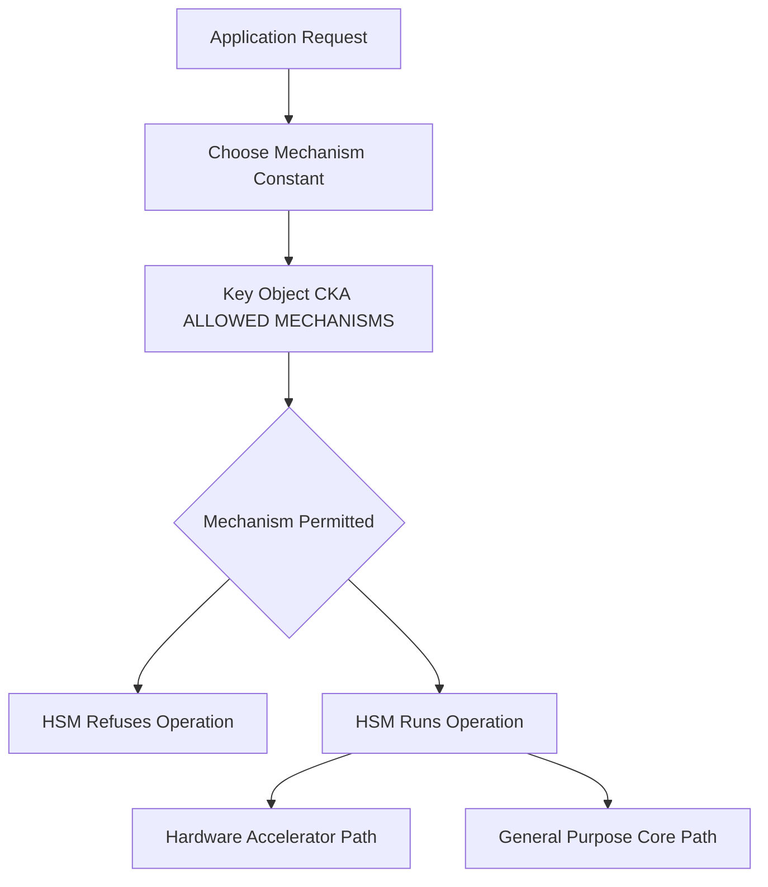

# Mechanism Selection: Why the Same Key Can Behave Differently

## English

Inside PKCS#11, a cryptographic operation is described by a mechanism, which is a constant that names both an algorithm and a mode of operation — for example CKM_RSA_PKCS (RSA with PKCS#1 v1.5 padding), CKM_RSA_PKCS_OAEP (RSA with OAEP padding), CKM_AES_CBC, or CKM_AES_GCM. The key object itself carries a set of permitted mechanisms in its CKA_ALLOWED_MECHANISMS attribute, and the HSM will refuse any operation that pairs the key with a mechanism outside that list. This is a subtle but powerful control: the same RSA private key can be allowed to sign but forbidden to decrypt, or allowed to decrypt with OAEP only and not with raw PKCS#1 v1.5, which historically leaked information through padding oracles. Because the restriction lives on the key object inside the vault, an application bug or a compromised client library cannot widen it.

The practical consequence is that mechanism choice is a security decision, not just a performance knob. Textbook RSA without padding is deterministic — encrypting the same plaintext twice yields the same ciphertext — so it leaks equality of inputs and is vulnerable to chosen-ciphertext attacks. OAEP adds randomised padding, so identical plaintexts produce different ciphertexts. AES-CBC requires an explicit IV and is malleable unless paired with a MAC; AES-GCM is authenticated but reusing a nonce with the same key catastrophically destroys confidentiality and integrity. An HSM cannot stop you from choosing a bad mechanism, but it can stop you from choosing a bad mechanism with a key that was never meant for it.

There is also a mechanical cost dimension. Some mechanisms are implemented in hardware accelerators (bulk AES, SHA-2 hashing), while others are computed on a general-purpose core inside the tamper boundary (RSA key generation, elliptic-curve scalar multiplication). The same vault may therefore be extremely fast at symmetric encryption and comparatively slow at asymmetric signing. When you profile an HSM-backed service, the mechanism name in your call is often a better predictor of latency than the data size.

A concrete example: a payments system stores a private key for decrypting PIN blocks. The policy sets CKA_ALLOWED_MECHANISMS to only the specific RSA-OAEP mechanism and forbids CKM_RSA_PKCS. Six months later an engineer copies a decryption code path from a different service that used PKCS#1 v1.5 padding. The call fails with CKR_MECHANISM_INVALID — not because the key is wrong, but because the vault enforced a decision made at key creation. That error is the policy doing its job.

When designing around an HSM, treat the mechanism list as part of the key's contract. Document it alongside the key, test the negative cases (wrong mechanism, wrong padding, wrong mode), and remember that the vault will happily perform a cryptographically weak operation if you explicitly allow it. The HSM enforces what you told it to enforce, nothing more.

## 中文

在 PKCS#11 之中，一個密碼學操作是由 mechanism（機制）來描述的，它是一個常數，同時指明演算法與運作模式——例如 CKM_RSA_PKCS（RSA 配 PKCS#1 v1.5 填充）、CKM_RSA_PKCS_OAEP（RSA 配 OAEP 填充）、CKM_AES_CBC 或 CKM_AES_GCM。金鑰物件本身在 CKA_ALLOWED_MECHANISMS 屬性中攜帶一組獲准的機制，而 HSM 會拒絕任何把該金鑰與清單以外機制配對的操作。這是一個細微但強大的控制：同一把 RSA 私鑰可以被允許簽署但禁止解密，或者只准以 OAEP 解密而不准用原始的 PKCS#1 v1.5——後者在歷史上曾透過填充預言（padding oracle）洩漏資訊。因為限制存在於保險庫內部的金鑰物件上，應用程式的錯誤或遭入侵的客戶端程式庫都無法把它放寬。

實際後果是：機制的選擇是一項安全決策，而不只是效能旋鈕。教科書式無填充的 RSA 是確定性的——同一段明文加密兩次會得到相同的密文——因此會洩漏輸入是否相等，也易受選擇密文攻擊。OAEP 加入隨機化填充，所以相同的明文會產生不同的密文。AES-CBC 需要明確的 IV，而且除非配上 MAC，否則具可塑性；AES-GCM 具認證功能，但對同一把金鑰重用 nonce 會災難性地同時摧毀機密性與完整性。HSM 無法阻止你選擇一個壞機制，但它可以阻止你用一把從未打算用於該機制的金鑰去選擇壞機制。

還有一個機械成本層面。有些機制由硬件加速器實現（大量 AES、SHA-2 雜湊），其他則在防篡改邊界內的通用核心上計算（RSA 金鑰生成、橢圓曲線純量乘法）。因此同一個保險庫可能對對稱加密極快，而對非對稱簽署相對緩慢。當你對一個以 HSM 為後端的服務做效能剖析時，呼叫中的機制名稱往往比資料大小更能預測延遲。

一個具體例子：某支付系統儲存一把用於解密 PIN 區塊的私鑰。政策把 CKA_ALLOWED_MECHANISMS 設為只准特定的 RSA-OAEP 機制，並禁止 CKM_RSA_PKCS。六個月後，一位工程師從另一個服務複製了一段使用 PKCS#1 v1.5 填充的解密程式碼路徑。呼叫失敗並回傳 CKR_MECHANISM_INVALID——不是因為金鑰錯了，而是因為保險庫強制執行了金鑰建立時所作的決定。那個錯誤正是政策在履行職責。

圍繞 HSM 設計時，把機制清單視為金鑰契約的一部分。把它與金鑰一併記錄，測試反面情況（錯誤機制、錯誤填充、錯誤模式），並記住：只要你明確允許，保險庫會樂意執行一個密碼學上薄弱的操作。HSM 只會強制執行你告訴它要執行的東西，僅此而已。

## Key Takeaway

Mechanism selection is a per-key security policy enforced inside the vault, so choosing padding and mode carefully — and restricting it on the key object — matters as much as choosing the algorithm.

## Related Concepts
- PKCS#11 mechanism constants
- Padding oracles

## Diagram

