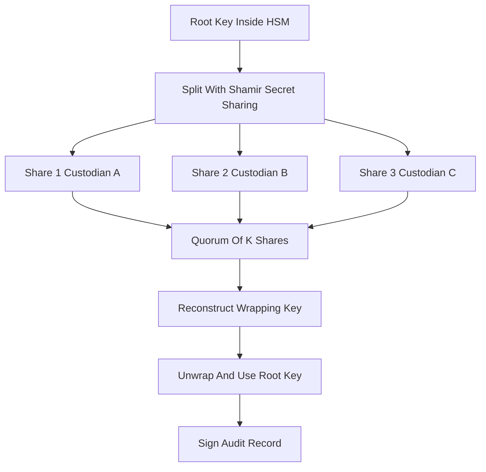

# The Key Ceremony as a Cryptographic Protocol, Not a Ritual

## English

A key ceremony is often described as a formal event with witnesses, sealed envelopes, and signed scripts. Strip away the theatre and what remains is a cryptographic protocol with a specific goal: ensuring that no single person, and no single moment in time, ever holds enough material to reconstruct a root key. The mechanism that makes this possible is secret sharing, most commonly Shamir's Secret Sharing, in which a secret is split into n shares such that any k of them reconstruct it but any k-1 reveal nothing at all — not even a partial hint. The mathematics is polynomial interpolation: a random polynomial of degree k-1 is chosen with the secret as its constant term, each share is a point on that polynomial, and k points uniquely determine it while fewer points leave infinitely many candidates.

Inside an HSM, the ceremony typically involves generating the root key inside the tamper boundary so it never exists in plaintext outside, then exporting it wrapped under a split authorisation. In PKCS#11 terms this often uses C_WrapKey with a wrapping key whose value is itself reconstructed from M-of-N smart cards presented to the HSM, so the vault only unwraps when a quorum is physically present. The shares may be stored on separate physical tokens held by different custodians in different locations. The point is that compromising the vault, or one custodian, or one backup tape, is insufficient — an attacker needs a coordinated compromise across k independent parties.

The ceremony's real product is not the key but the record. Every step — who was present, which serial numbers of tokens were used, what the HSM's audit log shows, which firmware version was running, what the script computed — is captured and signed. This matters because a ceremony can only be audited after the fact, and the audit must be able to answer the question: could anyone have deviated from the script without detection? If the answer is yes, the ceremony failed even if the key works perfectly.

A common failure mode is treating the script as documentation rather than as executable code. Scripts that are typed by hand invite transcription errors; scripts that are version-controlled and hash-verified before execution give you a reproducible record. Another failure mode is reusing custodians across multiple ceremonies, which collapses the independence assumption — if the same three people hold shares for every root key in the organisation, the M-of-N threshold is nominal rather than real.

For an engineer, the useful mental model is that a ceremony is a distributed computation over people. The HSM is one participant, the custodians are others, and the script is the protocol. Design it the way you would design any protocol: define the adversary, define what each party learns, and verify that no coalition below the threshold can reach the goal.

## 中文

金鑰儀式（key ceremony）常被描述為一個有見證人、密封信封和簽署腳本的正式活動。把戲劇性的部分剝掉，剩下的就是一個有明確目標的密碼學協議：確保沒有單一個人、也沒有單一時間點，曾經掌握足夠的材料去重建一把根金鑰。使這成為可能的機制是秘密分享，最常見的是 Shamir 秘密分享（Shamir's Secret Sharing），它把一個秘密拆成 n 份，使得任意 k 份可重建它，但任意 k-1 份完全不洩漏任何東西——甚至連部分提示都沒有。其數學是多項式插值：選一個 k-1 次隨機多項式，以秘密作為其常數項，每份分享是該多項式上的一點，k 點唯一確定它，而更少的點則留下無限多個候選。

在 HSM 內部，儀式通常涉及在防篡改邊界內生成根金鑰，使它從未以明文存在於邊界之外，然後在分割授權下包裝匯出。以 PKCS#11 的術語來說，這通常使用 C_WrapKey，而包裝金鑰的值本身是由呈現給 HSM 的 M-of-N 智能卡重建出來的，因此保險庫只有在法定人數實體在場時才會解包。各份分享可能儲存在由不同地點的不同保管人持有的獨立實體令牌上。重點是：入侵保險庫、或一位保管人、或一捲備份磁帶，都不足夠——攻擊者需要跨 k 個獨立方進行協調一致的入侵。

儀式真正的產物不是金鑰，而是記錄。每一步——誰在場、用了哪些令牌序號、HSM 的稽核日誌顯示什麼、正在執行哪個固件版本、腳本計算了什麼——都被擷取並簽署。這很重要，因為儀式只能在事後稽核，而稽核必須能回答這個問題：有沒有任何人能在不被偵測的情況下偏離腳本？如果答案是「有」，那麼即使金鑰運作完美，儀式也失敗了。

一個常見的失敗模式是把腳本當作文件而非可執行程式碼。手工輸入的腳本會招致轉錄錯誤；在執行前經過版本控制與雜湊驗證的腳本則給你一份可重現的記錄。另一個失敗模式是在多個儀式中重複使用保管人，這會瓦解獨立性假設——如果同一批三個人為組織內每一把根金鑰持有分享，那麼 M-of-N 門檻只是名義上的，而非真實的。

對工程師而言，有用的心智模型是：儀式是分散在人群之上的運算。HSM 是其中一個參與者，保管人是其他參與者，而腳本就是協議。像設計任何協議那樣設計它：定義對手、定義每一方學到什麼，並驗證任何低於門檻的聯盟都無法達成目標。

## Key Takeaway

A key ceremony is a distributed protocol over people and hardware — its security rests on secret sharing, independent custodians, and a verifiable record, not on the formality of the event.

## Related Concepts
- Shamir's Secret Sharing
- M-of-N quorum authorisation

## Diagram

