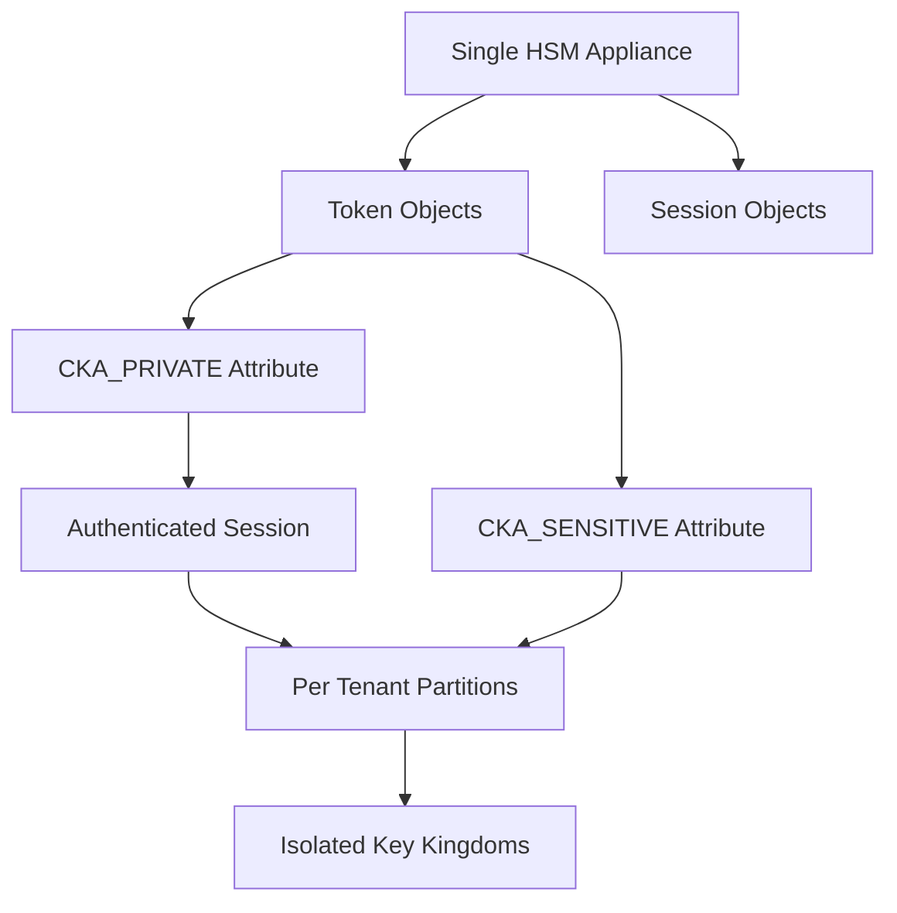

# Compartmentalised Keys: Why One Vault Holds Many Small Kingdoms

## English

A single HSM appliance is rarely dedicated to one application. It typically holds dozens or hundreds of key objects belonging to different services, teams, or tenants, and the vault must keep them mutually invisible. PKCS#11 provides the primitives for this through token objects versus session objects, and through the CKA_PRIVATE and CKA_SENSITIVE attributes. A private object is only visible after the session has been authenticated to the token; a sensitive object cannot have its value read out at all, even by an authenticated session. Combined with per-application PINs or per-tenant partitions, these attributes create the illusion of many small vaults inside one physical box.

The illusion is thin in places, and understanding where is important. Objects are not encrypted per-owner inside the vault in the way a multi-tenant database might encrypt rows; the isolation is enforced by the HSM's access-control logic and by the partitioning of storage and session state. If the firmware has a bug that lets a session enumerate objects it should not see, the isolation fails for every tenant at once. This is why compliance regimes care so much about the HSM's own firmware assurance: the boundary between tenants is only as strong as the code that enforces it, and it is a single piece of code shared by everyone.

A practical consequence is that naming and ownership discipline matters enormously. Two teams that both create a key labelled 'signing-key' will collide, and depending on the vault's behaviour one may overwrite or shadow the other. Mature deployments adopt a naming convention that encodes tenant, environment, purpose, and version, and they treat the HSM's object list as a shared namespace requiring governance — much like DNS or a public package registry. They also monitor object counts and creation events, because an unexpected new key is a signal worth investigating.

Performance is another shared resource. Sessions, cryptographic operation slots, and internal queues are finite. One tenant running a bulk re-encryption job can starve another tenant's latency-sensitive signing calls. Some appliances offer quality-of-service or partition-level rate limits; others do not, and the only remedy is architectural — separate appliances for workloads with very different latency profiles, or strict client-side concurrency budgets per tenant.

When you design for a shared HSM, ask three questions. Can tenant A prove it cannot see tenant B's keys even if its client library is malicious? Can tenant A's workload degrade tenant B's service? And if the firmware is compromised, what is the blast radius? The answers determine whether you need partitions, separate appliances, or a different architecture entirely.

## 中文

單一台 HSM 設備很少專屬於一個應用程式。它通常持有數十或數百個屬於不同服務、團隊或租戶的金鑰物件，而保險庫必須使它們彼此不可見。PKCS#11 透過 token 物件與 session 物件，以及透過 CKA_PRIVATE 與 CKA_SENSITIVE 屬性，提供了實現這一點的基本要素。私有物件只有在 session 已向 token 認證之後才可見；敏感物件的值則完全不能被讀出，即使是已認證的 session 也不行。再配合每個應用程式的 PIN 或每個租戶的分割區，這些屬性就在一個實體盒子內創造出許多小保險庫的假象。

這個假象在某些地方很薄弱，而了解薄弱之處很重要。物件在保險庫內部並不像多租戶資料庫可能加密資料列那樣按擁有者加密；隔離是由 HSM 的存取控制邏輯、以及儲存與 session 狀態的分割來強制執行的。如果固件有錯誤，讓某個 session 能列舉它不該看到的物件，那麼隔離會同時對所有租戶失效。這就是為什麼合規制度如此重視 HSM 自身固件的保證：租戶之間的邊界，只與強制執行它的程式碼一樣強，而那是所有人共用的一段程式碼。

一個實際後果是：命名與擁有權的紀律極其重要。兩個團隊都建立一把標籤為「signing-key」的金鑰就會碰撞，視保險庫的行為而定，其中一方可能覆寫或遮蔽另一方。成熟的部署會採用一套命名慣例，編碼租戶、環境、用途與版本，並把 HSM 的物件清單視為需要治理的共用命名空間——很像 DNS 或公開的套件註冊表。他們也會監控物件數量與建立事件，因為一把意料之外的新金鑰是值得調查的訊號。

效能是另一項共用資源。Session、密碼學操作槽與內部佇列都是有限的。一個租戶執行大量重新加密的工作，可以令另一個租戶對延遲敏感的簽署呼叫餓死。有些設備提供服務品質或分割區層級的速率限制；有些則沒有，唯一的補救是架構性的——為延遲特性差異極大的工作負載使用獨立設備，或為每個租戶設定嚴格的客戶端並行預算。

為共用 HSM 設計時，問三個問題。租戶 A 能否證明即使它的客戶端程式庫心懷惡意，也看不到租戶 B 的金鑰？租戶 A 的工作負載能否令租戶 B 的服務變差？而如果固件遭入侵，爆炸半徑有多大？答案決定你需要分割區、獨立設備，還是完全不同的架構。

## Key Takeaway

Multi-tenancy inside an HSM is enforced by shared firmware access-control logic, so isolation, naming discipline, and performance fairness must all be designed rather than assumed.

## Related Concepts
- PKCS#11 object attributes
- Blast radius analysis

## Diagram

