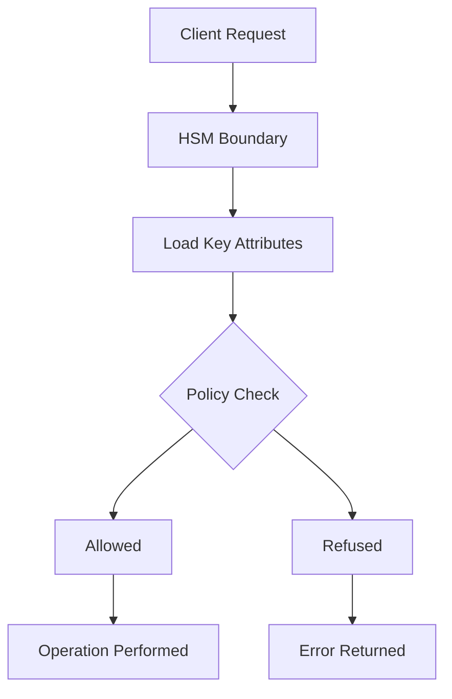

# The HSM as a Policy Engine: How Rules Become Refusals

## English

Most people picture an HSM as a locked box that holds keys. That is only half the story. The more interesting half is that an HSM is a rule interpreter: every operation you request is checked against a set of attributes and policy constraints attached to the key object, and the answer is either 'performed' or 'refused'. Those attributes live with the key inside the boundary, so a compromised client cannot simply edit them. Typical attributes include whether the key may encrypt, decrypt, sign, verify, wrap, or unwrap; whether it may be exported at all and, if so, only in wrapped form under a specific wrapping key; whether it is sensitive (never leaves in plaintext) or extractable; and whether it is a token object (persisted) or a session object (vanishes when the session closes).

A concrete example: a key marked CKA_SIGN=true but CKA_DECRYPT=false will happily produce signatures but will reject any attempt to use it as a decryption oracle. This matters because a signing key is often a far more dangerous object than people assume — if an attacker can get arbitrary data decrypted with it, they may be able to forge signatures via padding oracles. Denying the decrypt operation at the hardware level removes an entire class of attack that no amount of careful application code can fully guarantee.

Policy also covers usage counts and time. Some HSMs support attributes that limit a key to a number of operations, or restrict it to a validity window, or bind it to a specific mechanism (algorithm and mode). A key created for AES-GCM cannot be silently repurposed for raw AES-CBC by a buggy client, because the mechanism is part of the object's contract. When you call the HSM with a mismatched mechanism, you get an error, not a surprise ciphertext.

The practical lesson is that HSM policy is defence in depth for your application's own bugs. You should design keys so that the least privilege principle applies at the hardware layer: a key that only needs to verify should not be able to sign; a key that only needs to unwrap data keys should not be able to decrypt arbitrary payloads. The HSM becomes a second reviewer that never gets tired and never trusts your code.

Finally, remember that policy is only as good as its provisioning. If your deployment script creates every key with all flags enabled 'just in case', you have rebuilt the software problem inside expensive hardware. Treat the attribute set as part of your security design document, review it, and test that the refusals actually happen.

## 中文

多數人想像 HSM 是一個鎖住的箱子，裡面放著金鑰。這只說對了一半。更有趣的另一半是：HSM 其實是一個規則直譯器——你提出的每一個操作，都會拿金鑰物件身上的一組屬性與政策約束來比對，答案只有兩種：「執行」或「拒絕」。這些屬性與金鑰一同存放在邊界之內，所以即使客戶端被攻破，也無法隨便改動它們。典型屬性包括：這把金鑰可否加密、解密、簽章、驗證、包裝（wrap）或解包裝（unwrap）；它可否被匯出，若可，是否只允許以特定包裝金鑰包裝後的形式匯出；它是敏感（永不以明文離開）還是可提取；它是 token 物件（持久儲存）還是 session 物件（session 結束即消失）。

舉個具體例子：一把標記為 CKA_SIGN=true 但 CKA_DECRYPT=false 的金鑰，會樂意產生簽章，但會拒絕任何把它當作解密預言機的嘗試。這一點很重要，因為簽章金鑰往往比人們以為的危險得多——如果攻擊者能拿它解密任意資料，就可能透過填充預言機（padding oracle）偽造簽章。在硬體層面直接拒絕解密操作，等於移除了一整類攻擊，而這是再小心撰寫的應用程式碼也無法完全保證的。

政策也涵蓋使用次數與時間。有些 HSM 支援限制金鑰只能執行若干次操作的屬性，或把它限制在某個有效期間內，或繫結到特定機制（演演算法與模式）。一把為 AES-GCM 建立的金鑰，不會因為客戶端有 bug 就被悄悄拿去跑原始 AES-CBC，因為機制本身就是該物件契約的一部分。當你以不相符的機制呼叫 HSM，你會拿到錯誤，而不是一個出乎意料的密文。

實務上的教訓是：HSM 政策是你應用程式自身 bug 的縱深防禦。你應該以硬體層面的最小許可權來設計金鑰：只需要驗證的金鑰就不該能簽章；只需要解包裝資料金鑰的金鑰，就不該能解密任意內容。HSM 於焉成為第二位永不疲倦、也永不信任你程式碼的審查者。

最後要記住：政策的好壞取決於它的佈建方式。如果你的部署指令碼為了「以防萬一」而替每把金鑰開啟所有旗標，你只是把軟體的問題重建在昂貴的硬體裡。請把屬性組視為安全設計檔案的一部分，審閱它，並實際測試那些拒絕真的會發生。

## Key Takeaway

An HSM enforces security through per-key attributes and policy, so least-privilege key design turns the device into a tireless second reviewer of your application's intent.

## Related Concepts
- Key attributes and least privilege
- Padding oracle attacks

## Diagram

