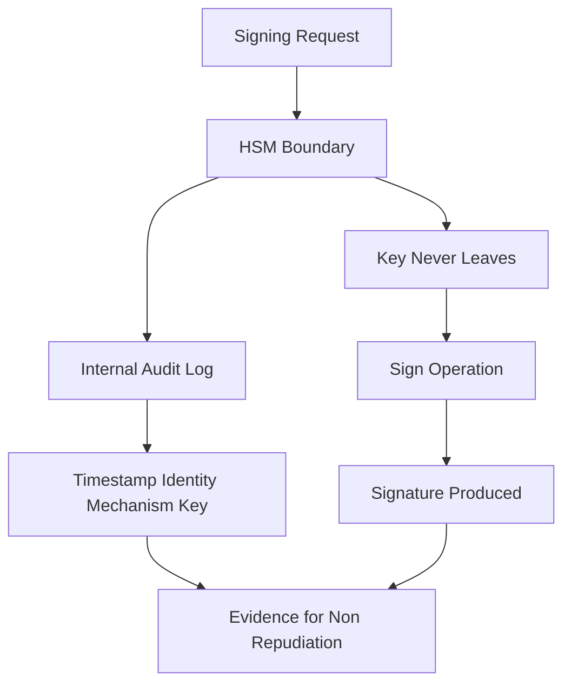

# Non-Repudiation and the HSM as an Unimpeachable Signer

## English

There is a legal and evidentiary question hiding inside every signing operation: if a signature appears, who can prove it came from the legitimate holder and not from a stolen key, a buggy script, or a malicious insider? This is the problem of non-repudiation — the property that a party cannot credibly deny having performed an action. Software signing fails here because the private key exists in memory at some point, and anyone with access to that memory could have copied it. An HSM changes the argument: the key never leaves the boundary in usable form, so the set of entities capable of producing a signature is exactly the set of entities the HSM allowed to invoke the sign operation.

That 'exactly' is doing a lot of work, and it depends on the audit trail. A well-run HSM logs each signing request with a timestamp, the identity of the authenticated session (often a named operator or a service account), the mechanism used, and the key handle. Because the log is generated inside the tamper boundary and cannot be rewritten by the client, it becomes evidence rather than assertion. In regulated contexts — certificate authorities issuing TLS certificates, code-signing authorities, payment networks authorising transactions — this log is often the artefact auditors actually examine.

A subtlety: non-repudiation is only as strong as authentication. If a service account's PIN is shared among ten microservices, the audit log tells you 'the service account signed' but not which service. If a human operator's credentials are used by an automated pipeline, the log attributes machine actions to a person. Good practice is to give each distinct signer its own identity inside the HSM, even if they all run on the same host, so the audit trail can distinguish them later.

Another subtlety is that the HSM cannot tell you the *meaning* of what was signed. It knows it signed 32 bytes of SHA-256 digest, not that those bytes represent a certificate for example.com or a firmware image for a specific device. The semantic binding has to come from the application layer, typically by having the signer construct a structured payload (with a schema, a purpose field, and a timestamp) and then signing that, so the evidence trail and the business meaning line up.

In short, the HSM's contribution to non-repudiation is not magic — it is the combination of a key that cannot be copied, an authentication event that identifies the caller, and an audit record that cannot be altered after the fact. Remove any one of the three and you are back to assertions rather than evidence.

## 中文

每一次簽章操作背後，都藏著一個法律與證據層面的問題：如果出現了一個簽章，誰能證明它來自合法的持有人，而不是被竊的金鑰、有 bug 的指令碼，或惡意的內部人員？這就是「不可否認性」（non-repudiation）的問題——也就是某一方無法可信地否認自己做過某個行為。軟體簽章在這裡行不通，因為私鑰在某些時刻確實存在於記憶體中，任何能存取那段記憶體的人都有可能複製它。HSM 改變了這個論證：金鑰永不以可用形式離開邊界，所以有能力產生簽章的實體集合，恰好就是 HSM 允許呼叫簽章操作的實體集合。

那個「恰好」承擔了很大的責任，而它取決於稽核軌跡。管理良好的 HSM 會記錄每一次簽章請求，包括時間戳、已驗證 session 的身分（通常是有名有姓的操作員或服務帳號）、使用的機制，以及金鑰 handle。由於這份日誌是在防篡改邊界內產生、客戶端無法改寫，它就從「主張」變成了「證據」。在受監管的場景中——簽發 TLS 憑證的憑證機構、程式碼簽章機構、授權交易的支付網路——這份日誌往往正是稽核人員實際查閱的物件。

有個微妙之處：不可否認性的強度只等於驗證的強度。如果一個服務帳號的 PIN 被十個微服務共用，稽核日誌只會告訴你「該服務帳號簽了章」，而不會告訴你是哪個服務。如果一個自動化流程使用了真人操作員的憑證，日誌就會把機器行為歸到某個人頭上。良好的做法是讓每個不同的簽章者在 HSM 內擁有自己的身分，即使它們都跑在同一臺主機上，這樣日後稽核軌跡才分得清楚。

另一個微妙之處是：HSM 無法告訴你被簽的東西「代表什麼意義」。它知道自己簽了 32 位元組的 SHA-256 摘要，但不知道這些位元組代表的是一張 example.com 的憑證，還是某臺特定裝置的韌體映像。語意上的繫結必須來自應用層，典型做法是讓簽章者先建構一個結構化載荷（含 schema、用途欄位與時間戳），再對它簽章，這樣證據軌跡與業務意義才會對得上。

總而言之，HSM 對不可否認性的貢獻並不神奇——它是三件事的組合：一把無法被複製的金鑰、一個能識別呼叫者的驗證事件，以及一份事後無法竄改的稽核記錄。三者缺一，你就又回到「主張」而非「證據」了。

## Key Takeaway

Non-repudiation emerges only when an uncopyable key, an identifying authentication event, and a tamper-proof audit record all line up behind a single signing operation.

## Related Concepts
- Audit trails as evidence
- Digital signature legal frameworks

## Diagram

