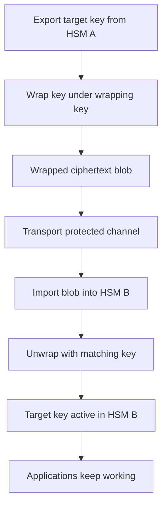

# Migration and Interoperability: Moving Keys Between Different HSMs

## English

Organisations rarely stay on one HSM vendor forever. Appliances age out, contracts change, acquisitions happen, and cloud migrations pull workloads from on-premises racks into managed services. Each of those events raises an awkward question: how do you move a key from HSM A to HSM B without ever exposing it in plaintext, and without breaking the applications that depend on it? This is the migration and interoperability problem, and it is harder than it looks because HSMs from different vendors rarely share the same internal key format.

The standard escape hatch is key wrapping: export the key from HSM A encrypted under a wrapping key, then import it into HSM B by unwrapping with the corresponding key. But there is a catch — the wrapping algorithm and key format must be supported on both sides. PKCS#11 defines mechanisms like CKM_AES_KEY_WRAP and CKM_RSA_PKCS_OAEP that many vendors implement, and some support the newer AES Key Wrap with Padding (RFC 5649) variant for keys whose length is not a multiple of the block size. If the two devices disagree on padding, byte order, or attribute encoding, the unwrap will fail — sometimes loudly, sometimes with a subtly different key.

A more robust approach is to use a vendor-neutral envelope. You generate a fresh symmetric key inside HSM B, wrap it under a public key belonging to HSM B, send the wrapped blob to HSM A, and have HSM A re-wrap the target key under that symmetric key and send it back. Both devices only ever see ciphertext. The downside is that the target key briefly exists in wrapped form outside either boundary, so the transport channel itself must be protected (typically a dedicated link, a signed manifest, and dual control over the transfer).

Interoperability is not only about moving keys; it is also about moving *behaviour*. A key that was CKA_SIGN=true on HSM A may need to be CKA_SIGN=true and CKA_SIGN_RECOVER=true on HSM B, and the target device may reject attributes it does not understand. Some vendors support a 'key import with attributes' mode where you specify the target attribute set explicitly; others silently apply defaults. Always test the imported key in a staging environment: sign a known payload with it and verify against the original public key, and check the audit log shows the expected attributes.

The strategic lesson is to treat key portability as a design requirement from day one. Document which mechanisms each key uses, keep a manifest of key metadata outside the HSM (identifiers, purposes, owners, rotation dates), and rehearse the migration before you need it. The worst time to discover that your wrapping scheme is incompatible is during an incident, when the old appliance is already failing.

## 中文

組織很少會永遠停留在同一家 HSM 廠商。裝置會老化、合約會更換、併購會發生，而雲端遷移會把工作負載從地端機櫃拉進託管服務。這些事件每一次都會丟擲一個尷尬的問題：你要如何把金鑰從 HSM A 搬到 HSM B，既不讓它以明文暴露，又不弄壞依賴它的應用程式？這就是遷移與互通性問題，而它比表面上看起來更難，因為不同廠商的 HSM 內部金鑰格式很少相同。

標準的逃生門是金鑰包裝（key wrapping）：在包裝金鑰下把金鑰從 HSM A 加密匯出，再以對應金鑰解包裝匯入 HSM B。但有個陷阱——包裝演演算法與金鑰格式必須兩邊都支援。PKCS#11 定義了 CKM_AES_KEY_WRAP 與 CKM_RSA_PKCS_OAEP 等機制，許多廠商都有實作，有些還支援較新的 AES Key Wrap with Padding（RFC 5649）變體，用於長度不是區塊大小整數倍的金鑰。如果兩臺裝置在填充、位元組順序或屬性編碼上不一致，解包裝就會失敗——有時大聲報錯，有時則悄悄產生一把略有不同的金鑰。

更穩健的做法是使用廠商中立的外封套。你在 HSM B 內產生一把新的對稱金鑰，用屬於 HSM B 的公鑰把它包裝起來，把包裝後的 blob 送給 HSM A，讓 HSM A 用那把對稱金鑰重新包裝目標金鑰再送回來。兩臺裝置都只看到密文。缺點是目標金鑰會短暫以包裝形式存在於兩個邊界之外，所以傳輸通道本身必須受保護（通常是專用鏈路、簽章過的清單，以及對傳輸過程的雙人控制）。

互通性不只是搬金鑰，也是搬「行為」。一把在 HSM A 上是 CKA_SIGN=true 的金鑰，到了 HSM B 可能需要同時是 CKA_SIGN=true 與 CKA_SIGN_RECOVER=true，而目標裝置可能會拒絕它不認得的屬性。有些廠商支援「帶屬性匯入」模式，讓你明確指定目標屬性組；有些則默默套用預設值。務必在預備環境測試匯入後的金鑰：用它對已知載荷簽章，並以原始公鑰驗證，同時檢查稽核日誌顯示的屬性是預期的那些。

策略上的教訓是：從第一天起就把金鑰可攜性當成設計需求。記錄每把金鑰使用哪些機制，在 HSM 之外儲存一份金鑰中介資料清單（識別碼、用途、擁有者、輪替日期），並在你真正需要之前先演練遷移。最糟的時機，就是在事故發生、舊裝置已經故障時，才發現你的包裝方案並不相容。

## Key Takeaway

Plan key portability before you need it: vendor-neutral wrapping, an external metadata manifest, and rehearsed migrations turn a painful vendor change into a routine operation.

## Related Concepts
- Key wrapping and RFC 5649
- Vendor lock-in in security infrastructure

## Diagram

