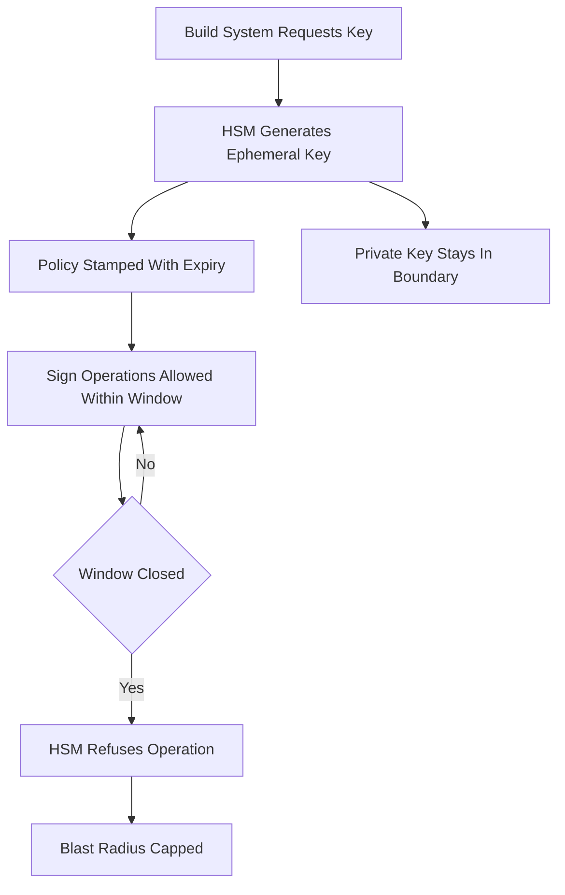

# The HSM as a Time-Bound Signer: Ephemeral Keys and Rate-Limited Authority

## English

Most discussion of HSMs treats keys as permanent residents: generated once, used for years, rotated on a schedule. But an HSM can also enforce authority that expires, and this is one of the least-discussed but most architecturally powerful things a vault can do. Because the HSM owns the clock (or at least a monotonic counter it trusts more than the client does), it can refuse an operation simply because the key's permitted window has closed, regardless of what the calling application believes. This turns the HSM from a key store into a time-bounded authority grant.

A concrete pattern is the short-lived signing key used in a CI/CD pipeline. Instead of a long-lived code-signing key that any compromised build server can abuse forever, the build system asks the HSM for a key that is valid for, say, the next four hours. The HSM generates it, stamps the policy with an expiry attribute, and from that moment refuses every operation once the window closes — even if the handle is still open in a session. The private key never leaves the boundary, and the blast radius of a stolen build credential is capped at the remaining minutes rather than the remaining years.

This is not the same as certificate expiry. A certificate's notAfter is a claim checked by verifiers; it does nothing to stop the holder of the private key from signing after that date. An HSM expiry attribute is enforced by the hardware that holds the key, so the signer itself cannot override it. That distinction matters enormously in incident response: with certificate expiry you are trusting the attacker's honesty, with HSM-enforced expiry you are trusting physics and firmware.

The same idea generalises to usage budgets. Some HSM policy models let you attach counters — a key that may sign at most N times, or may be used only within a defined window each day. The counter lives inside the tamper boundary, so it cannot be reset by rolling back a VM snapshot or editing a config file. For high-value operations like root CA signing or firmware release signing, a hard usage cap is a meaningful second line of defence: even a fully compromised application layer cannot turn a key designed for ten signatures into an infinite signing oracle.

The trade-off is operational friction. Ephemeral keys mean your audit trail is full of short-lived key identifiers, and your key management story must explain how the public half reaches verifiers before the private half expires. Budget counters mean you must provision headroom and monitor consumption like any other finite resource. But when you need authority that decays, an HSM is one of the few places where the decay is real rather than advisory.

## 中文

大部分人講 HSM，都會當密鑰係永久居民：生成一次、用幾年、按時間表輪換。但 HSM 其實亦可以執行「會過期」的權限，而這一點在架構上極具威力，卻很少人討論。因為 HSM 自己擁有時鐘（或者至少有一個它信得過、而客戶端信不過的單調計數器），所以它可以純粹因為密鑰的許可窗口已關閉而拒絕操作，無論呼叫的應用程式以為自己身處何時。這就把 HSM 由一個密鑰倉庫，變成一個有時間限制的授權授予機制。

一個具體模式是 CI/CD 流程中的短命簽署密鑰。與其用一把長期存在、任何被入侵的建置伺服器都可以永遠濫用的程式碼簽署密鑰，不如讓建置系統向 HSM 索取一把只在未來四小時內有效的密鑰。HSM 生成它、在政策上蓋上到期屬性，由那一刻起，窗口一關就拒絕所有操作——即使 session 裡那個 handle 仍然開著。私鑰永遠不離開邊界，而被盜的建置憑證所造成的爆炸半徑，就由「剩下幾年」收窄到「剩下幾分鐘」。

這跟憑證到期完全不同。憑證的 notAfter 只是一個由驗證方檢查的聲明，它完全阻止不了私鑰持有人過了那個日期繼續簽署。HSM 的到期屬性則由持有密鑰的硬件強制執行，簽署者自己無法繞過。這個分別在事故應變時非常關鍵：靠憑證到期，你信的是攻擊者的誠實；靠 HSM 強制到期，你信的是物理與固件。

同一個想法可以推廣到用量預算。有些 HSM 政策模型讓你在密鑰上掛計數器——一把密鑰最多只可簽 N 次，或者每日只可在指定窗口內使用。計數器住在防篡改邊界之內，所以無法靠回滾 VM 快照或者改設定檔來重設。對於根 CA 簽署、固件發佈簽署這類高價值操作，硬性用量上限就是有意義的第二道防線：即使應用層完全被攻陷，也無法把一把設計只簽十次的密鑰，變成無限的簽署神諭。

代價是營運上的摩擦。短命密鑰意味著你的審計軌跡會塞滿短暫的密鑰識別碼，而你的密鑰管理故事亦要講清楚：公鑰那一半如何在私鑰過期之前送到驗證方手上。用量計數器則意味著你要預留餘量，並且像監控其他有限資源一樣監控消耗。但當你需要一種會衰減的權限時，HSM 是少數幾個能令衰減真實發生、而非只屬建議的地方。

## Key Takeaway

An HSM can enforce expiry and usage budgets on keys from inside the tamper boundary, turning time-limited authority into something the signer itself cannot override.

## Related Concepts
- Key lifecycle policy attributes
- Certificate expiry versus key expiry

## Diagram

