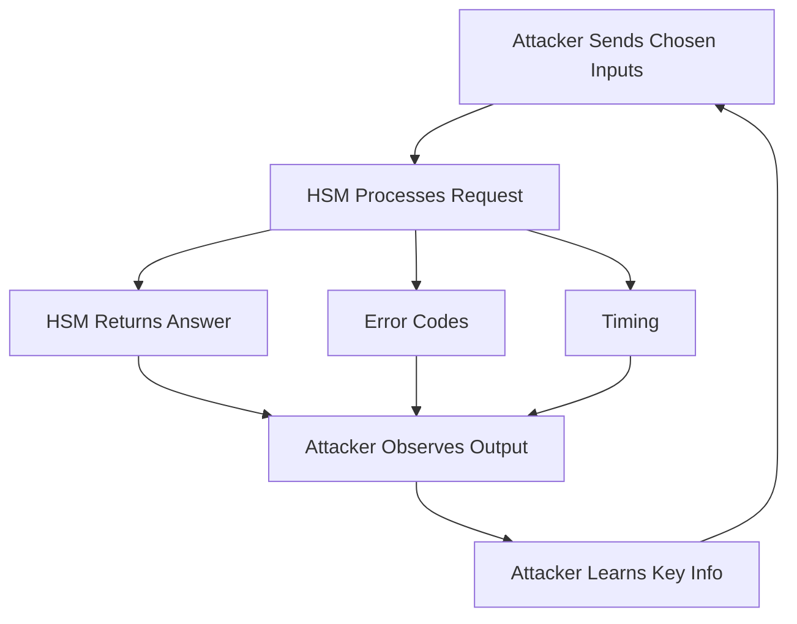

# The HSM as an Oracle: What an Attacker Learns From the Answers Alone

## English

There is a class of attack that never touches the key and never breaks the tamper boundary: it simply asks the HSM questions and studies the answers. In cryptography this is called an oracle attack, and the HSM is a particularly interesting oracle because it is honest, deterministic, and fast. If an attacker can submit chosen inputs and observe outputs — ciphertext, MAC values, error codes, timing, even whether an operation succeeded — the HSM will faithfully leak information about the key it is protecting, one bit at a time.

The classic illustration is a padding oracle. Suppose a protocol decrypts a message and then checks its padding, returning a distinguishable error when the padding is wrong versus when the padding is fine but the plaintext is garbage. Each distinguishable response tells the attacker something about the decrypted bytes. By iterating, they can recover plaintext without ever seeing the key. The key stayed inside the vault the entire time; the vault simply answered too many questions too precisely. Modern designs defend against this by making all decryption failures look identical and by authenticating before decrypting, but the underlying lesson is general: an HSM's willingness to answer is itself an attack surface.

Timing is the subtler channel. A comparison that exits early on the first mismatched byte takes measurably less time than one that compares the whole buffer. If an attacker can measure that difference across many attempts, they can guess a MAC or a password byte by byte. Good HSM firmware uses constant-time comparison routines precisely because the hardware is otherwise a perfect timing measurement device. When you build on top of an HSM, the same discipline applies to your own code: never compare a secret with an early-exit loop, and never let the difference between 'wrong key' and 'wrong format' escape to the caller.

The practical defence is to treat the HSM as a rate-limited, monitored oracle rather than a free function call. That means authenticating callers before they can trigger decryption, logging every failed operation so a burst of failures looks like an incident rather than noise, and designing protocols so that a single query reveals nothing useful. Encrypt-then-MAC, constant-time comparison, uniform error messages, and per-caller quotas are all ways of making the oracle expensive to interrogate.

This reframes a question that comes up often: why does the HSM refuse to tell you what it holds? Because every answer it gives is a potential leak. The vault's silence is not unfriendliness; it is the same principle that makes a witness credible — the fewer questions it answers loosely, the more the answers it does give are worth.

## 中文

有一類攻擊，從來不碰金鑰，也從來不破壞防篡改邊界：它只是向 HSM 提問，然後研究答案。在密碼學裡這叫做神諭攻擊（oracle attack），而 HSM 是一個特別有趣的神諭，因為它誠實、確定性強、而且快。如果攻擊者可以提交自選輸入並觀察輸出——密文、MAC 值、錯誤碼、時間差、甚至只是操作成功與否——HSM 就會忠實地一點一滴洩漏它正在保護的那把金鑰的資訊。

經典例子是填充神諭（padding oracle）。假設某個協定先解密訊息、再檢查填充，並且在「填充錯誤」與「填充正確但明文是垃圾」兩種情況下回傳可區分的錯誤。每一個可區分的回應，都告訴攻擊者一些關於解密後位元組的資訊。透過反覆迭代，他們可以在完全沒見過金鑰的情況下還原明文。整段時間金鑰都留在保險庫裡面；問題純粹是保險庫答得太多、答得太準。現代設計靠「所有解密失敗都看起來一模一樣」以及「先驗證再解密」來防禦，但背後的原則很普遍：HSM 願意回答問題這件事本身，就是一個攻擊面。

時間差是更隱蔽的通道。一個在第一個不符位元組就提早退出的比較，所需時間明顯少於比較整個緩衝區。如果攻擊者可以在多次嘗試中量度到這個差異，他們就可以逐個位元組猜出 MAC 或者密碼。優良的 HSM 韌體之所以用恆定時間比較常式，正因為硬體本身就是一部完美的時間測量儀器。當你在 HSM 之上建構系統時，同樣的紀律適用於你自己的程式碼：永遠不要用提早退出的迴圈比較秘密，也永遠不要讓「金鑰錯」與「格式錯」之間的差別洩漏給呼叫者。

實際的防禦，是把 HSM 當成一個有速率限制、受監控的神諭，而不是一個免費的函式呼叫。意思是：在觸發解密之前先驗證呼叫者身分；記錄每一次失敗操作，令一連串失敗看起來像事故而非雜訊；並把協定設計成單一次查詢洩漏不到任何有用的東西。先加密後 MAC、恆定時間比較、統一的錯誤訊息、以及按呼叫者設配額，全部都是令神諭「問起來很貴」的手段。

這也重新解釋了一個常見問題：為甚麼 HSM 拒絕告訴你它裡面有甚麼？因為它給出的每一個答案，都是潛在的洩漏。保險庫的沉默不是不友善；這跟證人之所以可信是同一個道理——它越是少亂答問題，它肯答的答案就越有價值。

## Key Takeaway

An HSM is an honest, fast oracle, so every distinguishable answer it gives can leak key information; the defence is to make interrogation expensive and answers uniform.

## Related Concepts
- Padding oracle attacks
- Constant-time comparison

## Diagram

