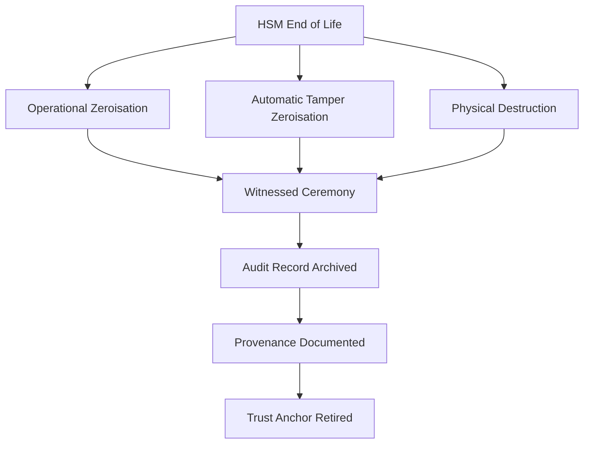

# Decommissioning an HSM: Zeroisation, Provenance, and the End of a Trust Anchor

## English

Every HSM eventually reaches the end of its life, and the retirement step is where a surprising number of real-world failures happen. The question is not just 'how do we destroy the keys' but 'how do we prove, to someone who was not there, that the keys are gone and that nothing left the box on the way out'. A trust anchor that is quietly powered off and put in a store room is not retired; it is a loaded weapon with no owner.

The technical core is zeroisation: the deliberate, verifiable destruction of key material. HSMs implement this in several layers. There is the operational zeroisation you invoke deliberately — a command that wipes the partition or the whole device, typically requiring quorum authorisation because it is irreversible. There is the automatic zeroisation triggered by tamper response, where sensors detect an intrusion and the device erases keys before an attacker can read them. And there is the physical end: some modules ship with a 'zeroise on removal' behaviour tied to a battery or a tamper mesh, so that opening the chassis destroys the contents.

What makes decommissioning hard is the evidence problem. If you simply send the device back to the vendor for disposal, how do you know the keys were wiped rather than extracted? The credible answer is procedural: a witnessed ceremony, in which authorised custodians issue the zeroise command, the device reports success, and the audit record is captured and archived alongside the serial number. Some organisations go further and require a certificate of destruction from the vendor, or physically destroy the module themselves and retain the wreckage as evidence.

There is also a subtler obligation: provenance. If the HSM was a root of trust — the thing that signed your CA, or anchored your code-signing chain — then decommissioning it changes what your downstream artefacts mean. A signature made by a key that no longer exists is still verifiable, but you can no longer re-sign, re-issue, or prove freshness with it. Teams often discover this the hard way when a long-lived artefact needs an update years later and the signing key is a pile of shredded silicon. The fix is to plan the successor before the predecessor dies, and to keep the archived public key and audit record so that historical signatures remain explainable.

Finally, consider the human side. Decommissioning is often the moment when the last person who understood the key ceremony leaves, and the documentation turns out to be thinner than everyone assumed. Treat retirement as a project with a checklist, a witness, and an archived record — the same rigour as the original ceremony — and the end of the trust anchor becomes a controlled event rather than an archaeological one.

## 中文

每一個 HSM 最終都會走到生命盡頭，而退役這一步，正是現實世界裡大量失敗發生的地方。問題不單是「我們怎樣銷毀金鑰」，而是「我們怎樣向一個當時不在場的人證明：金鑰真的不見了，而且離開的過程中沒有任何東西流出機箱」。一個被悄悄關機、放進雜物房的信任錨，不叫做退役；它是一件上了膛、但沒有主人的武器。

技術核心是零化（zeroisation）：有意識、可驗證地銷毀金鑰材料。HSM 會分幾層實現。第一層是你刻意呼叫的操作性零化——一個會抹掉分割區或整部裝置的指令，通常因為不可逆而需要法定人數授權。第二層是防篡改反應觸發的自動零化：感應器偵測到入侵，裝置會在攻擊者讀取之前先擦掉金鑰。第三層是物理終結：有些模組帶有與電池或防篡改網相連的「一拆即零化」行為，一開啟機箱內容就毀掉。

令退役困難的是舉證問題。如果你只是把裝置寄回廠商棄置，你怎麼知道金鑰是被抹掉而不是被抽走？可信的答案在於程式：一場有見證人的儀式，由授權保管人發出零化指令、裝置回報成功、審計記錄被擷取並與序號一併存檔。有些機構要求更嚴，會索取廠商的銷毀證書，或者乾脆自行物理銷毀模組，並保留殘骸作為證據。

還有一項更微妙的義務：來源追溯（provenance）。如果這部 HSM 曾是信任錨——簽發你的 CA、或者錨定你的程式碼簽署鏈——那麼把它退役，會改變你下游產物的意義。由一把已經不存在的金鑰所產生的簽章仍然可以驗證，但你再也無法用它重新簽署、重新簽發、或者證明新鮮度。很多團隊就是這樣踩坑：幾年後某個長壽命的產物需要更新，才發現簽署金鑰已經是一堆碎矽。解法是在前任死亡之前先規劃好繼任者，並保留已歸檔的公鑰與審計記錄，令歷史簽章仍然可解釋。

最後，也要考慮人的因素。退役往往正是最後一個真正明白那場金鑰儀式的人離職的時刻，然後大家才發現檔案比想像中薄得多。把退役當成一個有清單、有見證人、有歸檔記錄的專案來做——跟原本那場儀式同等嚴謹——信任錨的終結就會是一件受控的事，而不是一場考古發掘。

## Key Takeaway

Retiring an HSM safely requires witnessed zeroisation, archived evidence, and a planned successor, because a trust anchor that disappears without a record leaves historical signatures unexplainable.

## Related Concepts
- Zeroisation
- Cryptographic provenance

## Diagram

