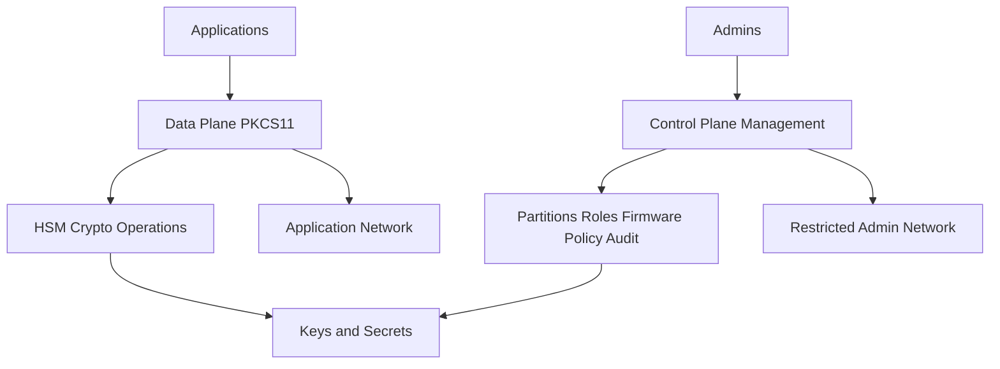

# HSM APIs Are Not the Only Door: The Control Plane vs the Data Plane

## English

Most discussions of HSMs focus on the cryptographic data plane: the PKCS#11 calls that generate keys, sign data, or wrap secrets. But a real HSM deployment has a second, equally important surface: the control plane. This is the administrative interface used to create partitions, assign roles, load firmware, configure network settings, set policy, and manage audit logging. On a network appliance, the control plane is often reached through a separate management port, a serial console, or a dedicated web UI — deliberately kept off the same path that applications use for crypto operations. The reason is simple: an attacker who can reach the control plane can often do far more damage than one who can reach the data plane. Creating a new partition, resetting a PIN, or disabling an audit rule may let them extract or misuse keys without ever touching a crypto API. This is why good deployments treat the control plane like a firewall's management interface: restricted to a jump host, logged separately, and reachable only from a narrow administrative network.

A useful analogy is a bank. The teller windows (data plane) handle routine transactions and are designed to be fast, concurrent, and safe for many customers at once. The vault room and the manager's office (control plane) are behind a different door, require different credentials, and are visited rarely. If the manager's door were on the same corridor as the teller windows, every customer would be one bad day away from walking into the vault. HSMs enforce a similar separation, but the separation is only as good as the network and identity controls around it. A common mistake is to expose the management interface on the same VLAN as application servers because it is 'convenient' — which quietly collapses the two planes into one.

Control-plane actions also tend to be the ones that produce the most important audit records. Creating a partition, changing a policy, or importing a wrapped key is a rare, high-consequence event, and the log entry for it is often the single most valuable piece of evidence in an incident investigation. Data-plane operations, by contrast, may happen millions of times a day and are usually sampled or aggregated. When you design monitoring, treat control-plane events as alerts and data-plane events as metrics. A spike in failed PKCS#11 logins is interesting; a single successful partition creation outside a change window should page someone.

There is also a bootstrapping problem. The control plane is what you use to configure the HSM before any application can talk to it — setting up the initial partition, the first administrator, the network address, the time source. That means the control plane must be usable when the data plane is not yet configured, which is exactly when the HSM is most fragile. Many organisations handle this with a dedicated 'day zero' procedure performed on an isolated network, then move the appliance to its production network. Skipping that step is how appliances end up with default admin credentials reachable from a broad subnet.

Finally, remember that firmware updates, backups, and key ceremonies all live on the control plane. If your data-plane integration is excellent but your control-plane process is ad hoc, you have a vault with a very secure front door and a propped-open back door. The right mental model is two doors, two credential sets, two logging pipelines, and two change-management processes — not one HSM with one admin password.

## 中文

大部分人討論 HSM 時，焦點都放在加密的資料平面（data plane）：那些用 PKCS#11 去產生金鑰、簽署資料或者包裝金鑰的呼叫。但一個真實的 HSM 部署，其實有第二個同樣重要的介面：控制平面（control plane）。這是管理介面，用來建立分割區、指派角色、載入韌體、設定網路、配置政策，以及管理稽核日誌。在網路裝置上，控制平面通常經由獨立的管理埠、序列主控臺或者專屬網頁介面進入，刻意與應用程式用來做加密運算的路徑分開。原因很簡單：能夠接觸控制平面的攻擊者，往往比只能接觸資料平面的攻擊者造成更大破壞。建立新分割區、重設 PIN、或者停用某條稽核規則，都可能讓他們在完全不碰加密 API 的情況下取出或濫用金鑰。所以良好的部署會把控制平面當成防火牆的管理介面來處理：只限於跳板主機、獨立記錄、並且只能從狹窄的管理網路進入。

一個好用的比喻是銀行。櫃檯視窗（資料平面）處理日常交易，設計上要快、要能並行、要對大量客戶同時安全。金庫房與經理室（控制平面）在另一道門後面，需要不同的憑證，而且很少進去。如果經理的門就在櫃檯同一條走廊上，任何客戶只要碰上一個壞日子，就可能走進金庫。HSM 有類似的分隔，但這個分隔的強度，完全取決於它周圍的網路與身份控制。常見的錯誤，是為了「方便」而把管理介面放在與應用伺服器同一個 VLAN，這等於悄悄把兩個平面合併成一個。

控制平面的操作，通常也是產生最重要稽核記錄的操作。建立分割區、更改政策、匯入已包裝的金鑰，都是罕見而後果重大的事件，它的日誌條目往往是事故調查中最有價值的一份證據。相反，資料平面操作一天可能發生幾百萬次，通常只會抽樣或者彙總。設計監控時，應該把控制平面事件當作警報，把資料平面事件當作指標。PKCS#11 登入失敗突然暴增值得注意；但在變更視窗以外出現一次成功的分割區建立，就應該立即通知相關人員。

還有一個啟動（bootstrapping）問題。控制平面正是你在任何應用程式能與 HSM 通訊之前，用來配置 HSM 的工具：建立初始分割區、設定第一位管理員、設定網路地址、設定時間來源。這意味著控制平面必須在資料平面尚未配置時就能使用，而這正是 HSM 最脆弱的時候。很多機構會用一套專門的「第零日」程式，在隔離網路上完成，然後才把裝置移到生產網路。跳過這一步，就是裝置帶著預設管理員憑證、暴露在寬廣子網上的常見原因。

最後要記住：韌體更新、備份、金鑰儀式，全部都在控制平面上。如果你的資料平面整合做得極好，但控制平面流程得過且過，你就等於有一座前門非常穩固、後門卻用木棍撐開的金庫。正確的心智模型是：兩道門、兩套憑證、兩條日誌管道、兩套變更管理流程——而不是一個 HSM 加一個管理員密碼。

## Key Takeaway

An HSM has two doors — the crypto data plane and the administrative control plane — and most real-world compromises come through the second one, so secure and log them separately.

## Related Concepts
- Network segmentation
- Privileged access management

## Diagram

