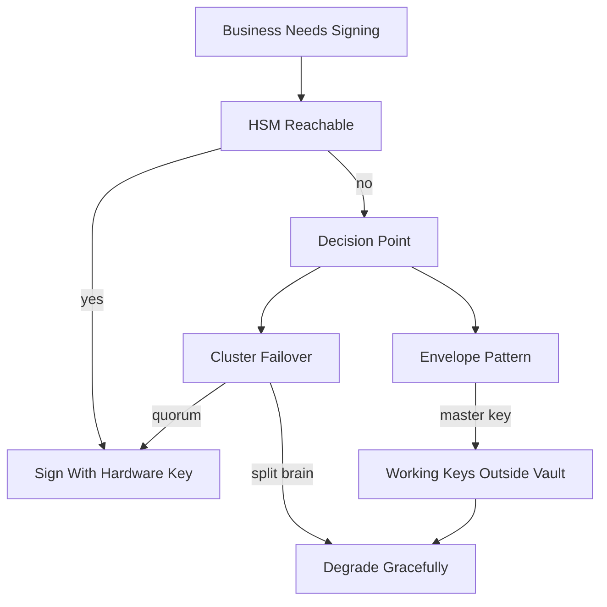

# What Happens When the HSM Is Down: Designing for Cryptographic Unavailability

## English

Every architecture that depends on an HSM has to answer a question that is easy to postpone and expensive to ignore: what does the system do when the HSM is not answering? Unlike a database, an HSM cannot be made 'eventually consistent' or read from a replica that lags slightly. If the signing key lives only inside the vault, and the vault is unreachable, the signature cannot be produced. There is no fallback that preserves security — a copy of the key on a local disk would defeat the entire point. So the design question is not 'how do we keep signing without the HSM' but 'how do we degrade gracefully, and how do we make the HSM as available as the business needs?'

The first lever is redundancy at the cryptographic layer. Most enterprise HSMs support clustering, where several appliances share a synchronised key store and a client can fail over from one to another. This is not the same as a database replica: the cluster members must agree on key state, and a member that has drifted or been partitioned away must not silently serve stale keys. That is why clusters have quorum rules and why a 'split brain' scenario — where two halves each believe they are authoritative — is a serious failure mode rather than a minor inconvenience. Designing for availability means understanding exactly how the cluster behaves when a link drops, and testing that behaviour rather than assuming it.

The second lever is architectural: decide which operations truly need the HSM and which do not. A common pattern is to use the HSM to protect a long-lived master key, and to use that master key — via the key wrapping or envelope pattern — to protect many short-lived working keys that live outside the vault. Signing operations that must be non-repudiable and tied to a hardware-protected key still go to the HSM; bulk encryption of ephemeral session data may not. This lets you shrink the blast radius of an HSM outage from 'the whole service is down' to 'new key issuance is paused, existing sessions continue'. The trade-off is that you now have keys outside the vault, so the envelope's wrapping key and its access controls become the new critical asset.

The third lever is operational honesty. Many outages are not hardware failures but change-induced: a firmware update, a certificate rotation on the client, a network ACL change, or a full session table. These are predictable and preventable with staging, canary partitions, and capacity planning. It also helps to know your HSM's connection model — whether clients hold long-lived sessions or reconnect per operation — because a flood of reconnects after a blip can itself become the outage. Rate limiting, connection pooling, and backoff on the client side are not optional niceties; they are part of keeping the vault reachable.

Finally, write down the degradation policy before you need it. Which endpoints fail closed (refuse to serve) and which fail open (continue with reduced assurance)? Who is allowed to declare an HSM outage, and what is the manual override? A useful exercise is a tabletop drill: unplug the HSM's network link during a quiet period and watch what actually happens, including what your monitoring says and whether your on-call engineer knows which runbook to open. The organisations that survive HSM outages calmly are the ones that rehearsed them, not the ones that assumed the vault would always be there.

## 中文

每一個依賴 HSM 的架構，都要回答一個很容易拖延、但代價高昂的問題：當 HSM 不回應時，系統怎麼辦？HSM 不像資料庫，不能做到「最終一致」，也不能從稍微落後的副本讀取。如果簽署金鑰只存在於金庫內，而金庫無法觸及，簽章就無法產生。任何保留安全性的後備方案都不存在——把金鑰副本放在本機磁碟，就會完全破壞原本的意義。所以設計問題不是「如何在沒有 HSM 的情況下繼續簽署」，而是「如何優雅地降級，以及如何讓 HSM 達到業務所需的可用度？」

第一個槓桿是加密層的冗餘。大部分企業級 HSM 支援叢集，幾部設備共享同步的金鑰儲存，用戶端可以從一部切換到另一部。這與資料庫副本不同：叢集成員必須對金鑰狀態達成一致，一個已經漂移或被分割出去的成員，絕不能悄悄提供過時的金鑰。這就是叢集要有 quorum（法定人數）規則的原因，也是「腦裂」（split brain）——兩半各自相信自己才是權威——屬於嚴重故障模式、而非小麻煩的原因。為可用度而設計，意味著你要準確了解叢集在連線中斷時的行為，並且實際測試，而不是假設。

第二個槓桿是架構層面：決定哪些操作真正需要 HSM，哪些不需要。常見模式是用 HSM 保護一把長期的主金鑰，再透過金鑰包裝或信封模式，用這把主金鑰保護大量存放在金庫外的短期工作金鑰。必須具備不可否認性、並且綁定硬件保護金鑰的簽署操作，仍然要走 HSM；大量臨時會話資料的加密則未必需要。這樣可以把 HSM 故障的影響範圍，由「整個服務停擺」縮小到「新金鑰簽發暫停，現有會話繼續」。代價是你現在有金鑰存在金庫外，於是信封的包裝金鑰及其存取控制，就成為新的關鍵資產。

第三個槓桿是營運上的誠實。很多故障不是硬件損壞，而是變更引起：韌體更新、用戶端憑證輪換、網絡 ACL 改動，或者會話表爆滿。這些都是可預測、可預防的，靠的是預演環境、金絲雀分割區和容量規劃。了解 HSM 的連線模型亦有幫助——用戶端是維持長期會話，還是每次操作都重新連線——因為一次短暫中斷之後湧入的大量重連，本身就可能變成故障。用戶端的速度限制、連線池和退避策略不是可有可無的點綴，而是讓金庫保持可達的一部分。

最後，在你需要之前就把降級政策寫下來。哪些端點是 fail closed（拒絕服務），哪些是 fail open（以較低保證繼續運作）？誰有權宣告 HSM 故障，手動override 又是什麼？一個實用的練習是桌上演練：在平靜時段拔掉 HSM 的網絡線，看看實際會發生什麼，包括監控顯示什麼、值班工程師是否知道該打開哪本 runbook。能夠從容度過 HSM 故障的機構，是那些演練過的，而不是那些假設金庫永遠都在的。

## Key Takeaway

Design explicitly for HSM unavailability: cluster with quorum, decide which operations fail closed, shrink the blast radius with envelope keys, and rehearse the outage before it happens.

## Related Concepts
- Graceful degradation
- Quorum and split-brain

## Diagram

