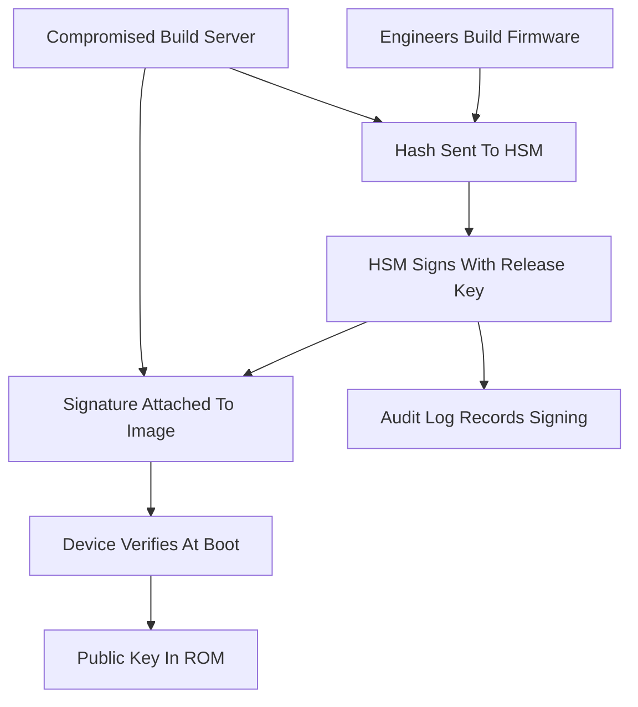

# The HSM in the Supply Chain: Keys That Authenticate Hardware and Software Before They Run

## English

One of the least visible but most consequential uses of an HSM is not protecting user data at all — it is protecting the integrity of the products themselves. Every time a device boots, a phone installs an update, or a server loads a signed container image, something has to verify that the code is genuine and unmodified. That verification depends on a public key whose corresponding private key must be protected at the highest level. If an attacker obtains that private key, they can sign malicious firmware that every device in the field will happily accept. This is why code-signing and firmware-signing keys are among the most tightly guarded secrets in any hardware company, and why they almost always live inside an HSM.

The typical flow looks like this. Engineers build a firmware image in a controlled build system. A hash of the image is sent to the HSM, which signs it with the release key. The signature is attached to the image, and devices verify it at boot using a public key baked into read-only memory. Because the private key never leaves the HSM, a compromised build server can at worst produce an image that fails verification — it cannot produce one that passes. This distinction matters enormously: it turns a catastrophic supply-chain compromise into a denial-of-service incident. The HSM is acting as a non-repudiable signer, and its audit log becomes the record of exactly which images were signed, when, and under which release key.

There is a second, subtler role: the HSM anchors the identity of the hardware itself. Devices are often provisioned with unique key pairs or certificates at manufacture, and those keys may be generated inside the device's own secure element or, in some designs, derived from material protected by an HSM at the factory. When the device later connects to a backend, mutual authentication proves not just that the client knows a secret, but that this particular piece of hardware was manufactured and provisioned through a trusted process. Without a hardware root of trust at the factory, an attacker who can clone devices or extract provisioning keys can impersonate legitimate hardware at scale — a problem that has affected real consumer and industrial products.

The supply-chain angle also changes how you think about key ceremonies. A release-signing key may have a validity measured in years and a signing cadence measured in releases per quarter. Its ceremony is a rare, heavily audited event involving multiple custodians, often with an offline HSM kept in a physically secure room. The key is used sparingly, and every use is logged. Contrast that with a TLS key that signs millions of handshakes a day. The same hardware can serve both, but the operational discipline around them is completely different, and mixing them on one partition is usually a mistake.

Finally, consider revocation and rotation. If a signing key is suspected of compromise, you need a way to tell every device in the field to stop trusting it — which is itself a signed operation, and one that must work even when the network is hostile. Designing that path in advance, and testing it with a real HSM, is part of treating signing keys as critical infrastructure rather than as a build-step convenience. The HSM is the anchor, but the chain from HSM to device is only as strong as its weakest link: the build system, the provisioning line, the update channel, and the revocation mechanism all have to hold.

## 中文

HSM 其中一個最不顯眼、但影響最深遠的用途，完全不是保護使用者資料，而是保護產品本身的完整性。每次裝置開機、手機安裝更新、伺服器載入已簽署的容器映像，都要有東西去驗證程式碼是真實且未被篡改的。這個驗證依賴一把公開金鑰，而對應的私鑰必須以最高規格保護。如果攻擊者取得那把私鑰，就可以簽署惡意韌體，而所有已在現場的裝置都會欣然接受。這就是為何程式碼簽署與韌體簽署金鑰，是任何硬體公司守得最緊的秘密之一，也是為何它們幾乎總是住在 HSM 裡面。

典型流程是這樣的。工程師在受控的建置系統中建出韌體映像。映像的雜湊值送到 HSM，由釋出金鑰簽署。簽章附加到映像上，裝置開機時用燒錄在唯讀記憶體中的公開金鑰驗證。因為私鑰從不離開 HSM，一個被入侵的建置伺服器，最壞也只能產生一個驗證失敗的映像——它無法產生一個能透過驗證的映像。這個差別極其重大：它把一場災難性的供應鏈入侵，降格為一次阻斷服務事故。HSM 在此扮演不可否認的簽署者，而它的稽核日誌就成為「哪些映像在何時、用哪把釋出金鑰簽署過」的記錄。

還有第二個更微妙的角色：HSM 為硬體本身的身份提供錨點。裝置在生產時通常會被配發唯一的金鑰對或憑證，這些金鑰可能在裝置本身的安全元件內產生，或者在某些設計中，由工廠內受 HSM 保護的素材衍生而來。當裝置日後連線後端時，雙向認證不只證明使用者端知道某個秘密，更證明這件硬體是經由可信流程製造與配發的。如果工廠沒有硬體信任根，能複製裝置或取出配發金鑰的攻擊者，就可以大規模冒充合法硬體——這個問題確實影響過真實的消費與工業產品。

供應鏈角度也會改變你對金鑰儀式的想法。一把釋出簽署金鑰，有效期可能以年計，簽署頻率則以每季幾次釋出計。它的儀式是罕見、高度稽核的事件，涉及多位保管人，通常還有一部離線 HSM 放在實體安全的房間內。金鑰用得很少，每次使用都有記錄。對比之下，一把 TLS 金鑰一天要簽幾百萬次握手。同一部硬體可以兼顧兩者，但圍繞它們的營運紀律完全不同，把它們放在同一個分割區通常是錯誤。

最後要考慮撤銷與輪換。如果某把簽署金鑰懷疑外洩，你需要一個方法告訴現場每一部裝置停止信任它——這本身也是一個簽署操作，而且必須在網路充滿敵意的情況下仍然有效。事先設計這條路徑，並用真實 HSM 測試，就是把簽署金鑰當作關鍵基礎設施、而非建置步驟的便利工具來看待。HSM 是錨點，但由 HSM 到裝置的整條鏈，強度只等於最弱的一環：建置系統、配發產線、更新通道、撤銷機制，全部都要撐得住。

## Key Takeaway

HSMs anchor supply-chain integrity by protecting the signing keys that authenticate firmware, software, and device identity — turning a key compromise into a denial-of-service rather than a trusted-malware disaster.

## Related Concepts
- Code signing
- Secure boot and attestation

## Diagram

