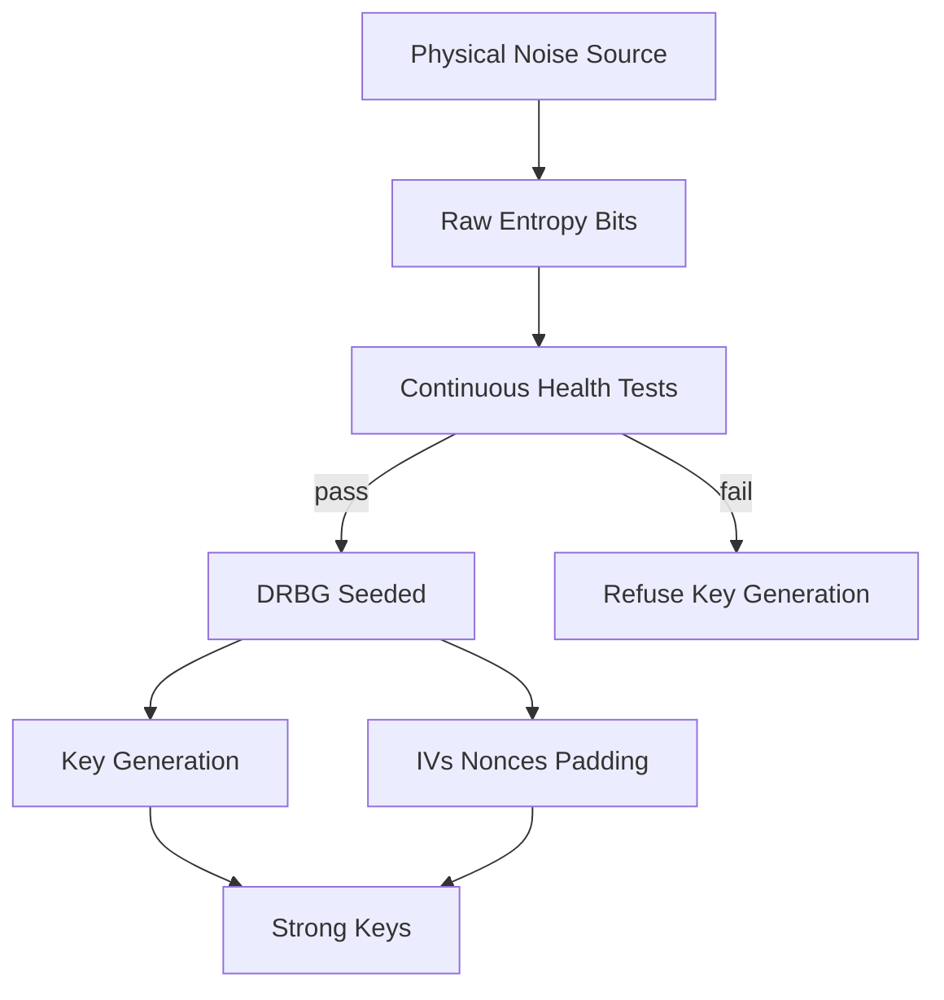

# The HSM as a Randomness Boundary: Why Entropy Quality Decides Everything

## English

Every key an HSM ever generates begins as a stream of bits from a random number generator (RNG). If that stream is predictable, the strongest algorithm and the thickest tamper mesh in the world are worthless, because an attacker who can guess the key never needs to extract it. This is why HSMs treat entropy as a first-class security property rather than an implementation detail. A typical design mixes a hardware noise source (thermal noise in a diode, ring-oscillator jitter, or shot noise) into a deterministic random bit generator (DRBG), a construction that stretches a small amount of true entropy into a long, fast output stream while remaining computationally unpredictable. The DRBG must be seeded from the physical source, and the design must survive the failure of that source.

The interesting engineering is what happens when the noise source degrades. A hardware RNG can fail silently: it keeps producing bits, but those bits become correlated, biased, or stuck. A well-designed HSM runs continuous health tests on the raw source, looking for stuck-at patterns, repeated blocks, and statistical bias. If a test fails, the module should refuse to generate keys rather than emit weak ones. This is a deliberate fail-closed choice, and it is one reason a healthy HSM can suddenly stop issuing keys: the entropy subsystem decided it no longer trusted itself. Operators sometimes mistake this for a bug when it is exactly the behaviour they paid for.

A second subtlety is that randomness is consumed by more than key generation. Initialisation vectors (IVs), nonces, padding, and challenge values all draw from the same pool. Reusing an IV in a mode like CBC or GCM is catastrophic, so the DRBG must never repeat a value within the lifetime of a key. Because the DRBG is stateful, its internal state is itself a secret: an attacker who learns the state can predict all future outputs. HSMs therefore protect DRBG state in the same tamper boundary as keys, and some designs re-seed periodically or on demand so that a momentary state compromise does not doom every future key.

For anyone building on top of an HSM, the practical lesson is that you should never generate keys outside the module and import them, even when the API makes it convenient. Keys born outside the boundary inherit the entropy quality of whatever generated them, which is usually a general-purpose operating system RNG that may have been starved at boot, cloned from a virtual machine snapshot, or seeded from a low-resolution clock. A key imported into an HSM looks identical to one generated inside it, but its provenance is weaker. When you audit a key store, ask not just where the key lives but where it was born and how much you trust the randomness at that moment.

## 中文

每個 HSM 所產生的金鑰，最初都只是一串由隨機數產生器（RNG）吐出的位元。如果這串位元可以被預測，那麼再強的演算法、再厚的防篡改網都形同虛設，因為攻擊者只要能猜出金鑰，就根本不需要把它抽出來。這就是為何 HSM 把熵（entropy，即真正的不可預測性）視為一等級的安全屬性，而非實作細節。典型的設計會把硬件雜訊源（二極管的熱雜訊、環形振盪器的抖動，或散粒雜訊）混入確定性隨機位元產生器（DRBG）之中；DRBG 是一種把少量真熵拉伸成長而快速的輸出流、同時保持計算上不可預測的構造。DRBG 必須以物理源作為種子，而整個設計必須能在該源失效時仍然站得住。

真正有趣的工程，在於雜訊源退化時會發生什麼事。硬件 RNG 可以無聲地壞掉：它照樣吐位元，但那些位元開始彼此相關、出現偏差，或者卡住不變。設計良好的 HSM 會對原始源執行持續的健康測試，尋找卡死模式、重複區塊與統計偏差。一旦測試失敗，模組應該拒絕產生金鑰，而不是吐出弱金鑰。這是一個刻意「失效即關閉」（fail-closed）的選擇，也是為何一個本來健康的 HSM 會突然停止發放金鑰：熵子系統判定自己已不可信。營運人員有時會把這當成 bug，但這恰恰是他們花錢買回來的行為。

第二個微妙之處，是消耗隨機性的地方遠不止金鑰產生。初始化向量（IV）、nonce、填充與挑戰值，全都從同一個池子抽取。在 CBC 或 GCM 這類模式下重用 IV 是災難性的，所以 DRBG 在一把金鑰的壽命之內絕不能重複任何值。由於 DRBG 是有狀態的，它的內部狀態本身就是機密：攻擊者一旦得知該狀態，就能預測所有未來的輸出。因此 HSM 會把 DRBG 狀態放在與金鑰相同的防篡改邊界內保護，有些設計更會定期或按需重新播種，使一時的狀態洩漏不至於毀掉未來所有的金鑰。

對於在 HSM 之上建構系統的人，實用的教訓是：即使 API 很方便，也絕不應該在模組之外產生金鑰再匯入。在邊界之外出生的金鑰，繼承的是產生它的那個東西的熵品質，而那通常是一個通用作業系統的 RNG，可能在開機時就已飢餓、從虛擬機快照被複製，或只以低解像度的時鐘播種。一把匯入 HSM 的金鑰，看起來與在內部產生的金鑰一模一樣，但它的來源（provenance）較弱。當你稽核一個金鑰庫時，不要只問金鑰住在哪裡，還要問它在哪裡出生，以及你有多信任那一刻的隨機性。

## Key Takeaway

A key is only as strong as the randomness that created it, so generate keys inside the HSM and treat entropy health as a security property you can audit.

## Related Concepts
- Deterministic Random Bit Generator
- Fail-closed design

## Diagram

