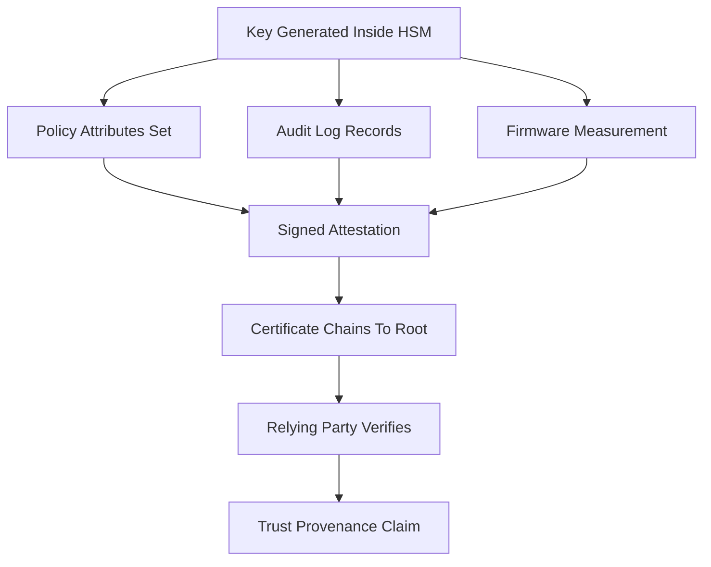

# Key Provenance: Proving Where a Key Came From and That It Never Left

## English

A key has two questions attached to it: what is it, and where did it come from? Most systems answer only the first. Key provenance is the second question, and it is the reason HSMs are valuable beyond mere storage. When a key is generated inside a module, the module can assert facts about it: this key was created at this time, under this policy, with these attributes, and has never existed outside the tamper boundary in plaintext. That assertion is what lets an auditor or a remote party trust the key without trusting the operator who runs the machine. Provenance turns a key from a secret into a claim with a history.

The mechanism that makes provenance meaningful is attestation: the module produces a signed statement about its own state, signed by a key whose certificate chains to a manufacturer or an operator root. A relying party can verify that statement and learn, for example, that the key was generated in a module running a particular firmware version with a particular security policy. This is the hardware analogue of a birth certificate. Without it, a key imported from an unknown source is indistinguishable from one generated securely, because both are just opaque blobs once inside the vault. The distinction only exists if the module records and can prove it.

Provenance also answers the harder question of whether a key ever leaked. No HSM can prove a negative in the absolute sense, but it can constrain the claim. If a key's policy says it is non-exportable, and the module's audit log shows no export operation, then the statement「this key has never left in plaintext」rests on the module's enforcement rather than on anyone's promise. The value is cumulative: policy attributes, audit records, attestation quotes, and firmware measurements together form a chain that a third party can inspect. Break any link, and the provenance claim weakens to a mere assertion.

Practically, this changes how you design key registration. Rather than generating a keypair and shipping the public half to a certificate authority, you ask the HSM to produce a certificate signing request (CSR) where the private key never leaves and the module signs the request itself. The resulting certificate is bound to a key whose origin is attested. Similarly, for code signing or payment keys, you keep a record of the ceremony, the firmware version, and the attestation quote alongside the key's identifier, so that years later an investigator can reconstruct the key's biography. Provenance is not a feature you enable; it is a discipline of recording what the module can prove and refusing to accept keys whose history is unknown.

There is a limit worth stating plainly: provenance is only as trustworthy as the root that signs the attestation. If the manufacturer's root key is compromised, or if the operator can reflash firmware and forge measurements, the whole chain collapses. That is why provenance and firmware integrity are inseparable topics, and why some deployments pin the expected firmware measurements rather than trusting whatever the module reports.

## 中文

一把金鑰身上掛著兩個問題：它是什麼，以及它從哪裡來？大多數系統只回答第一個。金鑰來源（key provenance）就是第二個問題，而這正是 HSM 的價值遠超單純儲存的原因。當一把金鑰在模組內部產生時，模組可以對它作出斷言：這把金鑰是在這個時間、依這套政策、帶這些屬性而創造，並且從未以明文形式存在於防篡改邊界之外。這個斷言，正是讓稽核員或遠端一方能夠信任金鑰、而不必信任操作機器那個人的原因。來源把一把金鑰從單純的機密，變成一個帶有歷史的聲明。

讓來源變得有意義的機制是遠端證明（attestation）：模組對自身狀態產生一份簽署聲明，由一條能追溯到製造商或營運方根憑證的憑證鏈簽署。依賴方可以驗證該聲明，從而得知例如這把金鑰是在執行某個特定韌體版本、某套特定安全政策的模組內產生。這是硬件的出生證明。沒有它，一把從不明來源匯入的金鑰，與一把安全產生的金鑰無從分辨，因為兩者一旦進入金庫，都只是不透明的 blob。唯有當模組記錄並能證明時，這個分別才存在。

來源也回答了更難的問題：這把金鑰到底有沒有洩漏過？沒有 HSM 能在絕對意義上證明一個否定命題，但它可以約束這個聲明。如果金鑰的政策寫明它不可匯出，而模組的稽核日誌顯示從未發生匯出操作，那麼「這把金鑰從未以明文離開」這個聲明，就建立在模組的強制執行之上，而非任何人的承諾。價值是累積的：政策屬性、稽核紀錄、遠端證明引述與韌體量測，共同構成一條第三方可以檢視的鏈。任何一環斷掉，來源聲明就弱化為單純的宣稱。

在實務上，這改變了你設計金鑰註冊的方式。與其產生一對金鑰再把公鑰部分送去憑證機構，你要求 HSM 產生一個憑證簽署請求（CSR），其中私鑰從不離開，並由模組自己簽署該請求。所得的憑證就綁定到一把來源已被證明的金鑰。同樣地，對於程式碼簽署或支付金鑰，你會把儀式的紀錄、韌體版本與遠端證明引述，與金鑰的識別碼一併保存，使多年之後調查者仍能重建這把金鑰的傳記。來源不是一個你可以開啟的功能，而是一種紀律：記錄模組所能證明的事，並拒絕接受歷史不明的金鑰。

有一個限制必須坦白說明：來源的可信度，只等於簽署遠端證明的那個根。如果製造商的根金鑰被攻破，或者營運方可以重刷韌體並偽造量測值，整條鏈就崩塌。這就是為何來源與韌體完整性是密不可分的話題，也是為何有些部署會釘住（pin）預期的韌體量測值，而不是信任模組所報告的任何東西。

## Key Takeaway

Provenance is the module's ability to prove a key's origin and confinement, and it is only as strong as the attestation root behind it.

## Related Concepts
- Remote attestation
- Certificate signing request

## Diagram

