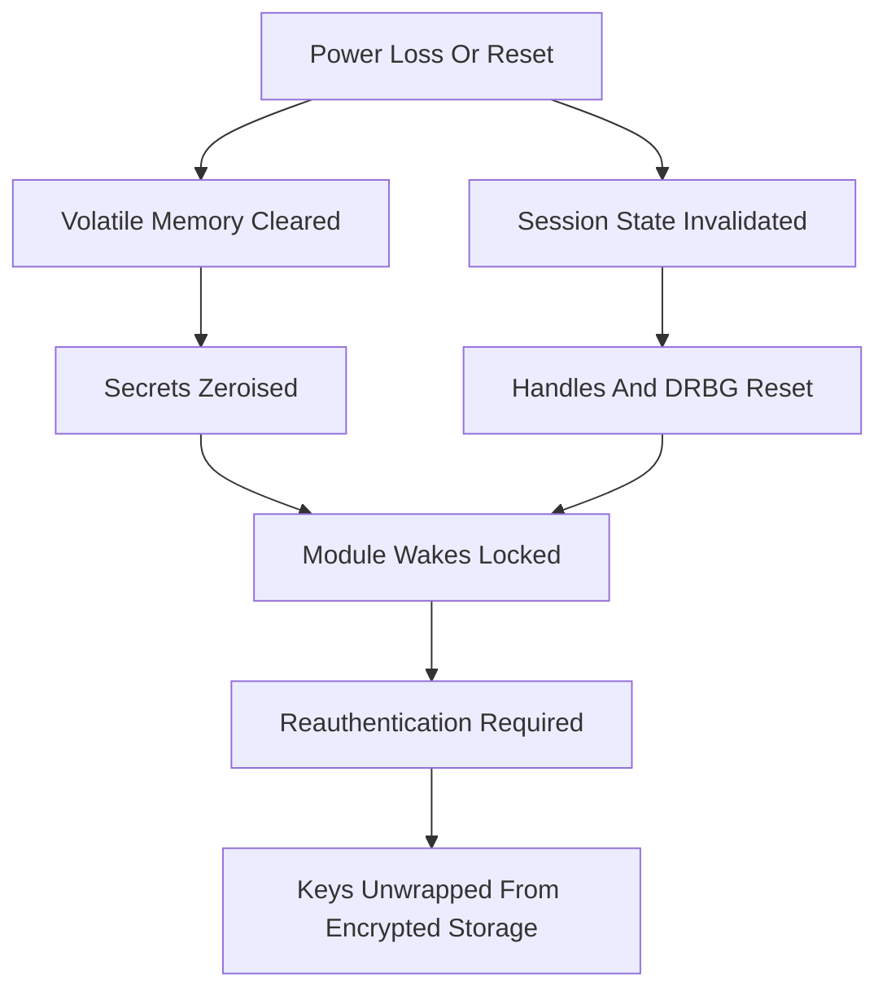

# The HSM's Power and Reset Behaviour: Why Pulling the Plug Is a Security Event

## English

An HSM is not just a computer that does cryptography; it is a computer whose power state is part of its security model. Inside the boundary, secrets live in volatile memory while the module is running: unwrapped keys, session state, DRBG state, and the plaintext of whatever operation is in flight. When power is removed, that memory should decay and, in a well-designed module, be actively cleared rather than left to fade. This is why a power loss is treated as a security-relevant event and not merely an availability incident. The module wakes up in a known, locked state and requires authentication again before it will do anything.

The interesting design question is what happens to keys that must survive a reboot. They cannot sit in volatile memory, so they are stored in non-volatile storage, but always in encrypted form, with the encryption key derived from something that only exists while the module is unlocked. Some modules keep a battery-backed RAM so that keys survive a brief outage without ever being written to flash; others use a tamper-responsive enclosure that zeroises volatile memory the instant the case is opened or the temperature or voltage moves outside tolerance. Both approaches share the same principle: the plaintext key exists only in the narrow window when the module is powered, unlocked, and authenticated.

Reset behaviour matters just as much. A warm reset that leaves stale session state behind is a vulnerability, because a new session might inherit handles or buffers from the old one. Good modules clear session objects, invalidate handles, and reset the DRBG on every reset, and they make the reset path itself part of the tamper response. An attacker who can force a reset at a chosen moment might try to exploit a half-initialised state, so the module must ensure that at no point during boot is it both reachable and unauthenticated with secrets loaded. This is why HSMs often have a defined boot sequence with integrity checks before the network interface comes up.

For the people operating these devices, the practical implications are concrete. Uninterruptible power supplies are not a luxury; they prevent the churn of repeated cold starts and the operational risk of a module coming back in an unexpected state. Change windows should account for the fact that a firmware update or a power event may require re-authentication and may invalidate cached sessions in your application. Monitoring should treat unexpected resets as an alert, because a reset can be the visible trace of a physical intrusion attempt or a voltage glitch attack. The module's own audit log will record the reset, and correlating that with physical access records is exactly the kind of evidence an investigation needs.

Finally, consider the failure mode where power is lost during a key generation or a wrapping operation. The module must not leave a half-written key object that looks valid. Well-designed storage uses atomic commit semantics, so an interrupted operation either completes fully or leaves no trace. If you ever find a key object with implausible attributes or a creation time that does not match your records, treat it as a symptom of an interrupted write rather than a curiosity, and investigate the power and reset history around that moment.

## 中文

HSM 不只是一部做密碼學運算的電腦；它是一部把電源狀態也納入安全模型的電腦。在邊界之內，機密在模組運行時存活於揮發性記憶體：已解封裝的金鑰、會話狀態、DRBG 狀態，以及任何進行中操作的明文。當電力被移除，那些記憶體理應衰減，而在設計良好的模組中，更會被主動清除，而非任其淡去。這就是為何斷電被視為一個與安全相關的事件，而不只是可用性事故。模組會以一個已知的鎖定狀態醒來，並在它能做任何事之前要求重新認證。

有趣的設計問題，是那些必須熬過重新開機的金鑰會怎樣。它們不能長駐揮發性記憶體，所以被存放在非揮發性儲存中，但永遠以加密形式存放，而其加密金鑰衍生自某個只在模組解鎖時才存在的東西。有些模組保留電池供電的 RAM，使金鑰能熬過短暫停電而從不寫入快閃記憶體；另一些則使用會即時反應的防篡改外殼，一旦機箱被打開、或溫度與電壓超出容差，就立刻清零揮發性記憶體。兩種做法共享同一原則：明文金鑰只存在於模組通電、解鎖、並已認證的那個狹窄窗口之內。

重置行為同樣重要。一個暖重置若留下殘餘的會話狀態，就是漏洞，因為新會話可能繼承舊會話的 handle 或緩衝區。良好的模組會在每次重置時清除會話物件、使 handle 失效、並重設 DRBG，而且把重置路徑本身納入防篡改反應之中。一個能在選定時刻強制重置的攻擊者，可能試圖利用半初始化的狀態，所以模組必須確保在開機過程中的任何一刻，它都不會同時處於可達、未認證、而又載入了機密的狀態。這就是為何 HSM 通常有明確的開機序列，在網絡介面啟動之前先做完整性檢查。

對於操作這些裝置的人，實務含義很具體。不間斷電源不是奢侈品；它避免反覆冷啟動的折騰，以及模組以意外狀態回來的營運風險。變更窗口應該考慮到：韌體更新或電源事件可能需要重新認證，並可能使應用程式快取的會話失效。監控應把非預期的重置當作警報，因為重置可以是實體入侵嘗試或電壓毛刺攻擊的可見痕跡。模組自身的稽核日誌會記錄該次重置，把它與實體進出紀錄相互關聯，正是調查所需的證據。

最後，考慮在產生金鑰或封裝操作途中失去電力的失敗模式。模組絕不能留下一個看似有效、實則半寫入的金鑰物件。設計良好的儲存使用原子提交語義，使中斷的操作要麼完整完成，要麼不留痕跡。如果你發現一個屬性不合理、或建立時間與紀錄不符的金鑰物件，請把它視為中斷寫入的症狀而非奇聞，並調查那一刻前後的電源與重置歷史。

## Key Takeaway

Power and reset are part of the HSM's security model, so treat unexpected resets as security events and design storage and operations around the fact that plaintext keys only exist while the module is powered, unlocked, and authenticated.

## Related Concepts
- Zeroisation
- Atomic commit semantics

## Diagram

