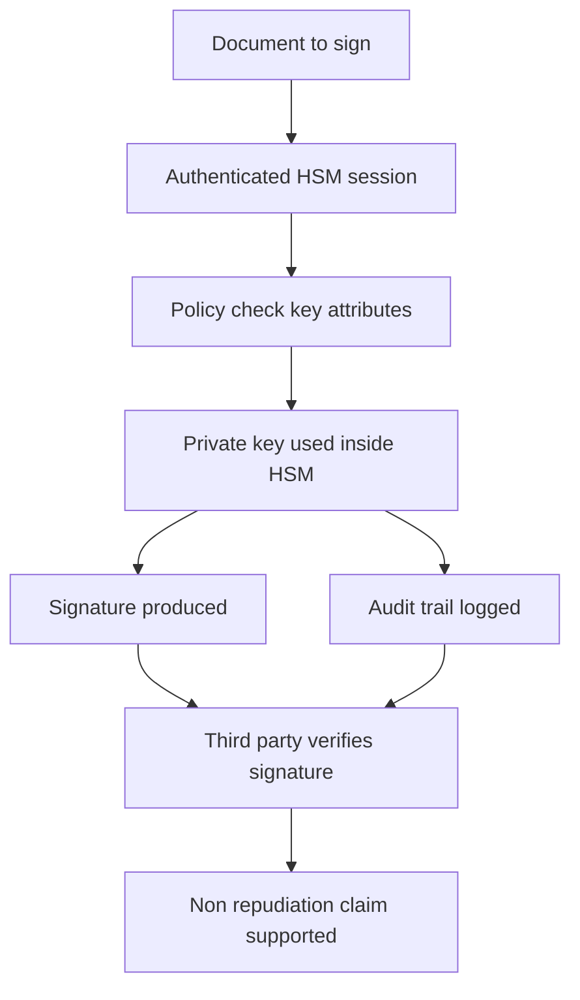

# The HSM as a Legal Witness: Evidentiary Weight of Vault-Backed Signatures

## English

When a document is signed by a key that lives inside an HSM, the signature carries a different kind of weight than one produced by a key sitting in a file. The reason is not that the mathematics differ — an RSA or ECDSA signature is the same bytes either way. The difference is what can be asserted about how the key was used. Because the HSM enforces a policy that only a specific mechanism, with specific attributes, under an authenticated session, can invoke the private key, the resulting signature sits at the end of a chain of custody that a third party can reason about. An auditor can ask: was the key extractable? Was it marked sensitive? Was the signing operation logged with a timestamp and identity? If the answers come from the vault's own audit trail, they are far more persuasive than a software log written by the same application that might have been compromised.

This is what people mean when they say an HSM provides 'non-repudiation infrastructure' rather than merely 'a signature'. Non-repudiation is a legal and procedural property, not a cryptographic one. Cryptography gives you integrity and authentication of a message relative to a key. Non-repudiation adds the claim that the holder of the key cannot plausibly deny having signed, because the key was held under controls they did not fully command at the moment of signing. The HSM contributes to that claim by removing the signer's ability to casually copy the key elsewhere, to sign offline without a record, or to claim the key was stolen and misused without leaving traces.

Consider a code-signing setup for a software vendor. If the signing key is a file on a build server, an attacker who compromises the server can sign a malicious update, and the vendor's later claim that 'our key was stolen' is hard to disprove. If the key lives in an HSM with a policy that requires an authenticated session from a named operator and logs every signature, the vendor can point to a continuous audit record: every legitimate release has a matching entry, and the malicious one does not, or does but from an unexpected identity. The absence of a log entry becomes evidence in itself.

None of this is automatic. The evidentiary value depends on the HSM's audit log being trustworthy, complete, and preserved — which is why log export, log signing, and off-box retention matter so much. It also depends on the policy being strict enough that 'the key was in the HSM' actually constrains behaviour. An HSM configured to allow key export to any authenticated session provides almost none of this assurance. The vault is only a witness if it is configured to be one, and if someone is willing to defend the configuration in front of a sceptical party.

Finally, be careful not to overclaim. Courts and regulators do not universally treat HSM-backed signatures as self-proving; they treat them as strong evidence that can be challenged. The correct framing is that the HSM shifts the burden of explanation. Without it, you must explain why anyone should believe the key was not misused. With it, the other side must explain how the key was misused despite the controls, the logs, and the physical boundary — a much harder argument to make.

## 中文

當一份檔案由存放在 HSM 內的金鑰簽署時，該簽名的份量與由檔案中的金鑰所產生的簽名並不相同。原因不在於數學上有差異——RSA 或 ECDSA 簽名兩者都是同樣的位元組。差別在於可以就「金鑰如何被使用」作出什麼主張。因為 HSM 強制執行一套策略：只有特定機制、特定屬性、在已驗證的工作階段下，才能呼叫私鑰，所以產生的簽名位於一條第三方可以推理的保管鏈末端。稽核員可以問：金鑰是否可被匯出？是否被標記為敏感？簽署操作是否有時間戳與身分記錄？若答案來自保險庫本身的稽核軌跡，其說服力遠高於由同一個可能已被入侵的應用程式所寫的軟體日誌。

這就是人們說 HSM 提供「不可否認性基礎設施」而非僅僅「一個簽名」的意思。不可否認性是法律與程式上的性質，而非密碼學性質。密碼學給你的是訊息相對於某把金鑰的完整性與真實性。不可否認性再加上一項主張：金鑰持有人無法合理地否認曾簽署，因為在簽署的那一刻，金鑰受到他們無法完全掌控的控制措施所保護。HSM 透過消除簽署者隨意複製金鑰、在無記錄下離線簽署、或聲稱金鑰被竊用卻不留痕跡的能力，來支撐這項主張。

設想一家軟體供應商的程式碼簽署設定。若簽署金鑰是建置伺服器上的一個檔案，入侵該伺服器的攻擊者便可簽署惡意更新，而供應商日後「我們的金鑰被偷了」的說法難以被駁倒。若金鑰存放在 HSM 內，且策略要求來自具名操作員的已驗證工作階段並記錄每次簽名，供應商便可指向一份連續的稽核記錄：每個合法釋出都有對應條目，而惡意的那個沒有，或者有但來自非預期的身分。日誌條目的缺失本身就成了證據。

這一切都不是自動的。證據價值取決於 HSM 的稽核日誌是否可信、完整且被儲存——這就是為何日誌匯出、日誌簽署與離箱保留如此重要。它也取決於策略是否嚴格到「金鑰在 HSM 內」真正約束了行為。一臺被設定為允許任何已驗證工作階段匯出金鑰的 HSM，幾乎提供不了這種保證。保險庫只有在被設定為見證者、且有人願意在抱持懷疑的對方面前捍衛該設定時，才真正是見證者。

最後，切勿過度主張。法院與監管機構並不普遍將 HSM 支撐的簽名視為自證；他們視之為可被質疑的強力證據。正確的框架是：HSM 轉移了舉證責任。沒有它，你必須解釋為何任何人應相信金鑰未被濫用。有了它，對方必須解釋在控制措施、日誌與物理邊界之下，金鑰如何仍被濫用——這是難得多的論證。

## Key Takeaway

An HSM does not make a signature mathematically stronger, but it makes the story of how the key was used far harder to dispute, shifting the burden of explanation onto anyone who claims misuse.

## Related Concepts
- Non-repudiation
- Audit trail integrity

## Diagram

