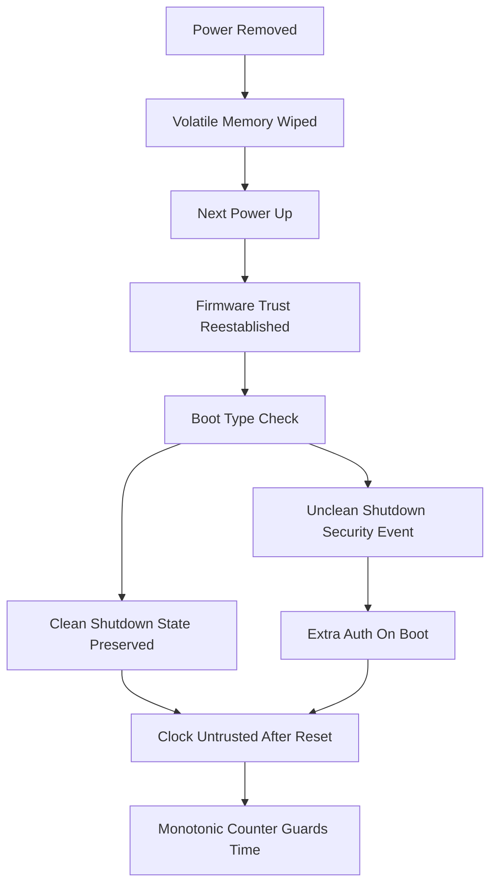

# Cold Boot, Warm Boot, and the HSM's Relationship With Time

## English

An HSM is a small computer, and like any computer it has a boot sequence. The difference is that the boot sequence is part of the security model. When power is removed, most HSMs enter a state in which the cryptographic material in volatile memory is wiped — either deliberately by zeroising RAM on power loss, or passively because the memory does not retain state. On the next power-up, the device must re-establish trust in its own firmware before it will accept any commands. This is why a power cycle is not a neutral operation: it is a re-assertion of the trust chain, and it can change what the device will and will not do.

Many HSMs treat a clean shutdown differently from an unexpected power loss. A clean shutdown, initiated through an administrative command or a controlled procedure, may preserve certain state — session information, counters, or a record that the shutdown was orderly. An unexpected loss of power may be recorded as a security event, may trigger additional authentication requirements on the next boot, or may invalidate keys marked as ephemeral. Some devices require physical presence or a quorum of smart cards to return to operational mode after an unclean shutdown, precisely because an attacker who can cut power can also control when the device reboots.

Time is entangled with this. HSMs typically maintain a real-time clock, often battery-backed, and use it for certificate validity checks, for audit log timestamps, and for policy decisions such as 'this key may only be used before date X'. A power loss can disturb the clock. Good designs handle this by treating the clock as untrusted after a reset, by requiring an external time source to be re-established, or by using monotonic counters that cannot be rolled back. The monotonic counter is important: if an HSM enforces a maximum number of signatures per key, or a rate limit, an attacker who can reset the counter by cycling power has defeated the control. Hardware monotonic counters that survive power loss and cannot be rewound are therefore a real security primitive, not a convenience.

There is a subtler issue: the HSM's notion of 'now' may diverge from the rest of your system. If the HSM believes it is 2023 and your application believes it is 2025, a certificate that the HSM considers expired may be considered valid by the application, or vice versa. When keys have time-bounded policies, this divergence becomes a correctness bug as well as a security one. Operational practice is to treat the HSM clock as an input to be monitored, not an oracle to be trusted blindly, and to alert on drift.

For the person designing a system around an HSM, the practical lesson is to include power and time in your threat model explicitly. Ask: what happens to my keys, my sessions, my counters, and my audit trail when the device loses power at an inconvenient moment? What happens when it comes back? Which operations require a human to be physically present after a reboot, and can my automation cope with that? These are not exotic questions — they are the everyday reality of running a device that is designed to notice when something is wrong.

## 中文

HSM 是一臺小型電腦，和任何電腦一樣有開機程式。差別在於開機程式本身就是安全模型的一部分。當電源被移除，多數 HSM 會進入一個狀態：揮發性記憶體中的密碼材料被抹除——可能是斷電時刻意將 RAM 清零，也可能是被動地因為記憶體不保留狀態。下次上電時，裝置必須先重建對自身韌體的信任，才會接受任何指令。這就是為何電源迴圈不是中性操作：它是信任鏈的重新主張，且可能改變裝置會做與不會做的事。

許多 HSM 對乾淨關機與非預期斷電的處理不同。透過管理指令或受控程式啟動的乾淨關機會保留某些狀態——工作階段資訊、計數器，或一項「關機是有序的」記錄。非預期的斷電可能被記錄為安全事件、可能在下次開機時觸發額外的驗證要求，或可能使標記為短暫的金鑰失效。有些裝置要求物理在場或智慧卡法定人數才能在不潔關機後回到運作模式，正因為能切斷電源的攻擊者也能控制裝置何時重啟。

時間與此糾纏在一起。HSM 通常維護一個即時時鐘，往往有電池供電，用於憑證有效期檢查、稽核日誌時間戳，以及「此金鑰只可在某日期前使用」之類的策略決策。斷電可能擾亂時鐘。良好設計會將重置後的時鐘視為不可信、要求重新建立外部時間來源，或使用無法回滾的單調計數器。單調計數器很重要：若 HSM 對每把金鑰強制最大簽名次數或速率限制，能藉由反覆斷電重置計數器的攻擊者便擊敗了該控制。能在斷電後存續且無法倒回的硬體單調計數器因此是真正的安全原語，而非便利功能。

還有一個更微妙的問題：HSM 的「現在」可能與你係統其餘部分分歧。若 HSM 認為現在是 2023 年而你的應用程式認為是 2025 年，HSM 視為過期的憑證可能被應用程式視為有效，反之亦然。當金鑰有時間限制策略時，這種分歧就同時成為正確性缺陷與安全缺陷。實務做法是將 HSM 時鐘視為需要監控的輸入，而非盲目信任的神諭，並對漂移發出告警。

對圍繞 HSM 設計系統的人而言，實際教訓是明確地把電源與時間納入威脅模型。問：當裝置在不方便的時刻失去電力，我的金鑰、工作階段、計數器與稽核軌跡會怎樣？回來時又會怎樣？哪些操作在重啟後需要有人在場，我的自動化能否應付？這些不是稀奇問題——它們是執行一臺被設計成會察覺異常的裝置的日常現實。

## Key Takeaway

Power loss and clock drift are not operational annoyances but security events; design for what the HSM does when it reboots and what it believes about the time.

## Related Concepts
- Monotonic counters
- Trust chain on boot

## Diagram

