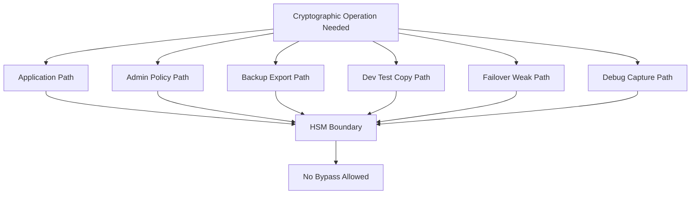

# The HSM as a Constraint on Architecture: Designing Systems That Cannot Bypass It

## English

The most common way an HSM fails to protect anything is not that it is broken, but that the system around it has a path that does not go through it. If an application can fall back to a software key when the HSM is slow or unavailable, then the HSM is decorative. If a developer can export the key 'just for testing' and the export is allowed, the vault has no teeth. The security property is not 'the key is in the HSM' — it is 'there is no way to use the key except through the HSM, and no way to obtain the key at all'. That property is an architectural one, and it must be designed, not assumed.

Designing for this means thinking about every path by which a cryptographic operation could occur. The obvious path is the application calling the HSM through its client library. The less obvious paths are: an operator with administrative access to the HSM who can change policy; a backup taken with key export enabled; a development environment that uses a copy of production keys; a failover path that uses a different, weaker mechanism; a monitoring or debugging tool that captures plaintext before encryption. Each of these is a bypass, and each must be closed or explicitly accepted with compensating controls.

A useful discipline is to enumerate the trust boundaries and ask, for each, what crosses it and under whose authority. The HSM boundary is one such line, but there are others: the boundary between your application and the HSM client library, the boundary between the client library and the network, the boundary between the HSM and its backup target. The HSM protects what is inside its boundary; it cannot protect what your application does with plaintext before handing it over, nor what it does with a signature after the HSM returns it. The architecture must ensure that the sensitive material only exists in places where it is supposed to.

This has a counterintuitive consequence: sometimes the right design is to make the HSM less convenient. If the only way to sign a release is a ceremony that requires two named operators and a hardware token, then a compromised build server cannot sign a release on its own. The inconvenience is the control. Systems that make the HSM easy to use by giving every service an unrestricted credential have recreated the problem the HSM was meant to solve, just at a higher price point. The policy on the HSM should reflect the actual authority structure of the organisation, not the convenience of the deployment pipeline.

Finally, architecture includes failure. What does your system do when the HSM is unreachable? If the answer is 'it keeps working using a cached key', you have chosen availability over key protection, and you should say so explicitly rather than discovering it during an incident. If the answer is 'it stops', you have chosen key protection over availability, and you should ensure the failure mode is graceful, observable, and tested. Neither answer is universally right, but the choice must be deliberate, documented, and consistent with what the HSM is supposed to guarantee.

## 中文

HSM 最常見的失效方式，不是它壞了，而是它周圍的系統存在一條不經過它的路徑。若應用程式在 HSM 緩慢或不可用時可以退回軟件密鑰，那 HSM 就只是裝飾。若開發者可以「只為測試」匯出密鑰而匯出被允許，保險庫就沒有牙齒。安全性質不是「密鑰在 HSM 內」——而是「除了透過 HSM 之外沒有辦法使用密鑰，且完全沒有辦法取得密鑰」。這個性質是架構性的，必須被設計出來，而非假設。

為此設計意味著思考密碼操作可能發生的每一條路徑。明顯的路徑是應用程式透過其客戶端程式庫呼叫 HSM。不那麼明顯的路徑包括：對 HSM 有管理存取權、能改變策略的操作員；在啟用密鑰匯出下取得的備份；使用生產密鑰副本的開發環境；使用不同、較弱機制的容錯移轉路徑；在加密前擷取明文的監控或除錯工具。每一項都是繞道，每一項都必須被關閉，或明確接受並以補償控制處理。

一個有用的紀律是列舉信任邊界，並對每一條問：什麼東西跨越它，在誰的權限之下。HSM 邊界是其中一條線，但還有其他：應用程式與 HSM 客戶端程式庫之間的邊界、客戶端程式庫與網路之間的邊界、HSM 與其備份目標之間的邊界。HSM 保護其邊界內的事物；它無法保護你的應用程式在交付前對明文所做的一切，也無法保護 HSM 回傳簽名後應用程式對它所做的一切。架構必須確保敏感材料只存在於它應該存在的地方。

這有一個反直覺的後果：有時正確的設計是讓 HSM 更不方便。若簽署一個發佈的唯一方式是要求兩名具名操作員與硬體令牌的儀式，那麼被入侵的建置伺服器便無法自行簽署發佈。不方便本身就是控制。那些透過給每個服務不受限制的憑證來讓 HSM 易於使用的系統，只是以更高的價格重現了 HSM 本要解決的問題。HSM 上的策略應反映組織實際的權限結構，而非部署管線的便利。

最後，架構包含失敗。當 HSM 無法觸達時你的系統會怎樣？若答案是「它用快取的密鑰繼續運作」，你選擇了可用性而非密鑰保護，你應該明說，而不是在事故中才發現。若答案是「它停下來」，你選擇了密鑰保護而非可用性，你應該確保失敗模式是優雅的、可觀察的且經過測試的。兩個答案都不是普遍正確的，但選擇必須是刻意的、有記錄的，且與 HSM 應保證的內容一致。

## Key Takeaway

An HSM only protects keys if the surrounding architecture has no path around it; the security property is the absence of bypasses, not the presence of a vault.

## Related Concepts
- Trust boundary enumeration
- Fail-closed vs fail-open design

## Diagram

