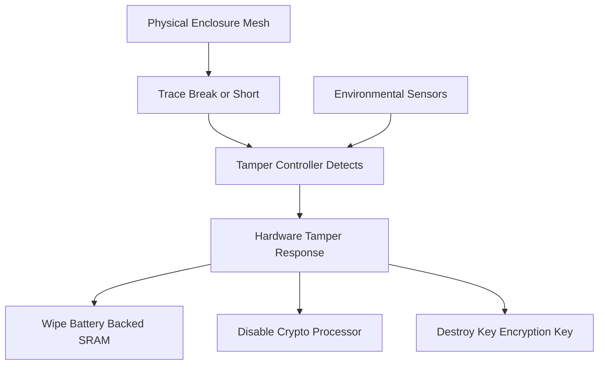

# The HSM's Cryptographic Boundary as a Physical Enclosure: Shielding, Sensors, and the Mesh

## English

When people say an HSM has a 'cryptographic boundary', they usually mean the logical line that keys never cross. But underneath that logical boundary sits a physical one: a sealed enclosure wrapped in a tamper-detection mesh. This mesh is a lattice of fine conductive traces, often embedded in a flexible film laminated to the inside of the casing or printed onto the circuit board itself. The traces carry a small current or are monitored for a characteristic impedance. Drill through the casing, scrape the coating, or pierce the board, and the trace breaks or shorts. The controller sees the change in a matter of microseconds and treats it as an intrusion.

The interesting engineering is not the mesh itself but the response it triggers. A real HSM does not merely log 'tamper detected' — it executes a tamper response in hardware: it wipes the battery-backed SRAM that holds working keys, disables the cryptographic processor, and may destroy the internal key-encryption key so that the stored key blobs become undecryptable ciphertext. This is why an HSM has a battery: not to run cryptography, but to keep volatile key material alive across brief power interruptions and to power the zeroisation circuit the instant the mesh is violated. Pull the plug, and the response fires.

Beyond the mesh, the enclosure hosts environmental sensors. Voltage sensors detect out-of-spec supply rails, because a sudden droop or spike can cause a processor to skip instructions — a classic fault-injection technique. Temperature sensors detect chilling (to slow DRAM refresh and preserve data after power-off) and heating (to induce faults). Light sensors detect the enclosure being opened. Some designs add radiation sensors, since a focused ion beam or a flash of light can flip bits in a chip. Each sensor is wired to the same response logic: any out-of-range condition is an intrusion.

The cryptographic boundary is thus a layered defence: the mesh catches mechanical intrusion, the sensors catch environmental manipulation, and the response logic ensures that detection always ends in destruction rather than disclosure. The design philosophy is 'fail safe, not fail open'. A software vault that crashes leaves the key in memory; an HSM that detects tampering destroys the key before an attacker can read it. This is why the physical enclosure is not a cosmetic shell but the actual security control that the logical boundary depends on.

For an architect, the practical consequence is that the HSM's physical integrity is part of your threat model whether you like it or not. If an attacker can reach the appliance — in a colocation cage, a branch office, a retail back room — the mesh and sensors are your last line. If the appliance is in a cloud provider's data centre, you are trusting the provider's physical controls. Either way, the cryptographic boundary is only as strong as the enclosure that enforces it.

## 中文

當人們說 HSM 有一個「密碼學邊界」時，通常指的是金鑰永遠不會跨越的那條邏輯界線。但在那條邏輯界線之下，還有一層物理界線：一個被防篡改偵測網（tamper-detection mesh）包裹的密封外殼。這個網是一層細密導電走線的格柵，通常嵌在貼合外殼內側的柔性薄膜裡，或直接印在電路板上。這些走線會承載微小電流，或被監測其特徵阻抗。鑽穿外殼、刮開塗層、刺穿電路板，走線就會斷裂或短路。控制器會在數微秒內察覺變化，並將其視為入侵。

真正有趣的工程不是網本身，而是它觸發的反應。真正的 HSM 不會只記錄「偵測到篡改」——它會在硬體層執行篡改反應：抹除存放工作金鑰的電池供電 SRAM、停用密碼學處理器，甚至銷毀內部的金鑰加密金鑰，使已儲存的金鑰 blob 變成無法解密的密文。這就是 HSM 為何需要電池：不是為了執行密碼學運算，而是為了在短暫斷電時維持揮發性金鑰材料存活，並在網被破壞的瞬間為清零電路供電。拔掉電源，反應就會觸發。

除了網之外，外殼還裝有環境感測器。電壓感測器偵測超出規格的供電軌，因為突然的電壓下降或尖峰會讓處理器跳過指令——這是經典的故障注入技術。溫度感測器偵測低溫（藉由減慢 DRAM 重新整理來在斷電後保留資料）與高溫（藉由誘發故障）。光感測器偵測外殼被開啟。有些設計還加入輻射感測器，因為聚焦離子束或一閃光線就能翻轉晶片中的位元。每個感測器都連線到同一套反應邏輯：任何超出範圍的狀況都是入侵。

因此，密碼學邊界是層層防禦：網攔截機械入侵，感測器攔截環境操縱，而反應邏輯確保偵測最終總是以銷毀收場，而非洩露。設計哲學是「安全失效，而非開放失效」（fail safe, not fail open）。軟體保險庫崩潰時，金鑰仍留在記憶體中；HSM 偵測到篡改時，會在攻擊者讀取之前銷毀金鑰。這就是為何物理外殼不是裝飾性外殼，而是邏輯邊界所依賴的真正安全控制。

對架構師而言，實際後果是：無論你喜不喜歡，HSM 的物理完整性都是你威脅模型的一部分。如果攻擊者能接觸到裝置——在代管機櫃、分公司、零售後場——網與感測器就是你的最後防線。如果裝置位於雲端供應商的資料中心，你就是在信任供應商的物理控制。無論哪種情況，密碼學邊界都只和執行它的外殼一樣強。

## Key Takeaway

The logical cryptographic boundary rests on a physical enclosure whose mesh and sensors guarantee that any intrusion ends in key destruction, not disclosure.

## Related Concepts
- Tamper response circuit
- Fault injection

## Diagram

