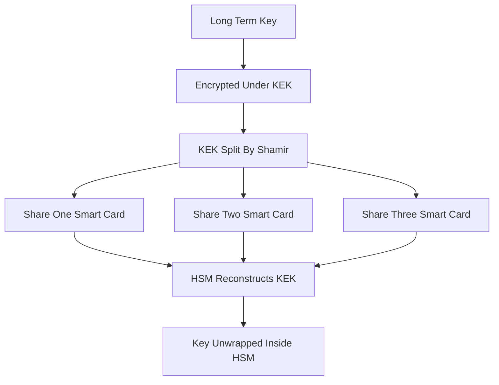

# Key Custody Without Key Exposure: How Shamir Splitting Works When the HSM Holds the Pieces

## English

Most discussion of M-of-N key custody stops at the idea of 'splitting a secret among custodians'. The interesting part is what actually happens inside the vault. A common mechanism is Shamir's Secret Sharing: a mathematical scheme that turns a secret S into N shares, any M of which reconstruct S, while any M−1 shares reveal nothing at all. The scheme is based on polynomials over a finite field. A random polynomial of degree M−1 is chosen so that its constant term equals S. Each share is a point on that polynomial. With M points you can interpolate the polynomial and recover S; with fewer, infinitely many polynomials of degree M−1 pass through your points, so S is information-theoretically hidden.

The subtlety is that the HSM rarely splits the actual long-term key. Instead, it splits a key-encryption key (KEK) or a 'split secret' that unlocks a key store. The long-term key stays encrypted under the KEK inside the vault. This separation matters: if you split the key itself, every reconstruction puts the raw key into memory. If you split a KEK, the shares only ever unlock a wrapped blob, and the unwrapped key never leaves the HSM's protected memory. The shares are typically stored on smart cards or USB tokens, each held by a different custodian, and the HSM reads them through its own card readers during a ceremony.

Reconstruction happens inside the HSM, not on a laptop. Custodians insert their tokens, enter their PINs, and the HSM's firmware performs the polynomial interpolation in protected memory. The shares never appear in the clear on any general-purpose machine. This is the crucial difference between 'splitting a secret with a script' and 'splitting a secret with an HSM': in the latter, the reconstruction environment is itself tamper-protected, so a compromised custodian laptop cannot harvest the shares as they are combined.

There are practical wrinkles. Shares must be bound to the specific HSM or cluster — otherwise a share from one device could be replayed against another. Many designs therefore wrap each share under a device-specific key before storing it on the token. Thresholds must be chosen with care: M=2 of N=3 tolerates one lost custodian, but it also means any two colluding custodians can reconstruct. The scheme protects against loss and against a single malicious insider, not against a coordinated majority. And the shares must be regenerated if the threshold changes, which is itself a ceremony.

For an architect, the takeaway is that Shamir splitting is not a backup convenience — it is a cryptographic protocol with its own threat model. It gives you information-theoretic secrecy against any coalition smaller than M, but it gives you nothing against a coalition of M or more, and nothing if the reconstruction environment is compromised. That is why the HSM performs the interpolation itself: it moves the trust anchor from 'the custodian's laptop' to 'the sealed vault', which is the whole point of using an HSM in the first place.

## 中文

大多數關於 M-of-N 金鑰託管的討論都停在「把秘密分給託管人」這個概念上。真正有趣的部分，是保險庫內部實際發生什麼事。常見機制是 Shamir 秘密分享（Shamir's Secret Sharing）：一套數學方案，把秘密 S 轉換成 N 份 share，其中任意 M 份可重建 S，而任意 M−1 份則完全不洩露任何資訊。此方案基於有限域上的多項式。隨機選取一個 M−1 次多項式，使其常數項等於 S。每份 share 就是該多項式上的一點。有 M 點就能內插出多項式並還原 S；少於 M 點時，有無窮多個 M−1 次多項式穿過你的點，因此 S 在資訊理論上是隱藏的。

微妙之處在於，HSM 很少直接分割長期金鑰本身。它分割的是金鑰加密金鑰（KEK），或是一個用來解鎖金鑰儲存區的「分割秘密」。長期金鑰在保險庫內以 KEK 加密儲存。這種分離很重要：若分割的是金鑰本身，每次重建都會把原始金鑰放進記憶體；若分割的是 KEK，share 只會解鎖一個已包裝的 blob，而未包裝的金鑰永遠不會離開 HSM 的受保護記憶體。share 通常儲存在智慧卡或 USB 令牌上，各由不同託管人持有，HSM 在儀式中透過自己的讀卡機讀取。

重建發生在 HSM 內部，而不是筆記型電腦上。託管人插入令牌、輸入 PIN，HSM 韌體在受保護記憶體中執行多項式內插。share 永遠不會以明文出現在任何通用機器上。這就是「用指令碼分割秘密」與「用 HSM 分割秘密」的關鍵差異：後者的重建環境本身受防篡改保護，因此被入侵的託管人筆電無法在 share 合併時攔截它們。

實務上有幾個細節。share 必須繫結到特定 HSM 或叢集——否則來自某臺裝置的 share 可能被重放到另一臺上。因此許多設計會先用裝置專屬金鑰包裝每份 share，再存到令牌上。門檻值必須謹慎選擇：M=2、N=3 可容忍一位託管人遺失，但也意味著任意兩位串通的託管人即可重建。此方案防的是遺失與單一惡意內部人員，而非協調一致的多數派。若門檻改變，share 必須重新產生，這本身又是一場儀式。

對架構師而言，重點是：Shamir 分割不是備份的便利工具，而是一套有自身威脅模型的密碼學協定。它對任何小於 M 的聯盟提供資訊理論上的保密性，但對 M 或以上的聯盟毫無作用，對重建環境被入侵也毫無作用。這就是為何 HSM 要自己執行內插：它把信任錨從「託管人的筆電」移到「密封的保險庫」，而這正是使用 HSM 的全部意義。

## Key Takeaway

Shamir splitting gives information-theoretic secrecy below the threshold, but only the HSM performing the interpolation keeps the reconstruction environment itself trustworthy.

## Related Concepts
- Shamir's Secret Sharing
- Key-encryption key

## Diagram

