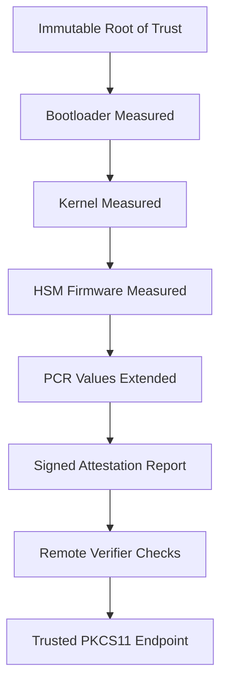

# The HSM as a Trust Anchor for Boot: Measured Boot, Attestation, and the Chain to the Vault

## English

An HSM is only useful if you can trust that the thing answering your PKCS#11 calls is the HSM and not something impersonating it. This is the boot-time trust problem. Modern HSMs and the servers that host them increasingly rely on a measured boot process: each stage of firmware and software computes a cryptographic hash of the next stage before handing control to it, and records that hash in a tamper-evident log or extends it into a TPM-style platform configuration register (PCR). The result is a chain of measurements from the immutable root of trust in hardware up to the HSM application itself.

The chain starts with an immutable root: a small piece of code in ROM or in a hardware root-of-trust module that cannot be modified and whose hash is known. That root measures the bootloader, which measures the kernel, which measures the HSM firmware. If any stage has been altered, its hash differs and the chain breaks. At the end, the device can produce a signed attestation report: a statement, signed by a key rooted in hardware, that says 'this device is running firmware with hash X, and its PCR values are Y'. A remote party can verify the signature and compare the measurements against a known-good reference.

For an HSM, attestation answers a question that PKCS#11 cannot: 'am I talking to a genuine device running genuine firmware?' PKCS#11 gives you an API, not an identity. An attacker who can intercept the network path, or who can substitute a software emulator, can answer PKCS#11 calls convincingly. Attestation closes that gap by binding the API endpoint to a hardware-rooted identity and a verified firmware measurement. Some HSM vendors expose this through a vendor-specific command; others integrate with a TPM or a secure element on the host.

The practical architecture is that your client library, before it sends the first key operation, performs an attestation handshake: it requests the device's measurement report, verifies the signature chain up to a pinned root certificate, and checks that the firmware version and measurements match policy. Only then does it open a session. This turns 'trust the network' into 'verify the endpoint', which is a much stronger posture. It also lets you detect a rolled-back firmware — an attacker reinstalling an old, vulnerable version — because the measurement will not match the expected value.

There are limits. Attestation tells you what firmware is running at the moment of measurement; it does not tell you that the firmware is free of backdoors, only that it is the firmware you expect. It also depends on the root of trust being genuinely immutable — if the attacker can reflash the root, the whole chain is fiction. And the verification policy must be maintained: pinned measurements need updating whenever you legitimately upgrade firmware, which is its own operational burden. Still, for any deployment where the HSM is reachable over a network, attestation is the mechanism that makes 'the HSM' a verifiable identity rather than an assumption.

## 中文

只有當你能信任回應 PKCS#11 呼叫的物件真的是 HSM、而不是冒充它的東西時，HSM 才有用。這就是開機時的信任問題。現代 HSM 及其宿主伺服器越來越依賴量測開機（measured boot）流程：韌體與軟體的每個階段在把控制權交給下一階段之前，會先計算下一階段的密碼學雜湊，並把該雜湊記錄到防篡改日誌，或延伸進 TPM 式的平臺組態暫存器（PCR）。結果是一條從硬體中不可變的信任根，一路量測到 HSM 應用程式本身的鏈。

這條鏈從一個不可變的根開始：一小段位於 ROM 或硬體信任根模組中的程式碼，無法被修改，且其雜湊是已知的。該根量測開機載入器，開機載入器量測核心，核心量測 HSM 韌體。若任一階段被篡改，其雜湊就會不同，鏈就斷了。最後，裝置可以產生一份簽署的遠端證明（attestation）報告：一份由硬體根源金鑰簽署的陳述，說明「本裝置正在執行雜湊為 X 的韌體，其 PCR 值為 Y」。遠端一方可驗證簽章，並將量測值與已知良好的參考值比對。

對 HSM 而言，遠端證明回答了 PKCS#11 無法回答的問題：「我是不是在跟執行正版韌體的正版裝置說話？」PKCS#11 給你的是 API，不是身分。能攔截網路路徑、或能替換成軟體模擬器的攻擊者，可以很有說服力地回應 PKCS#11 呼叫。遠端證明把 API 端點繫結到硬體根源的身分與經驗證的韌體量測，從而補上這個缺口。有些 HSM 廠商透過專屬命令提供此功能；有些則與主機上的 TPM 或安全元件整合。

實際架構是：你的客戶端函式庫在送出第一個金鑰操作之前，先執行遠端證明握手：請求裝置的量測報告、驗證簽章鏈直到釘選的根憑證、並檢查韌體版本與量測值是否符合政策。只有透過後才開啟工作階段。這把「信任網路」變成「驗證端點」，是強得多的態勢。它也能讓你偵測韌體回滾——攻擊者重灌舊的、有漏洞的版本——因為量測值不會符合預期值。

這也有其限制。遠端證明告訴你量測當下執行的是什麼韌體；它不告訴你該韌體沒有後門，只告訴你它是你預期的韌體。它也依賴信任根真正不可變——若攻擊者能重刷根，整條鏈就是虛構的。而且驗證政策必須維護：每當你合法升級韌體，釘選的量測值就需要更新，這本身是營運負擔。儘管如此，對於任何可透過網路觸及的 HSM 部署，遠端證明是讓「HSM」成為可驗證身分、而非假設的機制。

## Key Takeaway

Attestation turns the HSM from an assumed endpoint into a verifiable identity by binding the API to a hardware-rooted measurement of the firmware actually running.

## Related Concepts
- Measured boot
- Remote attestation

## Diagram

