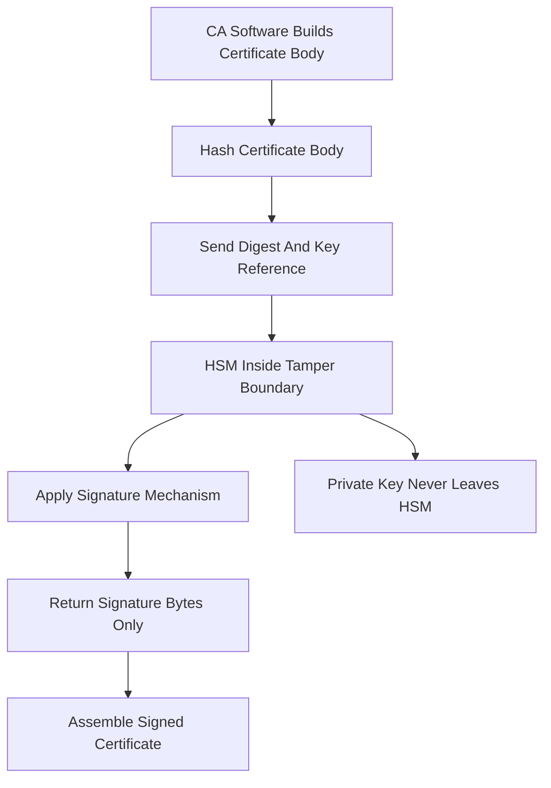

# The HSM as a Certificate Authority: Signing Inside the Boundary

## English

An HSM is often described as a place to keep keys, but a large share of real deployments use it as the signing engine behind a Certificate Authority (CA). A CA is the entity that issues digital certificates: structured blobs binding a public key to an identity, then signed with the CA's private key so that anyone can verify the binding. The crucial insight is that the CA's private key is the single most valuable object in the whole PKI, because whoever holds it can mint a certificate for any name and impersonate anyone. That is exactly the kind of asset an HSM exists to protect, so the signing operation is moved inside the tamper boundary while the certificate's contents are assembled outside it.

The flow looks like this: the CA software builds a certificate body (subject, public key, validity dates, extensions), hashes it, and hands the digest to the HSM with a reference to the CA key. The HSM applies the signature mechanism (for example RSA PKCS#1 v1.5 or ECDSA over a named curve) and returns only the signature bytes. The private key never appears in the CA server's memory, so a compromised web server or a stolen backup of the CA host yields no signing capability. Even a full disk image of the CA machine is useless without the HSM and its authentication material.

This design changes the threat model in a subtle way. The attacker's easiest path is no longer stealing the key but abusing the signing oracle: convincing the HSM to sign something it should not. That is why CA HSMs are configured with restrictive policy — the key is marked as signing-only, the mechanism list is narrowed, and often the HSM enforces that only a specific application identity may use the key. Some deployments go further and require an operator to authorise each signing session, or split the CA key so that issuance requires a quorum.

There is also a performance dimension. A busy internal CA might issue thousands of certificates per day during a rollout, and each issuance is one HSM signing operation. That is trivial for most appliances, but an online OCSP responder or a high-volume short-lived certificate system (common in service mesh and zero-trust networking) can push tens of thousands of signatures per second. In those cases the HSM becomes the bottleneck, and architects either pool multiple HSMs behind a load balancer or move to a different key hierarchy where a long-lived CA key in the HSM signs a short-lived intermediate whose key lives in software.

Finally, the HSM gives the CA something a software key store cannot: an auditable, tamper-evident record of every signature. Combined with the fact that the key cannot be copied out, this makes the CA's issuance history defensible. If a certificate is later disputed, the audit trail inside the vault is evidence that the signature really came from the CA and not from a stolen copy of its key.

## 中文

HSM 常被形容為「擺放金鑰的地方」，但實際上很大一部分部署是把它當成憑證授權機構（Certificate Authority，CA）背後的簽署引擎。CA 是簽發數碼憑證的實體：憑證是一段結構化資料，把公開金鑰繫結到某個身分，再用 CA 的私鑰簽署，令任何人都能驗證這個繫結。關鍵洞見是：CA 私鑰是整個 PKI 裡最值錢的物件，因為持有它的人可以為任何名字鑄造憑證、冒充任何人。這正是 HSM 存在的理由，所以簽署動作被搬進防篡改邊界之內，而憑證內容則在邊界之外組裝。

流程大致如此：CA 軟體砌出憑證主體（主體名、公開金鑰、有效日期、擴充套件欄位），計算雜湊，然後把摘要連同 CA 金鑰的引用交給 HSM。HSM 套用簽署機制（例如 RSA PKCS#1 v1.5，或於指定曲線上的 ECDSA），只回傳簽章位元組。私鑰永遠不會出現在 CA 伺服器的記憶體裡，所以就算網頁伺服器被攻陷、或 CA 主機的備份被偷，也拿不到簽署能力。即使整塊磁碟映像落入敵手，沒有 HSM 及其認證材料也是廢物。

這個設計微妙地改變了威脅模型。攻擊者最省力的路徑不再是偷金鑰，而是濫用「簽署神諭」：騙 HSM 去簽一些它不該簽的東西。所以 CA 用的 HSM 會配置嚴格策略——金鑰標記為只可簽署、機制清單收窄，很多時 HSM 更會強制只有某個特定應用身分可以使用該金鑰。有些部署更進一步，要求操作員授權每一次簽署工作階段，或者把 CA 金鑰拆分，令簽發需要達到法定人數。

還有效能這一面。一個繁忙的內部 CA 在推廣期可能每日簽發幾千張憑證，每次簽發就是一次 HSM 簽署操作，對大多數裝置而言微不足道；但線上 OCSP 回應器、或高流量的短命憑證系統（服務網格與零信任網路常見）可以每秒推送幾萬次簽署。這時 HSM 就成為瓶頸，架構師要麼把多臺 HSM 放在負載平衡器後面組成池，要麼改用不同的金鑰階層：由 HSM 內長期存在的 CA 金鑰去簽一張短命的 Intermediate，而 Intermediate 的金鑰則留在軟體裡。

最後，HSM 給 CA 一樣軟體金鑰庫給不了的東西：每次簽署都有可審計、可偵測篡改的紀錄。再加上金鑰無法被複製帶走，這令 CA 的簽發歷史站得住腳。日後若有憑證引起爭議，保險庫內的審計軌跡就是證據，證明簽章真的出自該 CA，而不是來自被盜的金鑰副本。

## Key Takeaway

Putting the CA's private key inside an HSM turns the hardest attack from key theft into oracle abuse, which policy and audit can defend against.

## Related Concepts
- Certificate Authority
- Signing Oracle

## Diagram

