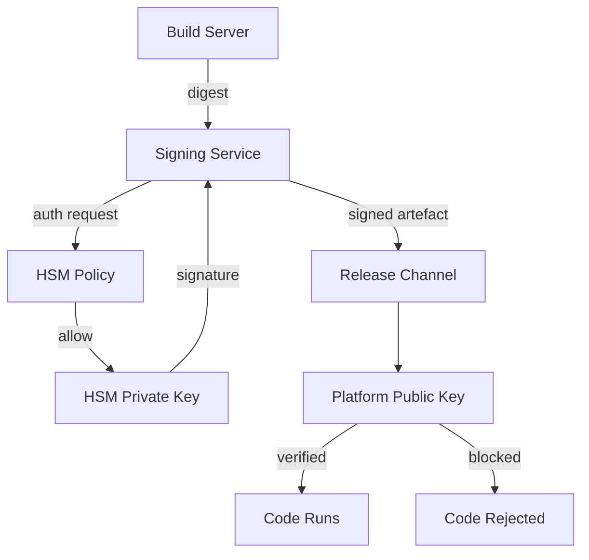

# Code Signing With an HSM: The Key That Decides What Runs

## English

Code signing keys are a special class of secret because they do not protect data — they protect the boundary between trusted and untrusted software. When an operating system, a package manager, or a mobile platform loads a binary, it checks a signature against a public key baked into the platform. If the signature verifies, the code runs with whatever privileges the platform grants; if not, it is blocked. That means a stolen code signing key lets an attacker produce malware that the world's devices will happily execute as if it came from the vendor. This is why code signing keys are among the most tightly guarded secrets in any software organisation, and why they are almost always held in an HSM.

The HSM's role here is narrower than people often assume. It does not build the software, hash it, or decide whether the build is trustworthy. It receives a digest — typically SHA-256 of the artefact — and returns a signature. The security property it provides is that the private key cannot be extracted, so even a compromised build server cannot exfiltrate it. The build server can still request signatures, so the real defence is the combination of HSM policy and the process around it: which identities may use the key, how many signatures per hour are allowed, and whether a human must approve each release.

Modern practice layers several controls on top. One is a dedicated signing service that sits between CI pipelines and the HSM, authenticating each request, checking that the artefact came from a known build, and logging the digest. Another is key separation: a different key for each product, platform, or release channel, so that compromise of one does not taint everything. A third is short-lived signing keys backed by a longer-lived root, so that a leaked release key has a bounded blast radius. The HSM enforces the cryptographic part of all of these, but the policy — what may be signed and by whom — lives in the surrounding system.

There is a practical subtlety around reproducibility and timestamping. Code signatures often include a timestamp so that the signature remains valid after the signing certificate expires. That timestamp is itself a signature from a timestamp authority, and in serious setups the timestamp authority's key is also in an HSM. The result is a chain of vault-backed signatures: the artefact, the timestamp, and the certificate chain all trace back to keys that never left a tamper boundary.

Finally, code signing is where the HSM's audit trail earns its keep. If a malicious binary is found signed with a vendor's key, the first question is whether the key leaked or the signing service was abused. The HSM's log — which identity requested which digest at what time — is often the only reliable answer. That log is why many organisations treat the signing HSM as a forensic asset, not just a cryptographic one.

## 中文

程式碼簽署金鑰是一類特別的秘密，因為它保護的不是資料，而是「可信軟體」與「不可信軟體」之間的界線。當作業系統、套件管理器或流動平臺載入一個二進位檔，它會用內建於平臺的公開金鑰去驗證簽章。驗證透過，程式就以平臺賦予的許可權執行；驗證失敗，就被攔截。換句話說，被偷走的程式碼簽署金鑰可以讓攻擊者製造出全世界裝置都會樂意執行的惡意程式，彷彿出自原廠。這就是為何程式碼簽署金鑰是軟體機構裡守得最緊的秘密之一，也幾乎總是由 HSM 保管。

HSM 在這裡的角色比一般人想像中窄。它不負責建構軟體、不負責計算雜湊、也不判斷這次建構是否可信。它接收一個摘要（通常是產物的 SHA-256），然後回傳簽章。它提供的安全性質是私鑰無法被抽出，所以即使建構伺服器被攻陷，也無法把金鑰帶走。可是建構伺服器仍然可以要求簽署，所以真正的防線是 HSM 策略加上圍繞它的流程：哪些身分可以使用該金鑰、每小時允許多少次簽署、以及每次釋出是否需要人手批准。

現代做法會再疊上幾層控制。第一層是專用的簽署服務，夾在 CI 管線與 HSM 之間，認證每個請求、檢查產物是否來自已知建構、並記錄摘要。第二層是金鑰分隔：每個產品、平臺或釋出通道用不同金鑰，令一個被攻陷不會汙染全部。第三層是以長壽根金鑰支撐的短命簽署金鑰，令洩漏的釋出金鑰影響範圍有界。HSM 負責執行這一切之中的密碼學部分，但「誰可以簽什麼」這種策略則住在周邊系統裡。

實務上還有一個關於可重現性與時間戳的細節。程式碼簽章通常附帶時間戳，令簽章在簽署憑證過期後仍然有效。那個時間戳本身又是時間戳機構的簽章，而在認真的部署裡，時間戳機構的金鑰同樣放在 HSM。結果是一條由保險庫支撐的簽章鏈：產物、時間戳、憑證鏈，全部追溯到從未離開防篡改邊界的金鑰。

最後，程式碼簽署正是 HSM 審計軌跡發揮價值的地方。若發現某個惡意二進位檔是用某廠商的金鑰簽署，第一個問題就是：金鑰洩漏了，還是簽署服務被濫用？HSM 的日誌——哪個身分在何時要求簽哪個摘要——往往是唯一可靠的答案。正因如此，很多機構視簽署用 HSM 為取證資產，而不只是密碼學資產。

## Key Takeaway

An HSM stops code signing keys from being stolen, but the trustworthiness of what gets signed depends on the policy and process wrapped around it.

## Related Concepts
- Code Signing
- Build Pipeline Integrity

## Diagram

