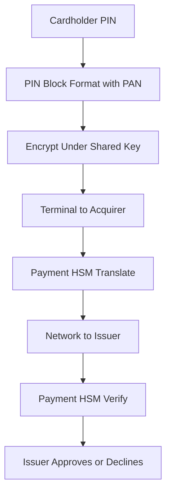

# Payment HSMs and PIN Blocks: Cryptography Under a Different Rulebook

## English

Most HSMs are general-purpose: they speak PKCS#11, hold keys for TLS or code signing, and are governed by the organisation that owns them. Payment HSMs are a different breed. They live in card payment networks — ATMs, point-of-sale terminals, card issuers, and the switches that route transactions — and they follow a separate standards ecosystem, historically driven by ANSI X9.24 and the PCI PIN Security requirements rather than by the generic PKI world. Their job is to protect the PIN, the four-to-twelve digit secret a cardholder types, as it travels from a terminal to the issuer that can verify it.

The core problem is that a PIN must be verified at the issuer, but it cannot travel in the clear. The solution is the PIN block: the PIN is combined with part of the card number (the PAN) using a defined format, then encrypted under a key shared between two parties in the payment chain. Different formats exist for different contexts (the ANSI and ISO 9564 families define several), and the choice of format matters because the combination with the PAN prevents two cards with the same PIN from producing the same block. The encrypted block then hops from terminal to acquirer to network to issuer, being translated — decrypted and re-encrypted under a different key — at each boundary.

This is where the payment HSM is essential. Translation means the PIN block must be decrypted and re-encrypted, and that operation must happen inside a tamper-responsive device that will erase its keys if opened. A general-purpose server cannot be trusted with this because the clear PIN would exist in memory. Payment HSMs implement a specific command set (often called the payment or POS command set) for translating PIN blocks between keys, verifying PINs against stored values, and generating and checking MACs on transaction messages. The keys involved are often called ZMKs (zone master keys) and ZPKs (zone PIN keys), and they are managed under rules that forbid export in the clear.

The standards shape the hardware in ways that surprise people coming from a PKI background. Payment HSMs are typically validated against FIPS 140 but also audited against PCI PIN Security, which imposes controls on key loading ceremonies, dual control, split knowledge, and physical security of the device. Key exchange between parties often uses manual methods — key components printed on paper, carried separately, entered by two custodians — precisely because the threat model assumes the network between organisations may be hostile. The HSM is designed to accept keys in component form and to never reveal them whole.

A useful way to think about it: a payment HSM is an HSM whose policy language is money. Every command has a financial consequence, and the standards exist to make sure that a single compromised device or a single dishonest insider cannot move funds or harvest PINs. The cryptography is familiar — triple-DES and AES in specific modes — but the operational discipline around it is far stricter than in most enterprise deployments, and that discipline is as much a part of the HSM as the silicon.

## 中文

大多數 HSM 是通用的：它們講 PKCS#11，為 TLS 或程式碼簽署保管金鑰，並由擁有它的機構管治。支付用 HSM 是另一個品種。它們活在卡支付網路裡——自動櫃員機、銷售點終端、發卡機構，以及路由交易的交換中心——並遵循另一套標準生態，歷史上由 ANSI X9.24 與 PCI PIN Security 要求推動，而非通用 PKI 世界。它們的職責是保護 PIN，即持卡人輸入的四至十二位數字秘密，由終端一路護送到能夠驗證它的發卡機構。

核心難題是：PIN 必須在發卡機構驗證，但不可以明文傳輸。解決方案就是 PIN block：PIN 用指定格式與卡號（PAN）的一部分結合，然後用支付鏈中兩方共享的金鑰加密。不同情境有不同格式（ANSI 與 ISO 9564 系列定義了好幾種），而格式的選擇很重要，因為與 PAN 結合可以防止兩張 PIN 相同的卡產生相同的 block。加密後的 block 便由終端跳到收單機構、網路、發卡機構，在每個邊界被「翻譯」——即解密再以另一條金鑰重新加密。

這正是支付用 HSM 不可或缺之處。翻譯意味著 PIN block 必須被解密再加密，而這個操作必須在一個一旦被開啟就會擦除金鑰的防篡改反應裝置內進行。通用伺服器不能託付此任，因為明文 PIN 會出現在記憶體裡。支付用 HSM 實作一套特定指令集（常稱為 payment 或 POS 指令集），用於在金鑰之間轉換 PIN block、對照已儲存值驗證 PIN、以及為交易訊息產生與檢查 MAC。涉及的金鑰常稱為 ZMK（zone master key）與 ZPK（zone PIN key），並在禁止明文匯出的規則下管理。

這些標準會以令 PKI 背景的人意外的方式塑造硬體。支付用 HSM 通常按 FIPS 140 驗證，但亦要按 PCI PIN Security 審計，後者對金鑰載入儀式、雙人控制、分割知識、以及裝置的實體安全施加控制。機構之間的金鑰交換往往採用手動方式——金鑰成分印在紙上、分開攜帶、由兩位保管人分別輸入——正因為威脅模型假設機構之間的網路可能是敵對的。HSM 被設計成接受成分形式的金鑰，並且永遠不會完整地洩露它們。

一個有用的想法：支付用 HSM 是一部「策略語言就是金錢」的 HSM。每條指令都有財務後果，而標準的存在就是確保單一被攻陷的裝置、或單一不誠實的內鬼，都不能轉移資金或收割 PIN。密碼學本身是熟悉的——特定模式下的 triple-DES 與 AES——但圍繞它的操作紀律比大多數企業部署嚴謹得多，而那份紀律與晶片本身一樣，都是 HSM 的一部分。

## Key Takeaway

Payment HSMs are not just general HSMs with card keys; their command set, key ceremonies, and standards exist to make PIN handling auditable and financially safe.

## Related Concepts
- PIN Block
- PCI PIN Security

## Diagram

