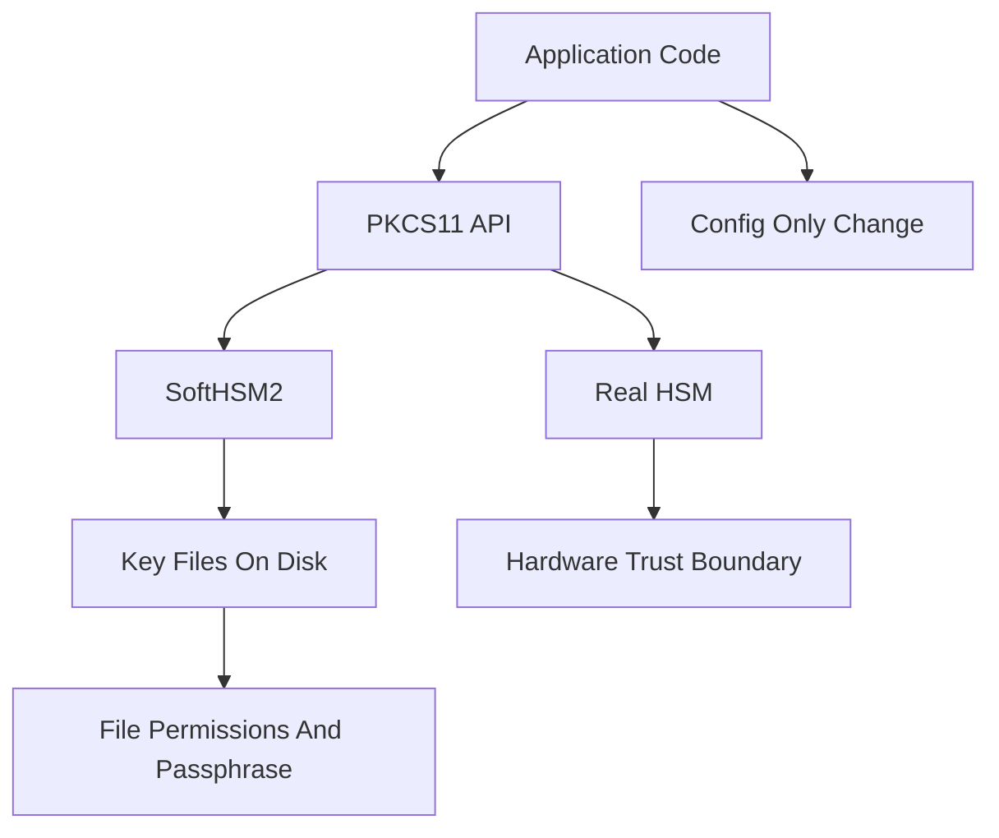

# Virtual HSMs and SoftHSM: Emulating the Vault in Software

## English

A virtual HSM (sometimes called a soft HSM) is a software program that behaves like an HSM: it stores keys in files, exposes the same PKCS#11 interface, enforces access rules, and lets applications call it as if it were a real appliance. SoftHSM2 is the best-known open-source example; it is widely used in development, CI pipelines, and test suites so that engineers can exercise their PKCS#11 code without buying hardware or paying for a cloud partition. The crucial point to internalise is that a soft HSM provides the API and the workflow but not the security guarantee — the key material lives in an ordinary file on an ordinary disk, protected only by file permissions and, if configured, a passphrase-derived wrapping key.

Think of the difference the way you would think of a flight simulator versus a real aircraft. The simulator lets a pilot rehearse every checklist, every switch, every emergency drill, and it is genuinely valuable for that. But nobody claims the simulator keeps passengers safe. A soft HSM is exactly this: it lets you rehearse the operational choreography — sessions, logins, object attributes, mechanism selection, error codes — so that when you point the same code at a real HSM in production, the only variable that changes is the endpoint and the credentials.

The reason this matters architecturally is that it forces a clean separation between the API surface and the trust boundary. If your application can run against SoftHSM2 in tests and against a network HSM in production with only configuration changes, you have proven that your code does not depend on any property of the hardware other than what the API promises. That is a healthy design. If, on the other hand, your code reaches into vendor-specific extensions or assumes the key is a file it can read, the test environment will happily let you do it and production will fail — or worse, silently weaken.

There are also traps. Teams sometimes deploy a soft HSM into production because it works and it is cheap, and then discover that the threat model has collapsed: anyone who can read the disk has the keys, backups are just file copies, and there is no tamper response at all. Some soft HSMs do offer protections — encrypted token stores, PIN policies, audit logs — but they are enforced by software the attacker may also control. Treat a soft HSM as a development and testing tool, and if you must use one in production, be explicit that you have accepted a software-level threat model.

A practical pattern is to build an abstraction layer or use a library that speaks PKCS#11 generically, then run the same integration tests against SoftHSM2 in CI, against a staging HSM partition before release, and against the production cluster. This catches the class of bugs that only appear at the boundary — handle reuse, session limits, mechanism quirks — while keeping the expensive hardware out of the inner development loop.

## 中文

虛擬 HSM（有時稱為軟件 HSM）是一個模擬 HSM 行為的軟件程式：它把金鑰存放在檔案中，對外提供相同的 PKCS#11 介面，執行存取規則，讓應用程式好像對著真實設備一樣呼叫它。SoftHSM2 是最知名的開源例子，廣泛用於開發、CI 流水線和測試套件，讓工程師毋須購買硬件或租用雲端分區，也能演練 PKCS#11 程式碼。必須牢牢記住的重點是：軟件 HSM 提供的是 API 和工作流程，而不是安全保證——金鑰材料只是存放在普通磁碟上的普通檔案，僅靠檔案權限，以及（若有設定）由密碼短語衍生的包裝金鑰來保護。

可以用飛行模擬器和真實飛機來理解這個分別。模擬器讓機師演練每一項檢查清單、每一個開關、每一個緊急程序，對訓練確實有價值；但沒有人會主張模擬器能保障乘客安全。軟件 HSM 正是如此：它讓你演練操作的編排——工作階段、登入、物件屬性、機制選擇、錯誤碼——這樣當你把同一份程式碼指向生產環境的真實 HSM 時，唯一改變的變數就是端點和憑證。

這件事在架構上之所以重要，是因為它迫使你把 API 表面和信任邊界清楚分開。如果你的應用程式可以在測試中對著 SoftHSM2 運行，在生產中對著網絡 HSM 運行，而只需改動配置，那就證明你的程式碼不依賴硬件的任何特性，只依賴 API 所承諾的東西。這是健康的設計。反過來說，如果你的程式碼伸手去用廠商專屬擴展，或者假設金鑰是一個它讀得到的檔案，測試環境會樂於讓你這樣做，而生產環境就會失敗——或者更糟，悄悄地削弱了安全性。

陷阱也不少。團隊有時因為軟件 HSM 能用又便宜，就把它部署到生產，然後才發現威脅模型已經崩塌：任何讀得到磁碟的人就等於持有金鑰，備份只是檔案複製，完全沒有篡改回應。有些軟件 HSM 確實提供保護——加密的權杖儲存、PIN 政策、稽核日誌——但這些都是由攻擊者可能同樣控制的軟件來執行。把軟件 HSM 當作開發和測試工具；若真的要在生產使用，就要明確承認你接受了一個軟件層級的威脅模型。

一個實用的模式是建立抽象層，或使用能通用地講 PKCS#11 的程式庫，然後在 CI 中對 SoftHSM2 跑同一套整合測試，發佈前對預備環境的 HSM 分區跑一次，生產則對著正式叢集。這樣就能捕捉只在邊界出現的一類錯誤——控制代碼重用、工作階段上限、機制怪癖——同時讓昂貴的硬件遠離日常開發循環。

## Key Takeaway

A virtual HSM like SoftHSM2 faithfully reproduces the PKCS#11 workflow but not the security guarantee, so use it to rehearse operations and never mistake it for a trust boundary.

## Related Concepts
- PKCS#11 API
- Threat modelling

## Diagram

