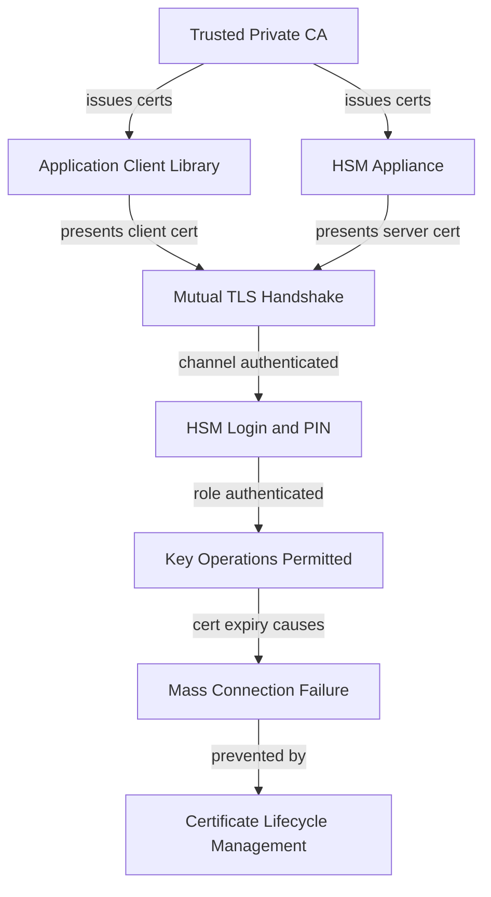

# HSM as a Mutual-TLS Client and Server: The Vault That Authenticates Itself

## English

When an HSM is a network appliance, the connection between your application and the vault is itself a cryptographic relationship that has to be authenticated in both directions. Most modern HSMs support mutual TLS (mTLS): the client library presents a client certificate to prove which application is calling, and the HSM presents its own certificate so the client can verify it is talking to the genuine appliance and not to an impostor on the network. This is a distinct layer from the HSM's own login and PIN mechanism — mTLS authenticates the channel and the client identity, while the HSM login authenticates the operator or application role inside the vault. Both must succeed before a key operation is permitted.

Why does this matter so much? Because an HSM is a high-value target and the network path to it is a classic man-in-the-middle opportunity. If a client library accepted any certificate, an attacker who could redirect traffic — via DNS poisoning, ARP spoofing on a flat network, or a compromised router — could stand between the application and the vault, terminate the TLS connection, and relay requests. The attacker would not learn the key (that never leaves the HSM), but they could observe which operations are performed, replay or reorder requests, and potentially harvest signed outputs. mTLS with proper certificate pinning or a private CA closes that door: the client refuses to talk to anything that does not hold a certificate issued by the trusted CA for that HSM.

The certificate lifecycle is the operational headache. Client certificates expire, and when they do, every application using that certificate fails to connect at once — a classic outage that is entirely preventable. Mature deployments treat HSM client certificates like any other production credential: they are issued by an internal CA, they are rotated on a schedule well before expiry, they are monitored for expiration with alerts, and the rotation is rehearsed. Some organisations use short-lived certificates and automated issuance to reduce the blast radius of a leaked client key, at the cost of more moving parts.

There is also a subtle trust question about the HSM's own certificate. How does the client know the certificate truly belongs to the appliance and not to a device that has been swapped in? In high-assurance settings the answer is a combination of a private CA that only issues to known HSM serial numbers, plus physical controls on the data centre, plus the HSM's own tamper-evident seals. The certificate binds an identity to a public key; the operational controls bind that identity to a physical object you can inspect.

A useful mental model is that the network path to an HSM is a tunnel with a locked door at each end. mTLS is the lock at the client end and the lock at the server end; the HSM login is the locked cabinet inside the room. All three have to be intact. When you design or review an HSM integration, ask explicitly: what certificate does the client trust, how is it pinned, when does it expire, and who can issue a replacement? If any of those answers is vague, the tunnel has a weak door.

## 中文

當 HSM 是一部網絡設備時，應用程式與金庫之間的連線本身就是一種密碼學關係，必須雙向認證。多數現代 HSM 支援雙向 TLS（mTLS）：客戶端程式庫出示客戶端憑證，證明是哪個應用程式在呼叫；HSM 亦出示自己的憑證，讓客戶端核實自己正在與真品設備通訊，而不是網絡上的冒牌貨。這與 HSM 本身的登入和 PIN 機制屬於不同層次——mTLS 認證通道和客戶端身分，而 HSM 登入則認證金庫內的操作者或應用程式角色。兩者都必須成功，金鑰操作才會被允許。

為何這件事如此重要？因為 HSM 是高價值目標，而通往它的網絡路徑正是典型的中間人攻擊機會。如果客戶端程式庫接受任何憑證，能夠改寫流量的攻擊者——透過 DNS 投毒、在扁平網絡上做 ARP 詐騙，或攻陷路由器——就可以站在應用程式與金庫之間，終止 TLS 連線並轉發請求。攻擊者不會得到金鑰（金鑰永不離開 HSM），但可以觀察執行了哪些操作、重播或重排請求，甚至收集簽署輸出。配合妥善的憑證釘選或私有 CA，mTLS 就能堵住這道門：客戶端拒絕與任何不持有該 HSM 受信任 CA 所簽發憑證的對象通話。

憑證生命週期才是營運上的頭痛之處。客戶端憑證會過期，一旦過期，所有使用該憑證的應用程式會同時連不上——這是完全可以避免的典型事故。成熟的部署會把 HSM 客戶端憑證當作一般生產憑證處理：由內部 CA 簽發、在到期前按計劃輪換、設定到期監控與告警，並且演練輪換流程。有些機構採用短壽命憑證配合自動簽發，以縮小客戶端金鑰洩漏的影響範圍，代價是更多活動部件。

關於 HSM 自身憑證，還有一個微妙的信任問題：客戶端怎知這張憑證真的屬於該設備，而不是屬於被偷偷換上的另一部裝置？在高保證環境中，答案是幾項措施並用：只向已知 HSM 序號簽發憑證的私有 CA、數據中心的物理管控，以及 HSM 本身的防篡改封條。憑證把身分綁定到公鑰；營運管控則把該身分綁定到你親眼可檢查的實物。

一個有用的心智模型是：通往 HSM 的網絡路徑是一條兩端各有一道鎖的隧道。mTLS 是客戶端一端和伺服器一端的鎖；HSM 登入則是房間內那個上了鎖的櫃。三道鎖都必須完好。當你設計或審查 HSM 整合時，要明確問：客戶端信任哪張憑證、如何釘選、何時到期、誰有權簽發替換憑證？如果任何一個答案含糊，這條隧道就有一道弱門。

## Key Takeaway

Mutual TLS authenticates both ends of the HSM connection and is a separate layer from HSM login, so both must be designed, rotated, and monitored deliberately.

## Related Concepts
- Mutual TLS
- Certificate lifecycle management

## Diagram

