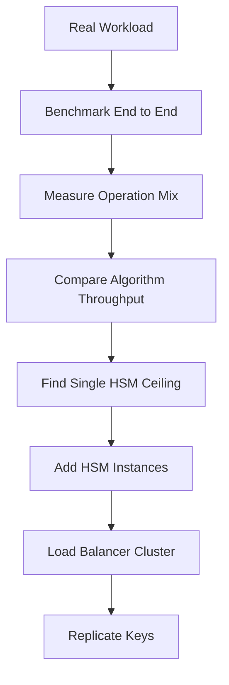

# HSM Throughput in Practice: Benchmarking and Sizing the Vault

## English

Every HSM has a finite rate at which it can perform operations, and that rate depends on the operation. A symmetric AES-GCM encryption might run at tens of thousands of operations per second on a mid-range appliance, while an RSA-2048 signature might be a few thousand per second, and an RSA-4096 signature an order of magnitude slower still. Elliptic-curve operations sit somewhere in between and vary by curve. These numbers are not interchangeable, and a vendor datasheet that quotes a single figure without saying which algorithm and which key size is telling you very little. Sizing an HSM means matching the mix of operations your workload actually performs against measured throughput for that mix.

The first practical step is to benchmark with your real workload, not a vendor's synthetic one. Measure the operations your application issues — session opens, logins, key lookups, the actual cryptographic calls — and measure them end-to-end through the client library over the real network path, because the network round trip often dominates. A signature that takes 200 microseconds inside the HSM may take 2 milliseconds end-to-end once you include TLS, request serialisation, and queueing. If your application performs ten thousand signatures per second and each round trip costs 2 milliseconds, you need concurrency, and concurrency on a single HSM is bounded by its session and connection limits.

This leads to the second lesson: throughput scales by adding HSM instances, not by making one HSM faster. Most appliances have a fixed ceiling, and the way to exceed it is a cluster behind a load balancer, with keys replicated across members so any node can serve any request. That is why HSM clustering exists. But clustering introduces its own costs: key synchronisation traffic, split-brain risk if the network partitions, and the need for consistent policy across nodes. The cluster is a throughput and availability mechanism, and it should be sized with headroom for the failure of one member.

The third lesson is about the shape of the workload. Bulk data encryption — encrypting gigabytes of files or database pages — is almost never done inside the HSM. Instead, the HSM generates or unwraps a data key, hands it to the application, and the application uses that key with a fast software cipher. This is the envelope pattern, and it exists precisely because the HSM is a scarce resource that should be reserved for the operations that truly need the boundary: wrapping keys, signing, and the occasional high-value operation. If you find your HSM saturated with bulk encryption, the architecture is probably wrong.

Finally, capacity planning must account for peaks and for retries. A payment system on a busy day may issue several times its average load, and a failed request that is retried doubles the load on a struggling HSM. Design for the peak, add a queue with bounded depth so that overload produces clean backpressure rather than timeouts, and monitor latency percentiles rather than averages — the tail is where the user experience lives. A well-sized HSM deployment has a clear answer to the question: what happens on the worst hour of the year?

## 中文

每一部 HSM 都有有限的運算速率，而這個速率取決於操作型別。對稱的 AES-GCM 加密在中階裝置上可能每秒執行數萬次，而 RSA-2048 簽章可能每秒只有數千次，RSA-4096 簽章還要再慢一個數量級。橢圓曲線運算介乎兩者之間，並因曲線而異。這些數字不能互換，廠商規格表若只給出一個數字而不說明是哪種演演算法、哪種金鑰長度，其實資訊量很低。為 HSM 選型，就是把你工作負載實際執行的操作組合，對應到該組合的實測吞吐量。

第一個實務步驟是用真實工作負載做基準測試，而不是用廠商的合成測試。量度你的應用程式發出的操作——開啟工作階段、登入、查詢金鑰、真正的密碼學呼叫——並且經由真實網路路徑、透過客戶端程式庫做端到端量度，因為網路來回時間往往佔主導。在 HSM 內部耗時 200 微秒的簽章，計入 TLS、請求序列化和排隊之後，端到端可能要 2 毫秒。如果你的應用程式每秒要做一萬次簽章，而每次來回要 2 毫秒，你就需要並行；而單一 HSM 上的並行受其工作階段和連線上限所限。

這帶出第二課：吞吐量是靠增加 HSM 例項來擴充套件，而不是靠令單一 HSM 更快。多數裝置有固定上限，要超越它就要在負載平衡器後面架設叢集，並把金鑰複製到各成員，讓任何節點都能服務任何請求。這就是 HSM 叢集存在的原因。但叢集本身也有代價：金鑰同步流量、網路分割槽時的腦裂風險，以及各節點政策必須一致。叢集是吞吐量和可用性的機制，選型時應預留一個成員故障的餘裕。

第三課關乎工作負載的形狀。大量資料加密——加密數以 GB 計的檔案或資料庫頁——幾乎從不在 HSM 內進行。相反，HSM 產生或解封一把資料金鑰，交給應用程式，應用程式再用快速的軟體密碼對資料加密。這就是信封模式，它存在的理由正是 HSM 是稀缺資源，應保留給真正需要邊界的操作：包裝金鑰、簽章，以及偶爾的高價值操作。如果你發現 HSM 被大量加密塞滿，架構大概出了問題。

最後，容量規劃必須考慮高峰和重試。支付系統在繁忙日子可能發出數倍於平均的負載，而失敗後重試的請求會令本來已吃力的 HSM 負載倍增。要為高峰設計，加上有界深度的佇列，讓超載產生乾淨的背壓而不是逾時，並且監控延遲的百分位而不是平均值——尾部才是使用者體驗所在。一個選型良好的 HSM 部署，對「一年中最差的那一小時會怎樣」應該有清楚的答案。

## Key Takeaway

Size an HSM by benchmarking your real operation mix end-to-end, then scale throughput with a cluster and reserve the vault for operations that genuinely need the boundary.

## Related Concepts
- Envelope encryption
- Load balancing and clustering

## Diagram

