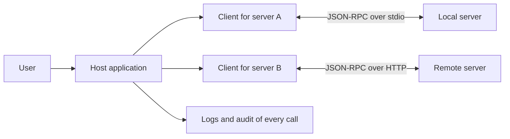

# MCP Architecture: Hosts, Clients, Servers, and JSON-RPC

### English

The Model Context Protocol (MCP) is a client-server protocol that lets an application (the host) connect to external systems (the servers) in a standard way. Think of it as a universal adapter between AI applications and the outside world, in the same way that USB standardised how peripherals connect to computers. MCP does not define any model, and it does not define what a tool actually does — it defines the conversation between the pieces.

There are three roles. The **host** is the application the user interacts with: it owns the user interface, decides when to reach outside for information, and holds the user's context and permissions. The **client** is a component inside the host; MCP gives each server its own client connection, so the host can multiplex several servers without their conversations interfering. The **server** is the process that exposes capabilities — a file system, a database, a ticketing system, a code repository. Servers can run locally on the same machine (over standard input and output) or remotely over HTTP, and the host treats both the same way.

All communication uses JSON-RPC 2.0, a JSON-based remote procedure call format. Each request has a `method` (a string naming the operation), optional `params`, and an `id` (a number or string that correlates the response). The server answers with either a `result` object or an `error` object carrying a code and message. If a request has no `id`, it is a notification: the server acts on it but sends nothing back, which is how progress updates and log messages are delivered without cluttering the channel. On top of JSON-RPC, MCP defines its own lifecycle methods, including `initialize` (where client and server exchange protocol version and capabilities) and `notifications/initialized`, plus the listing and calling methods for each primitive.

Because the protocol is JSON and stateless-looking, everything — capability lists, tool arguments, results — is plain JSON text. That makes it easy to log, inspect, cache, and reimplement in any language, at the cost of a little verbosity compared with a compact binary format.

### 中文

Model Context Protocol（MCP）是一套 client-server 協議，讓應用程式（host）可以用標準方式連接外部系統（server）。可以把它想像成 AI 應用與外在世界之間的通用轉接器，就像 USB 統一了周邊裝置與電腦的連接方式。MCP 不定義任何模型，也不定義工具實際做甚麼——它定義的是各個部分之間的對話方式。

角色有三個。**Host** 是用戶實際操作的應用程式：它負責介面、決定何時需要向外取資料，並持有用戶的脈絡與權限。**Client** 是 host 內部的元件；MCP 會為每個 server 配上一條獨立的 client 連線，令 host 能同時處理多個 server 而互不干擾。**Server** 則是提供能力的行程——檔案系統、資料庫、工單系統、程式碼倉庫。Server 可以與 host 同機運行（透過標準輸入與輸出），也可以透過 HTTP 遠端運行，而 host 對兩者一視同仁。

所有通訊都採用 JSON-RPC 2.0，一種以 JSON 為基礎的遠端程序呼叫格式。每個請求包含 `method`（指明操作名稱的字串）、可選的 `params`，以及 `id`（用來把回應與請求對應的數字或字串）。Server 會以 `result` 物件或帶有代碼與訊息的 `error` 物件作答。若請求沒有 `id`，它就是一個 notification：server 執行但不回傳內容——progress 更新與紀錄訊息就是用這種方式傳遞，以免污染主通道。在 JSON-RPC 之上，MCP 定義了自己的生命週期方法，包括 `initialize`（client 與 server 交換協議版本與能力）與 `notifications/initialized`，以及各類 primitive 的列出與呼叫方法。

因為協議是 JSON、而且看似無狀態，所以所有東西——能力清單、工具參數、結果——都是純文字 JSON。這使得紀錄、檢視、快取，以及用任何語言重新實作都非常容易，代價是比緊湊的二進位格式多一點冗長。

## Key Takeaway
MCP is a JSON-RPC conversation between a host that owns the user and a client-per-server inside it, and the server that supplies capabilities — which is why the same protocol works for local and remote servers alike.

## Related Concepts
- JSON-RPC 2.0
- Capability Negotiation
- Standard Input and Output Transport
- Tool Discovery

## Diagram

