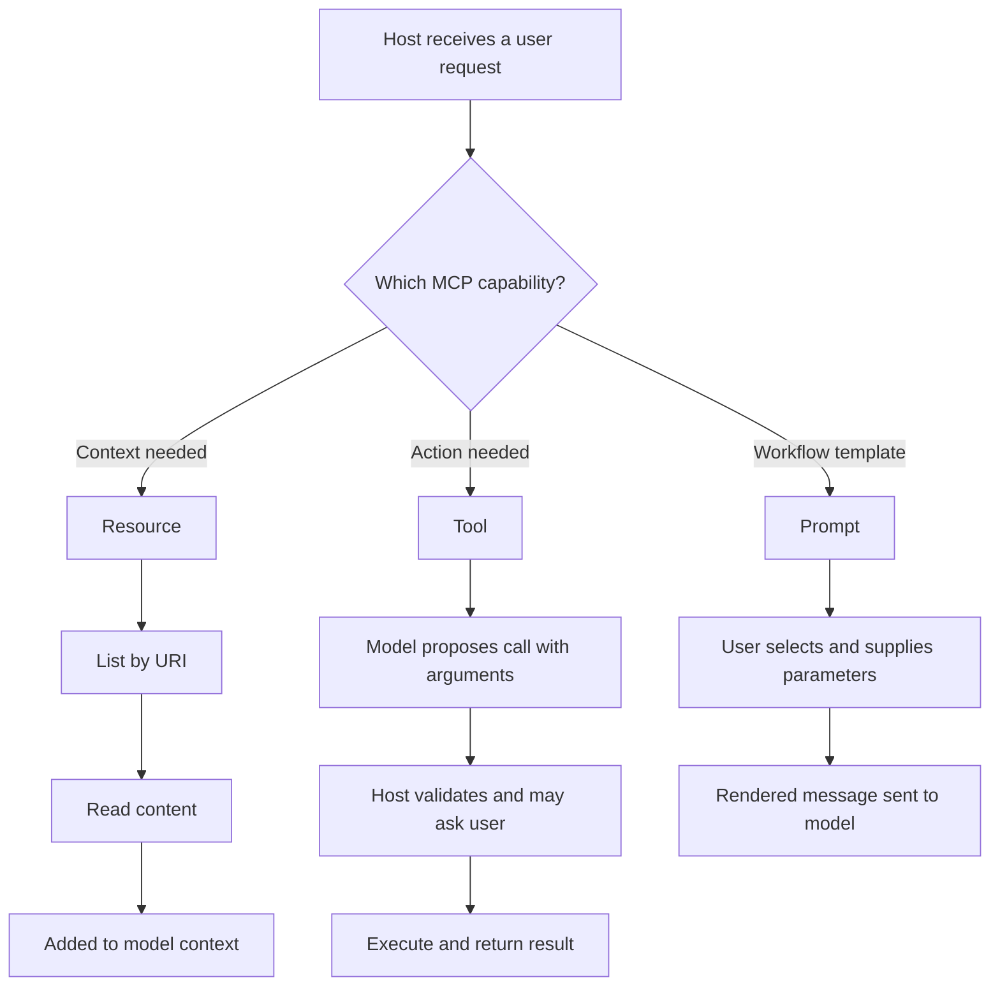

# Resources, Prompts, and Tools in the Model Context Protocol

### English

MCP exposes three kinds of capability, and the distinction between them is the most important thing to understand about the protocol. A **resource** is read-only context: a file, a database row, a log, a web page. Resources are identified by URI, for example `file:///project/readme.md` or `postgres://db/orders/42`, and the client can list and read them. The key idea is that resources are data the application chooses to put into context, and the model does not decide to fetch them on its own.

A **tool** is an operation the model can invoke: something with side effects or computation, such as searching a codebase, sending an email, or creating a ticket. Tools are described by a JSON Schema that tells the host the tool's name, what arguments it takes, and what it returns. The model proposes a call, the host executes it, and the result comes back as text or structured content. Because tools can change state, hosts typically require some form of user confirmation, and permissions are scoped per tool.

A **prompt** is a reusable template — a named, parameterised message that a user can invoke to trigger a particular interaction, such as "summarise this incident" or "draft a release note from these commits". Prompts are server-provided suggestions for how the server's capabilities should be used; they are not automatic, and they are usually surfaced to the user as a slash command or a menu entry.

The pattern to remember is: resources supply content, tools perform actions, prompts suggest workflows. The split exists partly for safety and partly for performance — listing resources is cheap and can be filtered by type, while listing tools is a smaller set because each one carries an execution risk. A well-designed server exposes many resources and a small number of well-scoped tools, because each additional tool increases the chance that the model picks the wrong one or that a prompt injection smuggles in an unwanted action.

### 中文

MCP 提供三類能力，當中三者的分別是最需要理解的觀念。**Resource**（資源）是唯讀的脈絡：一個檔案、一列資料、一段紀錄、一個網頁。資源以 URI 識別，例如 `file:///project/readme.md` 或 `postgres://db/orders/42`，client 可以列出並讀取。關鍵在於，資源是應用程式決定放進 context 的資料，模型不會自行決定去抓取它們。

**Tool**（工具）是模型可以呼叫的操作：帶有副作用或需要運算的動作，例如搜尋程式碼庫、寄出電郵、建立工單。工具以 JSON Schema 描述，讓 host 知道工具名稱、需要的引數，以及回傳什麼。模型提出呼叫，host 執行，結果以文字或結構化內容回到模型。因為工具可以改變狀態，host 通常會要求某種形式的用戶確認，並按工具逐一設定權限。

**Prompt**（提示）則是可重用的模板——具名且帶參數的訊息，使用者可以叫它來啟動特定互動，例如「總結這宗事故」或「根據這些 commit 草擬 release note」。Prompt 是 server 提供的建議用法，並非自動執行，通常會以斜線指令或選單項目的形式呈現給用戶。

要記住的模式是：資源提供內容，工具執行動作，提示建議工作流程。這個劃分部分出於安全考慮，部分出於效能——列出資源成本低並可按類型過濾，而列出工具的數量較少，因為每一個都附帶執行風險。設計良好的 server 會提供大量資源和少量範圍明確的工具，因為每多一個工具，模型選錯或提示注入挾帶了不必要動作的機會就會增加。

## Key Takeaway
Resources are read-only context, tools are model-invoked actions with side effects, and prompts are reusable templates — a split that keeps context cheap, tool lists small, and risk manageable.

## Related Concepts
- JSON Schema
- Context Window
- Prompt Injection
- Least Privilege

## Diagram

