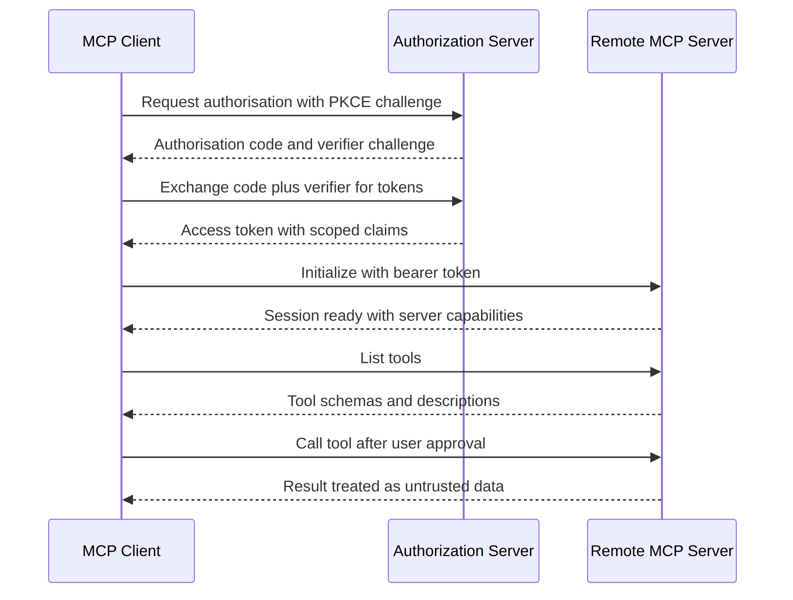

# Transports, Remote MCP Servers, and Security

### English

MCP defines two transports. **stdio** launches the server as a child process and speaks JSON-RPC over the server's standard input and standard output — one JSON-RPC message per line, with logging deliberately sent to standard error so it never corrupts the protocol stream. This is the simplest and most secure option for local tools: there is no network, no port, and no listening socket, and the server inherits the user's own permissions on their own machine. The downside is that the server must be installed locally and runs only while the host runs it.

The HTTP transport runs the server as a web service and carries the same JSON-RPC messages inside HTTP requests. The original design used HTTP with Server-Sent Events (SSE) — one stream for client-to-server requests, one for server-to-client messages. The newer **Streamable HTTP** transport simplifies this to a single endpoint that accepts POST requests and can return either a JSON response or a stream, which is easier to load balance and works better with proxies. In both cases the transport is just plumbing; the semantics above it are identical.

Remote servers bring authentication and authorisation problems that stdio avoids. The emerging convention is **OAuth 2.1** with **PKCE**: the client obtains authorisation from an identity provider, and because a bare bearer token could be replayed from a malicious server, the client also proves possession of a secret it never transmits. Authorisation is then expressed in OAuth scopes or in the server's own token claims — which tools may be called, which directories may be read. Servers should also require an `Origin` header check and use anti-forgery tokens to prevent attacks from a malicious web page, and hosts should display clearly which server a tool comes from.

Security is the area where MCP has been most scrutinised, and the failures are well documented. The classic pattern is **confused deputy**: a tool that can read arbitrary files will happily return a `.env` file or a private key if the model's instructions are steered to ask for it. Tool poisoning is the other — a server's tool description contains hidden instructions that the model reads and follows. The mitigations that have emerged are a layered defence: require explicit user approval for sensitive operations, restrict tools to narrow, well-scoped directories, show the source of every tool result, and treat any content read from a tool as untrusted data rather than as instructions.

### 中文

MCP 定義了兩種傳輸方式。**stdio** 把 server 啟動為子程序，並透過其標準輸入與標準輸出傳送 JSON-RPC——每行一個 JSON-RPC 訊息；紀錄一律寫到標準錯誤，確保不會污染協定串流。這是本地工具最簡單也最安全的做法：沒有網絡、沒有連接埠、沒有監聽 socket，而且 server 直接沿用用戶本身的權限。缺點是 server 必須在本地安裝，並且只在 host 運行期間存在。

HTTP 傳輸則把 server 當成網頁服務執行，在 HTTP 請求內承載同樣的 JSON-RPC 訊息。原本的設計採用 HTTP 加 Server-Sent Events（SSE）——一條串流處理 client 到 server 的請求，另一條處理 server 到 client 的訊息。較新的 **Streamable HTTP** 傳輸簡化為單一端點，可接受 POST 請求並回傳 JSON 或串流，更容易負載平衡，也更適合行經 proxy。兩種情況下，傳輸層只是管道；其上的語義完全相同。

遠端 server 帶來 stdio 得以避免的認證與授權問題。逐漸成為慣例的做法是 **OAuth 2.1** 搭配 **PKCE**：client 向身分提供者取得授權；由於單純的 bearer token 可能被惡意 server 重播，client 還需證明自己持有從不傳送的祕密。授權則以 OAuth scope 或 server 自身的 token claims 表述——哪些工具可呼叫、哪些目錄可讀取。Server 應檢查 `Origin` 標頭，並使用防偽造 token，以免惡意網頁發動攻擊；host 則應清楚顯示每個工具的來源。

安全是 MCP 受審視最嚴謹的範疇，而相關漏洞已有充分記錄。經典模式是**混淆代理（confused deputy）**：一個能讀取任意檔案的工具，若模型的指示被誘導去索取 `.env` 檔或私鑰，它會照樣交出。工具投毒（tool poisoning）是另一種——server 的工具描述內藏指示，模型讀到後便照做。逐步浮現的緩解方式是分層防禦：敏感操作要求用戶明確批准、把工具限制在範圍明確的目錄、清楚顯示每項工具結果的來源，並把工具讀到的內容視為不可信資料而非指令。

## Key Takeaway
MCP's two transports carry identical semantics but very different risk profiles — stdio is local and permission-inherited, while remote HTTP servers need OAuth with PKCE, scoped tokens, and layered defences against confused-deputy and tool-poisoning attacks.

## Related Concepts
- OAuth 2.1 and PKCE
- Server-Sent Events (SSE)
- Confused Deputy Problem
- Prompt Injection

## Diagram

