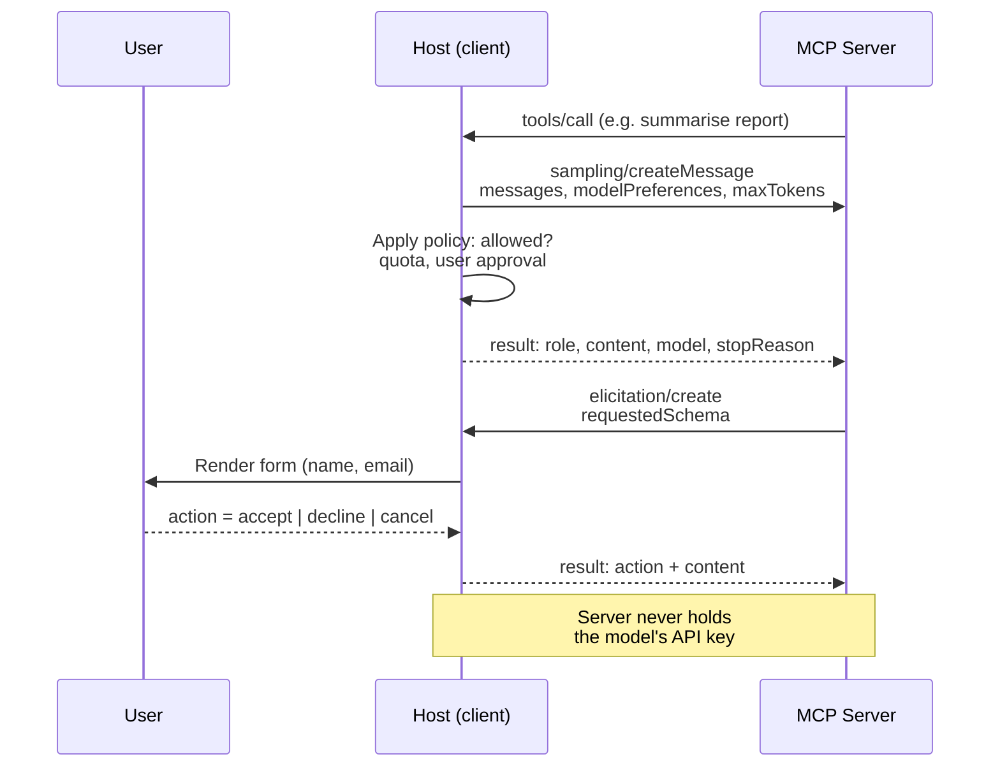

# Sampling and Elicitation: How a Server Calls Back Into the Client

### English

Most of MCP flows in one direction: the model decides it needs something, calls a tool, and the server returns data. But the 2025-06-18 revision added two client-side features that turn the protocol from a one-way request channel into a genuine two-way conversation. **Sampling** lets a server ask the client's language model to generate text, audio or an image. **Elicitation** lets a server ask the *user* for structured information. Both are "server calls client" operations, and both are capability-negotiated, meaning the client must explicitly declare support during `initialize` before a server may use them.

Sampling is the more interesting of the two, because it lets servers be agentic without holding model API keys. Consider a server that reads a large codebase, or one that processes a batch of documents: instead of shipping its own LLM integration (and its own API key, which would be a security liability sitting in the server's configuration), it sends a `sampling/createMessage` request back through the client, and the client performs the model call using the end user's own model access. The request carries messages, an optional `systemPrompt`, a `maxTokens` limit, and a `modelPreferences` object with hints such as `intelligencePriority` and `speedPriority` — the server expresses a preference, but the client remains in control of which model is actually used and of the end user's quota and cost.

```json
{
  "jsonrpc": "2.0",
  "id": 1,
  "method": "sampling/createMessage",
  "params": {
    "messages": [
      { "role": "user",
        "content": { "type": "text", "text": "Summarise this incident report" } }
    ],
    "modelPreferences": {
      "hints": [{ "name": "claude-3-sonnet" }],
      "intelligencePriority": 0.8,
      "speedPriority": 0.5
    },
    "systemPrompt": "You are a helpful assistant.",
    "maxTokens": 100
  }
}
```

The response mirrors the same shape as a normal model turn: `role`, `content`, the `model` that was actually used, and a `stopReason`. The `model` field matters — it lets the client and the end user see which model answered, which is essential when a server's hint was only a preference.

Elicitation is the human-in-the-loop counterpart. A server sends `elicitation/create` with a `requestedSchema` (a JSON Schema) describing what it needs, and the client presents it to the end user in whatever way it likes — a form, a prompt, a chat bubble. The user then responds with one of three actions: `accept` (with the data matching the schema), `decline`, or `cancel`. The three-way distinction is deliberate: `decline` means "I don't want to provide this", `cancel` means "I want to abort the whole operation", and a well-behaved server must treat them differently — declining one field of a multi-field schema should not abort the flow.

```json
{
  "jsonrpc": "2.0",
  "id": 2,
  "method": "elicitation/create",
  "params": {
    "message": "Please provide your contact information",
    "requestedSchema": {
      "type": "object",
      "properties": {
        "name":  { "type": "string" },
        "email": { "type": "string", "format": "email" },
        "age":   { "type": "number", "minimum": 18 }
      },
      "required": ["name", "email"]
    }
  }
}
```

The security implications are worth dwelling on, because these features can be abused. A malicious or compromised server could use sampling to burn the end user's model quota, or use elicitation to phish for credentials by asking for "your API key to continue". The spec's mitigations are structural: the client decides whether to honour a sampling request at all, the end user must be able to see and refuse the request, and hosts are expected to apply their own policy about which servers are permitted to sample. A server that receives an elicitation request for a credential must never have it treated as a normal field, and a client that renders elicitation requests should make it obvious that they come from the server rather than from the assistant.

### 中文

MCP 的大部分流程都是單向的：模型判斷需要甚麼，呼叫工具，伺服器回傳資料。但 2025-06-18 版本加入了兩項 client 端功能，令協定由單向請求通道變成真正的雙向對話。**Sampling** 讓伺服器反向要求 client 的語言模型生成文字、音訊或圖像。**Elicitation** 讓伺服器反向向 *使用者* 索取結構化資料。兩者都是「伺服器呼叫 client」的操作，而且都經過能力協商——client 必須在 `initialize` 階段明確宣告支援，伺服器方可使用。

Sampling 是兩者之中較有意思的，因為它讓伺服器可以具備代理能力而毋須持有模型 API 金鑰。試想一個讀取大型程式碼庫的伺服器，或一個批次處理文件的伺服器：與其在伺服器內自帶一套 LLM 整合（連同自己的 API 金鑰，那會是躺在設定檔裡的安全隱患），不如它經 client 送出 `sampling/createMessage` 請求，由 client 用使用者本身擁有的模型存取權完成該次模型呼叫。請求內含訊息、可選的 `systemPrompt`、`maxTokens` 上限，以及 `modelPreferences` 物件（帶有 `intelligencePriority`、`speedPriority` 等提示）——伺服器表達偏好，但實際使用哪個模型、使用者的額度與成本，全部仍由 client 掌握。

```json
{
  "jsonrpc": "2.0",
  "id": 1,
  "method": "sampling/createMessage",
  "params": {
    "messages": [
      { "role": "user",
        "content": { "type": "text", "text": "Summarise this incident report" } }
    ],
    "modelPreferences": {
      "hints": [{ "name": "claude-3-sonnet" }],
      "intelligencePriority": 0.8,
      "speedPriority": 0.5
    },
    "systemPrompt": "You are a helpful assistant.",
    "maxTokens": 100
  }
}
```

回應的結構與一般模型回合相同：`role`、`content`、實際使用的 `model`，以及 `stopReason`。`model` 欄位很重要——它讓 client 與使用者知道是哪個模型作答，而伺服器的 hint 畢竟只是一項偏好。

Elicitation 是「人在回路」那一半。伺服器送出 `elicitation/create`，附上描述所需內容的 `requestedSchema`（一個 JSON Schema），client 再以自己方便的方式呈現給使用者——表單、提示、聊天訊息皆可。使用者隨後以三種動作之一回應：`accept`（附上符合 schema 的資料）、`decline` 或 `cancel`。三者的區分是刻意的：`decline` 意為「我不願提供這項」，`cancel` 意為「我要中止整個操作」，而行為良好的伺服器必須分別對待——拒絕 schema 中其中一個欄位，不應中止整個流程。

```json
{
  "jsonrpc": "2.0",
  "id": 2,
  "method": "elicitation/create",
  "params": {
    "message": "Please provide your contact information",
    "requestedSchema": {
      "type": "object",
      "properties": {
        "name":  { "type": "string" },
        "email": { "type": "string", "format": "email" },
        "age":   { "type": "number", "minimum": 18 }
      },
      "required": ["name", "email"]
    }
  }
}
```

安全影響值得細想，因為這兩項功能都有被濫用的空間。惡意或遭攻破的伺服器可以用 sampling 耗盡使用者的模型額度，或用 elicitation 以「請提供你的 API 金鑰以繼續」之類字眼釣取憑證。規格的緩解手段是結構性的：是否理會 sampling 請求由 client 決定；使用者必須能看見並拒絕該請求；host 亦應自行訂立「哪些伺服器可以 sampling」的政策。若伺服器收到要求填寫憑證的 elicitation 請求，絕不可當作一般欄位處理；而呈現 elicitation 請求的 client，應令使用者清楚知道這是來自伺服器，而不是來自助理本身。

## Key Takeaway

Sampling and elicitation let an MCP server request model generation and user input respectively — which is what makes the protocol conversational, and also what makes it a new abuse surface that hosts must police.

## Related Concepts
- Capability negotiation in the MCP lifecycle
- Client-controlled model access and quota ownership
- Human-in-the-loop confirmation patterns
- Nested agentic workflows

## Diagram

