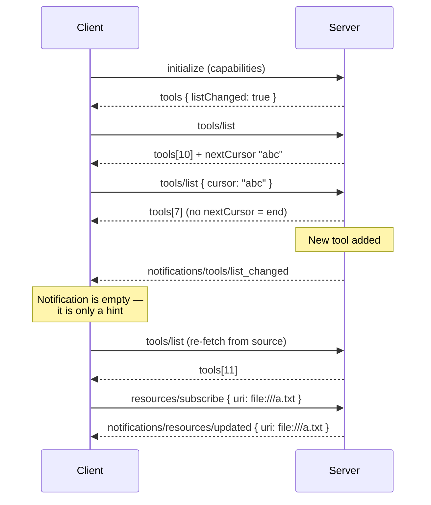

# Pagination, Notifications, and Change Tracking in MCP

### English

A server that exposes a thousand files, three hundred prompts or eighty tools cannot return them all in one response without problems: the message gets large, the host's context window suffers, and the round trip becomes slow. MCP therefore supports **cursor-based pagination** on the four list operations — `resources/list`, `resources/templates/list`, `prompts/list` and `tools/list`. The model is deliberately minimal. The server returns a page of results plus an optional `nextCursor`; the client sends that cursor back in the `params` of the next request; when `nextCursor` is absent, the client has reached the end.

```json
{ "jsonrpc": "2.0", "id": 123,
  "result": { "resources": [ ... ], "nextCursor": "eyJwYWdlIjogM30=" } }
```

Two rules make this work in practice. First, cursors are **opaque**: clients must not parse them, modify them, or assume their format, and must not persist them across sessions — the server is free to encode whatever it likes (an offset, a keyset position, a signed blob) and to change it between calls. Second, the page size is chosen by the server, and clients must not assume a fixed size. A client that assumes "50 per page" will break against a server that returns 10. An invalid cursor should produce a JSON-RPC error with code `-32602` (Invalid params), which is a good reason for servers to validate cursors rather than crash.

Pagination changes how a host should think about discovery. A host should not need to enumerate every tool before the model can do anything useful; fetching the first page and then paging on demand is the intended pattern. It also means that tool and resource listings are cheap to change without breaking clients — a server can add tools without every client needing to re-download a full catalogue at startup.

The second half of the problem is *knowing when* the list changed. MCP handles this with **list-changed notifications**. During initialization, a server that supports dynamic lists declares `listChanged: true` inside its `tools`, `resources` or `prompts` capability. The capability object is a sub-capability structure: `listChanged` means "I will send you a notification when this list changes", and `subscribe` (resources only) means "I support per-item change notifications for individual resources". When the list changes, the server sends a notification with no `id`, since a notification is fire-and-forget:

```json
{ "jsonrpc": "2.0", "method": "notifications/tools/list_changed" }
```

The client then re-issues `tools/list` to pick up the new catalogue. Note the direction of trust: the notification carries no payload — it is purely a hint, "something changed, come and look". The client must not assume what changed, and must re-list to find out. This matters because a notification that embedded the new tool list would be an attack surface: a malicious server could push a fabricated list. Keeping the notification empty means the client always goes back to the authoritative source.

Resource subscriptions are the more granular feature. With `resources: { subscribe: true }`, a client can ask to be told when a specific resource changes (the resource URI being sent in the subscription request), and the server emits `notifications/resources/updated` naming the URI. This is what allows a server to drive a host: when a file changes, the host is notified and can re-read the resource and update its context, rather than the end user having to ask for a refresh. Together, pagination and notifications give you a scalable discovery model: list lazily, page when needed, and refresh only when told something moved.

### 中文

一個提供上千個檔案、三百個 prompt 或八十個工具的伺服器，若一次過全部回傳會帶來問題：訊息體積龐大、host 的 context window 受影響、來回也變慢。因此 MCP 在四個列表操作上支援 **cursor-based pagination**（遊標式分頁）——`resources/list`、`resources/templates/list`、`prompts/list` 與 `tools/list`。這個模型刻意做得很簡單：伺服器回傳一頁結果連同可選的 `nextCursor`；client 把該遊標放進下一次請求的 `params`；當 `nextCursor` 不存在，即代表已到尾。

```json
{ "jsonrpc": "2.0", "id": 123,
  "result": { "resources": [ ... ], "nextCursor": "eyJwYWdlIjogM30=" } }
```

有兩條規則令這套做法在實務上成立。第一，遊標是 **opaque**（不透明）的：client 不得解析、修改或假定其格式，亦不得跨 session 儲存——伺服器可自由編碼成任何形式（位移量、keyset 位置、簽署過的 blob），亦可在不同呼叫之間改變。第二，頁面大小由伺服器決定，client 不得假定固定數值。假設「每頁 50 筆」的 client，遇上回傳 10 筆的伺服器就會壞掉。失效的遊標應回傳 JSON-RPC 錯誤碼 `-32602`（Invalid params），這也是伺服器應該驗證遊標、而不是直接崩潰的理由。

分頁改變了 host 思考「探索」的方式。host 不需要先把所有工具列齊，模型才有能力做事；先取第一頁、其後按需分頁才是預期做法。同時，分頁意味著工具與資源清單可以便宜地變更而不會弄壞 client——伺服器新增工具時，每個 client 都不必在啟動時重新下載整份目錄。

問題的第二半是「如何知道清單何時改變」。MCP 以 **list-changed notification**（清單變更通知）處理。初始化時，支援動態清單的伺服器會在 `tools`、`resources` 或 `prompts` 能力內宣告 `listChanged: true`。能力物件是一個子能力結構：`listChanged` 意為「清單有變時我會通知你」，而 `subscribe`（僅 resources 適用）意為「我支援針對個別資源的變更通知」。當清單改變，伺服器送出沒有 `id` 的通知——因為通知是即發即棄：

```json
{ "jsonrpc": "2.0", "method": "notifications/tools/list_changed" }
```

client 收到後便重新發出 `tools/list` 以取得新的目錄。注意其中的信任方向：通知本身不帶任何內容——它純粹是一個提示，「有東西變了，回來看看」。client 不應假設變了甚麼，必須重新列出才知道。這一點很重要，因為若通知內嵌新的工具清單，就會製造攻擊面：惡意伺服器可以推送捏造的清單。令通知保持空白，就等於令 client 永遠回到權威來源。

資源訂閱是更精細的功能。當 `resources: { subscribe: true }`，client 可以要求在某個特定資源改變時獲通知（訂閱請求中會送出該資源的 URI），伺服器則發出 `notifications/resources/updated` 指明該 URI。這正是讓伺服器可以主動驅動 host 的機制：檔案一有變動，host 即收到通知，可以重新讀取資源並更新其 context，而毋須使用者手動要求重新整理。分頁與通知合起來，就提供了一套可擴展的探索模型：延遲列出、需要時分頁、只在接到通知時才更新。

## Key Takeaway

MCP handles large catalogues with opaque cursors plus empty list-changed notifications, so clients page lazily and re-fetch on demand without ever trusting a server-pushed payload.

## Related Concepts
- Cursor-based pagination and opaque tokens
- List-changed and resource-updated notifications
- Capability negotiation and sub-capabilities (listChanged, subscribe)
- Context window budget management in AI hosts

## Diagram

