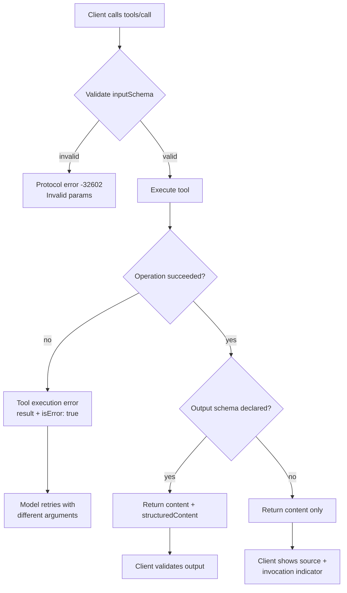

# Building an MCP Server: Design Patterns, Structured Output, and Error Handling

### English

Writing an MCP server looks deceptively simple: declare a couple of tools with JSON Schemas, return text. The protocol is not the hard part. The hard part is the design discipline that keeps a server useful without becoming dangerous, and the 2025-06-18 specification gives you several concrete mechanisms for that. This article walks through what a well-built server does.

Start with the tool definition. A tool has a `name` (unique identifier), an optional human-facing `title`, a `description` that is the *only* thing the model sees when deciding whether to call it, an `inputSchema` (JSON Schema) and, since the 2025-06-18 revision, an optional `outputSchema`. There is also an `annotations` object with optional hints such as `readOnlyHint`, `destructiveHint` and `idempotentHint` — these describe behaviour to the client, and the specification is explicit that clients **must treat annotations as untrusted unless they come from a trusted server**. That is not pedantry: annotations are the sort of field a malicious server would lie about.

```json
{
  "name": "search_docs",
  "title": "Search documentation",
  "description": "Full-text search over the product documentation. Returns matching excerpts with URLs.",
  "inputSchema": {
    "type": "object",
    "properties": {
      "query": { "type": "string", "description": "Search terms" },
      "limit":  { "type": "integer", "minimum": 1, "maximum": 20 }
    },
    "required": ["query"]
  },
  "annotations": { "readOnlyHint": true, "idempotentHint": true }
}
```

The `description` deserves special attention. Because it is what the model reads, vague descriptions produce wrong tool selection; a good description states what the tool does, when to use it, and — importantly — when *not* to use it. Servers with several overlapping tools should disambiguate explicitly.

Structured output is the second mechanism. A tool can declare an `outputSchema`, and the client then receives both human-readable content and a machine-readable `structuredContent` field that validates against that schema. This matters when the model is not the final consumer: if a server's result is going to be parsed by code, a schema is worth far more than prose. Many servers return both: a `content` array with text for the model and `structuredContent` for programs.

Error handling has two distinct channels, and confusing them is a common bug. **Protocol errors** are JSON-RPC errors — unknown tool, invalid arguments, internal failure — returned as an `error` object with a numeric code such as `-32602` for invalid params, `-32601` for method not found, `-32603` for internal error. **Tool execution errors** are results, not protocol errors: the tool ran, but the operation failed (an API returned 500, a file was missing, a business rule was violated). These come back as a normal `result` with `isError: true` and explanatory text in `content`. The distinction is semantic: a protocol error means "the request was malformed and I did not attempt it"; `isError` means "I attempted it and here is why it did not work". The model should be able to recover from an `isError` result — for instance, retrying with different arguments — whereas a protocol error usually requires the client to fix the request.

Two design patterns recur in good servers. The first is **narrow tools**. A tool that can read any file on the system is a liability; a tool that reads a specific configured directory is not. Scoping the input schema so that the path is a bounded enum or a fixed prefix converts a catastrophic failure mode into a validation error. The second is **separating read from write**. Read-only tools can usually be called without confirmation; mutating tools should trigger a user approval prompt in the host, and the specification states that there should always be a human in the loop with the ability to deny an invocation. Hosts are expected to show which server each tool comes from, to indicate when a tool is invoked, and to show the tool inputs before calling the server so the end user can catch accidental data exfiltration.

Finally, resource templates and prompts round out a server's usefulness. A resource template is a URI *pattern* with RFC 6570-style variables — for example `postgres://{host}/{table}/{id}` — which lets a client address a family of resources it has never seen, and the server can implement `resources/list` with a `uriTemplate` and `list` callbacks. Prompts are user-invoked templates. And the `completions` capability adds argument autocompletion: the client asks the server to suggest values for a partially typed argument, which is what makes an MCP server feel like a first-class developer tool rather than a bolted-on REST wrapper.

### 中文

寫一個 MCP 伺服器看似簡單：宣告幾個帶 JSON Schema 的工具、回傳文字。難的其實不是協定，而是讓伺服器既有用又不危險的設計紀律，而 2025-06-18 規格提供了幾項具體機制。本文走一遍一個做得出色的伺服器會做的事。

先由工具定義說起。工具包含 `name`（唯一識別碼）、可選的給人看的 `title`、**`description`**（模型判斷是否呼叫該工具時 *唯一* 看到的文字）、`inputSchema`（JSON Schema），以及自 2025-06-18 版本起新增的可選 `outputSchema`。另有一個 `annotations` 物件，內含 `readOnlyHint`、`destructiveHint`、`idempotentHint` 等可選提示，用來向 client 描述行為；規格明確要求 client **必須把 annotations 視為不可信，除非它來自受信任的伺服器**。這並非吹毛求疵：annotations 正正是惡意伺服器最可能說謊的欄位。

```json
{
  "name": "search_docs",
  "title": "Search documentation",
  "description": "Full-text search over the product documentation. Returns matching excerpts with URLs.",
  "inputSchema": {
    "type": "object",
    "properties": {
      "query": { "type": "string", "description": "Search terms" },
      "limit":  { "type": "integer", "minimum": 1, "maximum": 20 }
    },
    "required": ["query"]
  },
  "annotations": { "readOnlyHint": true, "idempotentHint": true }
}
```

`description` 值得特別留意。由於它是模型讀到的內容，描述含糊就會導致選錯工具；好的描述會說明工具做甚麼、何時使用，以及——同樣重要——何時 *不應* 使用。若伺服器有多個功能相近的工具，應明確加以區分。

結構化輸出是第二項機制。工具可以宣告 `outputSchema`，client 便會同時收到給人看的內容與符合該 schema 的機器可讀 `structuredContent` 欄位。當模型的最終消費者並非人時，這一點尤其重要：若伺服器的結果會被程式碼解析，一份 schema 的價值遠高於散文。許多伺服器兩者兼備：`content` 陣列內放文字給模型，另加 `structuredContent` 給程式。

錯誤處理有兩條不同通道，混淆兩者是常見錯誤。**協定錯誤**是 JSON-RPC 錯誤——未知工具、引數不合法、內部故障——以 `error` 物件回傳，並附數字錯誤碼，例如 `-32602`（Invalid params）、`-32601`（method not found）、`-32603`（internal error）。**工具執行錯誤**則是結果而非協定錯誤：工具確實執行了，但操作失敗（API 回傳 500、檔案不存在、業務規則不符）。它們以正常 `result` 回傳，內含 `isError: true` 與解釋文字放在 `content`。兩者的分別在意義：協定錯誤代表「請求格式有誤，我並未嘗試執行」；`isError` 代表「我執行了，但未能完成，原因如下」。模型應能從 `isError` 結果中恢復——例如改用其他引數重試——而協定錯誤通常需要 client 修正請求本身。

好伺服器常見兩個設計模式。第一是 **narrow tools**（收窄的工具）。一個可以讀取系統上任何檔案的工具是負擔；一個只讀取指定目錄的工具則不是。把輸入 schema 收窄，令路徑成為有限枚舉或有固定前綴，就能把一個災難性的失效模式變成一次驗證錯誤。第二是 **把讀與寫分開**。唯讀工具通常無需確認即可呼叫；會改動狀態的工具則應觸發 host 的使用者批准提示，而規格亦指出，應當永遠保留人在回路、可否決呼叫的能力。Host 應顯示每個工具來自哪個伺服器、在工具被呼叫時給出視覺提示，並在呼叫伺服器之前向使用者展示工具輸入，以便攔截意外的資料外洩。

最後，資源模板與 prompt 令伺服器更為實用。資源模板是一個 URI *樣式*，內含 RFC 6570 風格的變數——例如 `postgres://{host}/{table}/{id}`——令 client 可以指向它從未見過的一整族資源，伺服器則以 `uriTemplate` 與 `list` 回呼實作 `resources/list`。Prompt 是由使用者主動觸發的模板。而 `completions` 能力加入引數自動完成：client 向伺服器查詢部分輸入的引數應有哪些建議值，正正是它令一個 MCP 伺服器感覺像一等公民的開發者工具，而不是硬接上去的 REST 包裝。

## Key Takeaway

A production MCP server is defined less by its tools than by its discipline: narrow schemas, honest descriptions, structured output, and a clean split between protocol errors and tool execution errors.

## Related Concepts
- Tool annotations and untrusted-hint handling
- isError vs JSON-RPC error semantics
- Resource templates and URI parameters
- Human-in-the-loop approval for destructive tools

## Diagram

