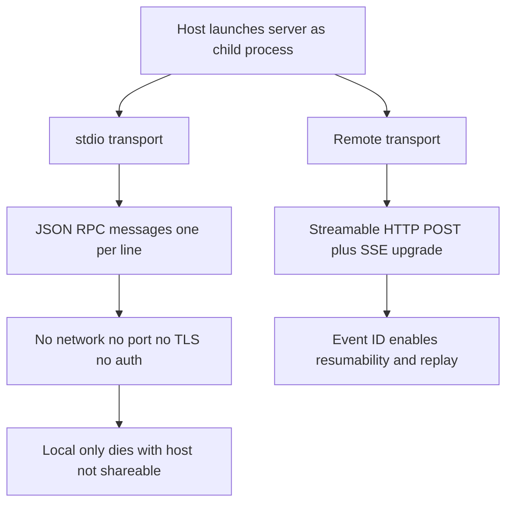

# Transport Deep Dive: stdio Pipes vs Streamable HTTP

## English

Every MCP connection rides on a transport, which is the underlying channel that carries JSON-RPC messages between client and server. The first standardized transport is stdio: the host launches the server as a child process and they talk over the process's standard input and standard output, one JSON-RPC message per line. This is beautifully simple. There is no network, no port, no TLS, and no authentication to configure, because the server is literally a subprocess of the client and inherits its trust. The trade-off is locality: a stdio server lives and dies with the host process, cannot be shared between users, and cannot be reached from another machine. That is why stdio is the natural fit for local filesystem access, local git operations, or a database the developer already has credentials for on their own laptop.

The remote counterpart has evolved. Early remote support used HTTP with Server-Sent Events (SSE), where the client POSTs requests and the server pushes responses and notifications down a long-lived SSE stream. Later revisions introduced Streamable HTTP, which consolidates this: the client sends JSON-RPC messages via HTTP POST, and the server may either answer with a plain JSON response or upgrade that same request to an SSE stream when it needs to push multiple messages. Crucially, Streamable HTTP supports resumability: the server can attach an event ID to streamed messages, and if the connection drops, the client can reconnect and pass the last event ID so the server replays what was missed. That is the difference between a flaky mobile connection silently losing a tool result and a client that can recover cleanly.

The practical consequence is that transport choice shapes your whole design. A stdio server can be written as a plain command-line program that prints to stdout and reads from stdin; it needs no web framework at all. A Streamable HTTP server, by contrast, is a web service: it must handle concurrent sessions, manage per-session state, deal with proxies and load balancers, and sit behind real authentication. You also cannot casually print debug logs to stdout in a stdio server, because stdout is the protocol channel; logs must go to stderr or they will corrupt the message stream. That single mistake is one of the most common beginner bugs.

A useful analogy is the difference between a private intercom inside one building and a public telephone exchange. stdio is the intercom: fast, private, only works while both ends are in the same building. Streamable HTTP is the exchange: reachable from anywhere, but you now need phone numbers, identity checks, and a way to redial when the line drops. Neither is better in the abstract; they serve different deployment shapes.

When choosing, ask three questions. Does the server need to reach resources that only exist on the user's machine? Use stdio. Does it need to be shared across users or devices, or hosted by a vendor? Use Streamable HTTP. Does it need to survive network interruptions with long-running operations? Prefer Streamable HTTP for its resumable streams. Getting this decision right early saves you from rewriting the entire server later.

## 中文

每一個 MCP 連線都建立在一種傳輸（transport）之上，也就是在客戶端與伺服器之間運送 JSON-RPC 訊息的底層通道。最早標準化的傳輸是 stdio：主機（host）把伺服器當作子程式啟動，雙方透過該程式的標準輸入與標準輸出對話，每行一個 JSON-RPC 訊息。這簡單得漂亮。沒有網路、沒有連線埠、沒有 TLS，也不用設定身分驗證，因為伺服器 literally 是客戶端的子程式，直接繼承它的信任關係。代價是地域性：stdio 伺服器隨主機程式生滅，無法在使用者之間共用，也無法從另一臺機器連進來。所以 stdio 天生適合本機檔案系統存取、本機 git 操作，或開發者自己筆記型電腦上已有憑證的資料庫。

遠端那邊則經歷了演進。早期遠端支援用 HTTP 搭配伺服器傳送事件（Server-Sent Events，SSE）：客戶端以 POST 送出請求，伺服器則透過一條長命的 SSE 串流把回應與通知推下來。後來的修訂引入了可串流 HTTP（Streamable HTTP），把這件事整合起來：客戶端用 HTTP POST 送出 JSON-RPC 訊息，伺服器可以選擇用單純的 JSON 回應，或在同一個請求上升級為 SSE 串流，以便推送多則訊息。關鍵在於，可串流 HTTP 支援可續傳（resumability）：伺服器可在串流訊息上附上事件 ID，連線中斷時，客戶端可重新連線並帶上最後一個事件 ID，讓伺服器重播漏掉的內容。這就是「不穩的行動網路悄悄丟掉一個工具結果」與「客戶端能乾淨復原」之間的差別。

實務上的後果是：傳輸選擇會形塑整個設計。stdio 伺服器可以寫成一支普通命令列程式，往 stdout 印、從 stdin 讀，完全不需要網頁框架。相對地，可串流 HTTP 伺服器就是一個網路服務：要處理並行工作階段、管理每個工作階段的狀態、應付代理與負載平衡器，還要放在真正的身分驗證後面。還有一點：在 stdio 伺服器裡不能隨便把除錯日誌印到 stdout，因為 stdout 就是協定通道；日誌必須走 stderr，否則會弄壞訊息流。這個單一錯誤是新手最常見的臭蟲之一。

一個好用的比喻，是同一棟大樓內的私人對講機與公共電話交換機之差。stdio 是對講機：快、私密，但只有兩端都在同一棟樓時才通。可串流 HTTP 是交換機：從哪都能撥通，但你現在需要電話號碼、身分查核，以及斷線後重撥的辦法。抽象來說沒有哪個更好，它們服務不同的部署形態。

選擇時問三個問題。伺服器是否需要碰觸只存在於使用者機器上的資源？用 stdio。是否需要跨使用者、跨裝置共用，或由廠商代管？用可串流 HTTP。是否需要靠可續傳串流撐過長時間操作中的網路中斷？優先選可串流 HTTP。及早做對這個決定，可以省下日後整個伺服器重寫的功夫。

## Key Takeaway

stdio is a trusted local subprocess channel with no network or auth, while Streamable HTTP is a real web service that adds sessions, authentication, and resumable SSE streams for remote deployment.

## Related Concepts
- JSON-RPC message framing
- Server-Sent Events

## Diagram

