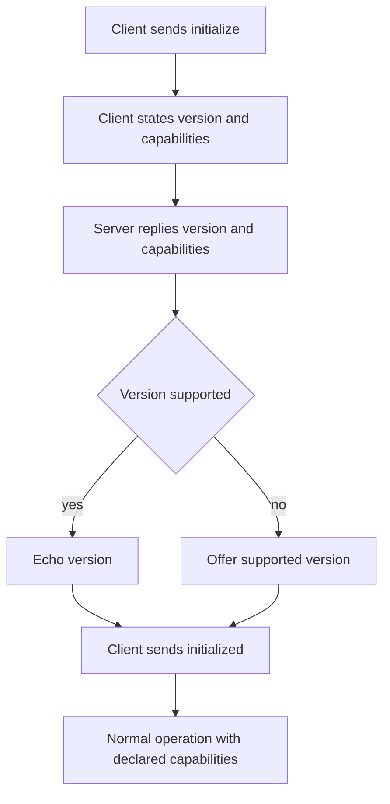

# Capability Negotiation: The Handshake That Shapes Everything

## English

Before a single tool is called, an MCP client and server perform an initialization handshake. The client sends an initialize request stating the protocol version it speaks and the capabilities it supports; the server replies with its own protocol version and capabilities. Only after that exchange does the client send an initialized notification, and only then does normal operation begin. This sounds like bureaucratic ceremony, but it is the mechanism that makes the protocol both forward-compatible and honest: neither side is allowed to assume the other can do something it never announced.

A capability is a declared feature, not a promise about specific contents. On the server side, the capabilities object typically flags whether the server offers tools, resources, or prompts, and may include sub-flags such as whether the resource list can change over time or whether resource subscriptions are supported. On the client side, capabilities describe what the client itself can handle, such as whether it can receive sampling requests (the server asking the client's model to generate text) or elicitation requests (the server asking the user for input). If a server never sees the sampling capability from the client, it must not attempt to call back for sampling. This is what keeps the protocol safe to extend: new capability flags can be added in future versions, and old peers simply ignore flags they do not recognize.

Protocol version negotiation works in parallel. The client proposes a version; if the server supports it, it echoes it back; if not, the server responds with a version it does support, and the client decides whether it can proceed. This is a classic compatibility dance, similar to how TLS or HTTP version negotiation avoids hard failures when peers are mismatched. The result is that a newer client can still talk to an older server, degrading gracefully rather than crashing.

Why does this matter in practice? Imagine a server that subscribes to changes in a configuration file and pushes notifications when it changes. If the client did not advertise that it can receive resource update notifications, the server should not bother sending them, and the client should not expect them. Without the handshake, the server would be guessing, and guesses produce either wasted traffic or silent bugs where a feature appears broken but was never actually negotiated. The handshake turns implicit assumptions into explicit contracts.

For anyone building a server, the lesson is to read the client's declared capabilities before using any callback feature, and to declare your own capabilities accurately rather than optimistically. Overstating what you support is worse than understating, because the client will build on a promise you cannot keep. The handshake is a small piece of the protocol that quietly determines which of its richer features are even in play.

## 中文

在呼叫任何一個工具之前，MCP 客戶端與伺服器會先做一次初始化握手（handshake）。客戶端送出 initialize 請求，說明它講的協定版本與支援的能力；伺服器回覆自己的協定版本與能力。只有在這段交換之後，客戶端才送出 initialized 通知，然後才進入正常運作。這聽起來像官僚儀式，但它正是讓協定既能向前相容又誠實的機制：任何一方都不準假設對方會做它從未宣告過的事。

能力（capability）是一種宣告的功能，而不是對具體內容的承諾。在伺服器端，能力物件通常標示伺服器是否提供工具、資源或提示，還可能包含子旗標，例如資源清單是否會隨時間變動，或是否支援資源訂閱。在客戶端，能力描述客戶端自己能處理什麼，例如能否接收取樣請求（伺服器請客戶端的模型生成文字），或引導請求（伺服器請使用者提供輸入）。如果伺服器從未看到客戶端宣告取樣能力，它就不得嘗試回呼取樣。這正是協定能安全擴充的原因：未來版本可以新增能力旗標，舊的對端就單純忽略不認識的旗標。

協定版本協商是平行進行的。客戶端提出一個版本；伺服器若支援就回覆同一個版本；若不支援，就回覆它支援的版本，由客戶端決定能否繼續。這是經典的相容性舞步，類似 TLS 或 HTTP 的版本協商，避免對端不匹配時硬性失敗。結果是較新的客戶端仍能與較舊的伺服器對話，優雅降級而不是崩潰。

實務上為什麼重要？想像一個伺服器訂閱了設定檔的變動，並在檔案改變時推送通知。如果客戶端沒有宣告自己能接收資源更新通知，伺服器就不該費心送出，客戶端也不該期待收到。少了握手，伺服器只能猜，而猜測會產生兩種後果：浪費的流量，或某功能看似壞掉、其實從未真正協商過的沉默臭蟲。握手把隱含假設變成明示契約。

對打造伺服器的人來說，教訓是：在使用任何回呼功能前，先讀客戶端宣告的能力，並誠實而非樂觀地宣告自己的能力。誇大支援比低估更糟，因為客戶端會建立在你守不住的承諾上。握手是協定裡小小的一塊，卻默默決定它那些較豐富的功能到底能不能派上用場。

## Key Takeaway

The initialize handshake exchanges declared capabilities and protocol versions so neither side ever assumes a feature the other did not advertise, enabling safe forward compatibility.

## Related Concepts
- Protocol version negotiation
- Backward compatibility

## Diagram

