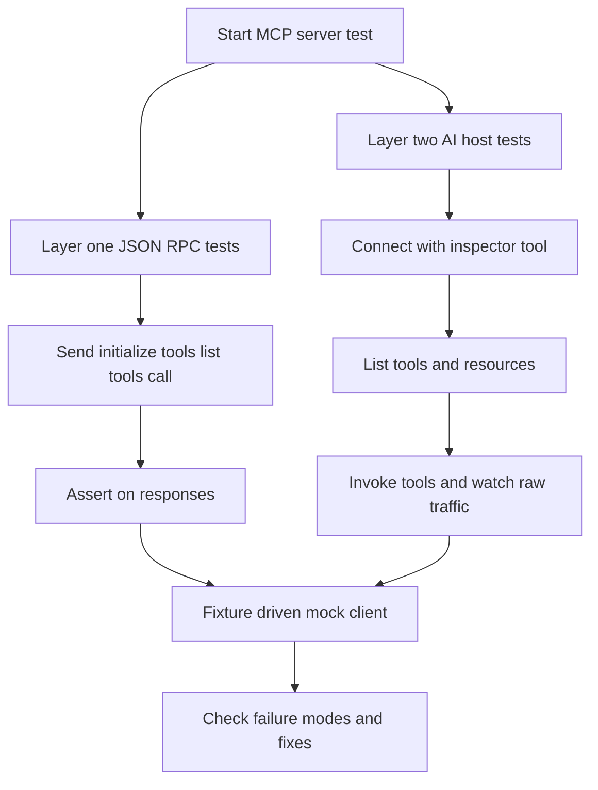

# Testing and Debugging MCP Servers: Inspectors, Fixtures, and Failure Modes

## English

An MCP server is a strange beast to test because its conversation partner is an AI host, not a human typing commands. You cannot simply run it and eyeball the output. The practical answer is to separate two layers of testing. First, test the server as a plain program that speaks JSON-RPC: send it well-formed initialize, tools/list, and tools/call messages over its transport and assert on the responses. Second, test how an AI host actually uses it, which is fuzzier and benefits from an inspector tool that lets you connect to a server, list its tools and resources, and manually invoke them while watching the raw message traffic. Official inspector tooling exists for exactly this purpose, and building your own minimal harness that pipes JSON lines into a stdio server is a worthwhile exercise.

The most common failure modes are worth memorizing. Logging to stdout in a stdio server corrupts the protocol stream, as mentioned elsewhere, but the subtler version is a library that prints warnings to stdout on startup. Returning malformed JSON-RPC, such as a response missing the matching request id, leaves the client waiting forever. Tool schemas that are technically valid but semantically vague, like a parameter named data typed as an unconstrained string, cause the model to send garbage. And errors that throw exceptions rather than returning structured error responses give the model nothing actionable to recover from. Each of these is testable, and each has a clear fix.

A powerful technique is fixture-driven testing with a mock client. Write a small script that stands in for the host: it performs the handshake, asserts the declared capabilities, calls each tool with representative inputs including edge cases (empty strings, very large payloads, unicode, missing optional fields), and checks the shape of the result. Because MCP is just JSON-RPC over a transport, this mock client can be a few dozen lines in any language. You can also record real message traces from a working session and replay them as regression tests, which catches accidental schema changes that would break existing hosts.

Debugging live sessions is its own skill. When a tool call mysteriously fails, the first question is whether the request ever reached the server. Instrument both sides with request-id logging so you can correlate. Check whether the failure is a transport problem (connection dropped, stream not resumed) or a semantic one (the tool ran but returned an error the model mishandled). For remote servers, remember that proxies and load balancers may buffer responses, which breaks streaming; testing through the same infrastructure as production is essential.

Finally, think about what "correct" means for an AI-facing server. A tool that returns a technically valid but unhelpfully terse error like "failed" is worse than one that returns "file not found at path X; check permissions or path spelling." The model consumes your output as context, so error messages are part of your API. Test them as carefully as you test success paths, and prefer structured, self-describing errors over free-form strings.

## 中文

MCP 伺服器是一種奇怪的東西，因為它的對話對象是 AI 主機，而不是敲指令的人類。你不能只是跑起來、用眼睛看看輸出。實務上的答案是分兩層測試。第一，把伺服器當成一支講 JSON-RPC 的普通程式來測：透過它的傳輸送出格式正確的 initialize、tools/list 與 tools/call 訊息，並對回應做斷言。第二，測 AI 主機實際上怎麼用它，這一層比較模糊，適合用檢視器（inspector）工具：連上伺服器、列出工具與資源、手動呼叫，同時觀察原始訊息流量。官方確實有為此目的而存在的檢視工具，而自己寫一個把 JSON 行灌進 stdio 伺服器的最小測試骨架，也是值得的練習。

最常見的失敗模式值得背下來。stdio 伺服器把日誌印到 stdout 會弄壞協定流（別處提過），但更細微的版本是：某個函式庫在啟動時把警告印到 stdout。回傳格式錯誤的 JSON-RPC，例如回應少了對應的請求 id，會讓客戶端永遠等下去。工具結構描述技術上合法但語意模糊，例如一個名為 data、型別是無限制字串的參數，會讓模型送出垃圾。而用拋例外而非回傳結構化錯誤回應的錯誤處理，等於沒給模型任何可據以復原的資訊。以上每一項都可測，也都有明確的修法。

一個有力的技巧是用假客戶端做固定樣本（fixture）驅動的測試。寫一支小腳本代替主機：它執行握手、斷言宣告的能力、用代表性輸入呼叫每個工具（包含邊界情況：空字串、超大負載、unicode、缺少的選填欄位），並檢查結果的形狀。因為 MCP 就只是跑在傳輸上的 JSON-RPC，這個假客戶端用任何語言寫都只要幾十行。你也可以錄下真實工作階段的訊息軌跡，當成回歸測試重播，這樣能抓到會弄壞既有主機的意外結構描述變更。

即時工作階段的除錯是另一門功夫。當工具呼叫莫名失敗，第一個問題是請求到底有沒有送到伺服器。在兩端都加上請求 id 日誌以便對應。判斷失敗是傳輸問題（連線中斷、串流未續傳）還是語意問題（工具跑了，但回傳的錯誤被模型誤處理）。對遠端伺服器，記得代理與負載平衡器可能緩衝回應，這會破壞串流；務必透過與正式環境相同的基礎設施來測試。

最後，想想對 AI 的伺服器而言「正確」是什麼意思。一個技術上合法但簡短到沒用的錯誤，例如「失敗」，比回傳「在路徑 X 找不到檔案；請檢查權限或路徑拼字」還糟。模型會把你的輸出當成上下文來消費，所以錯誤訊息是你 API 的一部分。像測成功路徑一樣仔細測它們，並偏好結構化、能自我描述的錯誤，而非自由格式的字串。

## Key Takeaway

Test MCP servers in two layers, a JSON-RPC harness with fixtures for protocol correctness and an inspector for real host behavior, and treat error messages as part of your API because the model reads them.

## Related Concepts
- JSON-RPC request id correlation
- Schema validation

## Diagram

