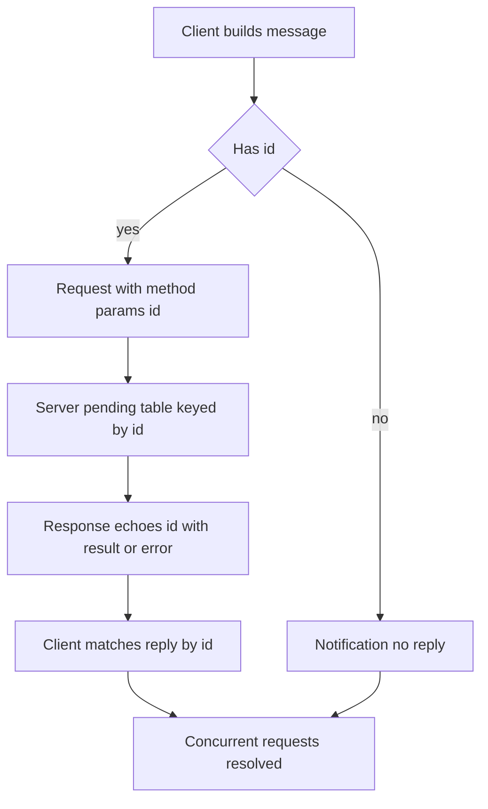

# JSON-RPC 2.0 Under the Hood: Messages, IDs, and Errors

## English

Every MCP conversation rides on JSON-RPC 2.0, a tiny remote procedure call convention that encodes each message as a single JSON object. There are three message shapes: a request has a `method` string, optional `params`, and a unique `id`; a response echoes that `id` and carries either a `result` or an `error` object; and a notification is a request with no `id` at all, meaning no reply is expected. That id is the whole trick behind concurrency — because replies are matched to requests by id rather than by order, a client can fire off several requests at once and process the responses in whatever order they arrive. Picture a busy restaurant where each order gets a numbered ticket; the kitchen can cook dishes in any sequence and still hand each plate to the right table.

The `id` must be a string or number, and it must be unique among requests still in flight. If you reuse an id before its response arrives, you cannot tell which reply belongs to which call. MCP servers and clients both maintain a table of pending requests keyed by id, so a leaked or duplicated id is a real bug, not a cosmetic one. Errors are structured too: the `error` object has an integer `code`, a short `message`, and optional `data`. JSON-RPC reserves codes like -32700 (parse error), -32600 (invalid request), -32601 (method not found), and -32602 (invalid params), while the range -32000 to -32099 is left for application-defined errors — a natural place for an MCP server to report things like a failed tool execution.

JSON-RPC 2.0 itself does support batching: a client may send a JSON array of request objects in one payload, and the server replies with an array of responses. But MCP deliberately removed that capability in its 2025-06-18 revision, so the current spec expects exactly one JSON-RPC message per HTTP POST body or per stdio line. A server that receives an array should treat it as a protocol error rather than trying to unpack it, which is why older tutorials that show batched calls are now misleading. The reasoning was that partial failures inside a batch, response ordering, and interaction with streaming responses added real complexity for little gain — the Streamable HTTP transport can already push several messages over one logical request when that is genuinely needed. If you are porting code from a pre-June-2025 SDK, this is the single most common breakage to look for.

Notifications are where MCP gets its event-driven feel. Because they carry no id, they are fire-and-forget: a server can announce that its list of tools changed, or that a resource was updated, without the client having asked. The client, in turn, can send notifications such as a cancellation for a long-running request. The asymmetry matters — if you accidentally give a notification an id, the peer will try to respond and may log a spurious error; if you forget the id on something that needs a reply, you will wait forever. Getting this distinction right is most of what 'speaking JSON-RPC correctly' means.

Finally, JSON-RPC is deliberately transport-agnostic. The same message objects flow over newline-delimited stdio, over HTTP POST bodies, or over a stream — the protocol layer does not care. That separation is why MCP can support both a local subprocess server and a remote HTTP server with the same semantics. When debugging, the practical skill is to read a raw message log and answer three questions: is this a request, response, or notification? Which id links them? And is the error a protocol-level one or an application-level one? Answer those and almost any MCP failure becomes legible.

## 中文

每一個 MCP 對話都跑在 JSON-RPC 2.0 之上——這是一套極簡的遠端程序呼叫慣例，把每則訊息編碼成單一 JSON 物件。訊息有三種形狀：請求（request）帶有 `method` 字串、可選的 `params`，以及唯一的 `id`；回應（response）回抄同一個 `id`，並攜帶 `result` 或 `error` 物件；通知（notification）則是沒有 `id` 的請求，代表不期待任何回覆。那個 id 正是併發能力的關鍵——因為回覆是靠 id 而非順序來配對請求，客戶端可以一次丟出多個請求，再依抵達順序處理回應。想像一間忙碌的餐廳，每張點單都拿到編號票據；廚房可以用任何順序出菜，仍然把每盤菜送到正確的桌。

`id` 必須是字串或數字，而且在尚未完成的請求之間必須唯一。若在某個回應回來之前就重用 id，你就分不清哪個回覆屬於哪個呼叫。MCP 的伺服器與客戶端都會維護一張以 id 為鍵的待處理請求表，所以外洩或重複的 id 是真實的 bug，而非外觀問題。錯誤也是結構化的：`error` 物件有整數 `code`、簡短 `message`，以及可選的 `data`。JSON-RPC 保留了 -32700（解析錯誤）、-32600（無效請求）、-32601（找不到方法）、-32602（無效參數）等代碼，而 -32000 至 -32099 這段範圍留給應用自訂錯誤——這正是 MCP 伺服器回報工具執行失敗之類情況的自然位置。

JSON-RPC 2.0 本身確實支援批次：客戶端可以在單一載荷中送出一個由請求物件組成的 JSON 陣列，伺服器則以回應陣列回覆。但 MCP 在 2025-06-18 版規格中刻意移除咗呢個能力，而家規格期望每次 HTTP POST 主體、或每一行 stdio，只帶一個 JSON-RPC 訊息。伺服器如果收到一個陣列，應該當成協定錯誤處理，而唔係嘗試拆開佢——所以舊教程教人送批次嘅做法而家已經誤導。官方理由係：批次內部嘅部分失敗、回應次序，同埋同串流回應嘅互動，令實作複雜度大增但收益有限——真正需要一次過推多個訊息時，可串流 HTTP 傳輸本身已經做到。 如果你係由 2025 年 6 月之前嘅 SDK 移植程式碼，最常見嘅壞處就係呢一點。

通知正是 MCP 事件驅動感的來源。因為它們不帶 id，所以是射後不理：伺服器可以宣告它的工具清單變了，或某個資源被更新了，而客戶端根本沒問。反過來，客戶端也可以送出通知，例如取消某個長時間執行的請求。這種不對稱很重要——若你不小心給通知加了 id，對端會試著回應並可能記下虛假的錯誤；若你在需要回覆的東西上忘了 id，你就會永遠等下去。把這個區別搞對，就是「正確地說 JSON-RPC」的大部分內容。

最後，JSON-RPC 刻意與傳輸層無關。同樣的訊息物件可以流過以換行分隔的 stdio、流過 HTTP POST 主體，或流過某種串流——協定層毫不在意。這種分離正是 MCP 能用相同語意同時支援本地子程序伺服器與遠端 HTTP 伺服器的原因。除錯時，實用的技能是讀原始訊息日誌並回答三個問題：這是請求、回應還是通知？哪個 id 把它們連起來？而這個錯誤是協定層的還是應用層的？回答完這三個，幾乎任何 MCP 故障都會變得可讀。

## Key Takeaway

JSON-RPC's request/response/notification triad and id-based matching are the mechanical backbone that makes MCP concurrent, event-driven, and transport-independent.

## Related Concepts
- JSON-RPC 2.0
- Asynchronous request matching

## Diagram

