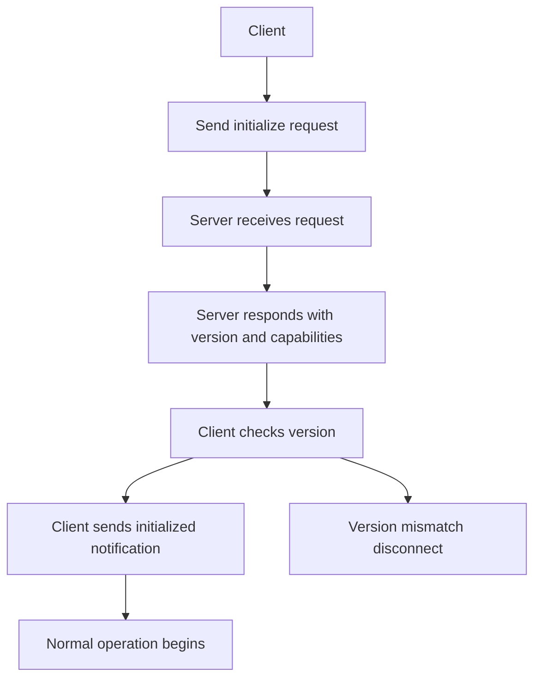

# Lifecycle and Version Negotiation: The initialize Handshake

## English

Before any tool is called or resource read, an MCP connection must pass through a lifecycle: the client sends an `initialize` request, the server responds, and the client sends an `initialized` notification to confirm. This is not ceremony — it is where both sides declare what they are, what they speak, and what they can do. The `initialize` request carries the protocol version the client proposes, the client's own capabilities, and information about the client (name, version). The server's response carries the protocol version it will use, its capabilities, and its own info. Only after the `initialized` notification does normal operation begin. This mirrors the ordering rules of classic protocols like TLS or SMTP, where greeting and capability exchange precede any real work.

The version field deserves attention. MCP versions are date-stamped strings, and the negotiation rule is that the server responds with the version it supports; if the client proposed a version the server does not know, the server replies with its own latest supported version and the client must decide whether to proceed or disconnect. There is no silent downgrade that pretends both sides agree. This is a deliberate design choice: protocol mismatches should surface loudly at the start rather than manifest as confusing behavior mid-session. Think of it like two people agreeing on a language before a meeting — better to discover at the door that one speaks only French than three sentences into a negotiation.

Capabilities are the second pillar of the handshake. Each side advertises which optional features it implements: a server might declare support for tools, resources, prompts, logging, or completions; a client might declare support for sampling or for roots (filesystem scopes it exposes). Crucially, capabilities are not just informational — they are constraints. A client must not call a tool on a server that did not advertise the tools capability, and a server must not send a sampling request to a client that did not advertise sampling. The handshake is therefore a contract: after it completes, both sides know exactly which messages are legal, and anything outside that set is a protocol violation rather than a surprise.

Roots and sampling illustrate why this matters. Roots let a client tell a server 'these are the directories or URIs I am willing to let you touch', which is a client-side capability that shapes what the server should even attempt. Sampling lets a server ask the client's model to generate text, which is a server-initiated request that only makes sense if the client supports it. Without negotiation, a server would have to guess whether sampling is available and might fail unpredictably. With negotiation, the server simply checks the client's declared capabilities and chooses a fallback path if sampling is absent — for example, returning a template-based answer instead.

Practically, the lifecycle has three phases worth knowing: initialization (the handshake), operation (normal requests and notifications), and shutdown. Shutdown is transport-dependent — over stdio, closing the input stream and terminating the subprocess; over HTTP, ending the session. A well-behaved implementation cleans up pending requests and releases resources on shutdown rather than relying on the operating system to reap them. When you debug a server that 'works in isolation but not when connected', the first place to look is the handshake: did the client send `initialize` with a version the server recognizes, did the server respond with capabilities that match what the client expects, and did the client send the `initialized` notification before making its first real call? Nine times out of ten, the answer to one of those is no.

## 中文

在任何工具被呼叫、任何資源被讀取之前，一條 MCP 連線必須先經過生命週期：客戶端送出 `initialize` 請求，伺服器回應，客戶端再送出 `initialized` 通知來確認。這不是行禮如儀——這正是雙方宣告自己是誰、說哪種語言、能做哪些事的地方。`initialize` 請求攜帶客戶端提議的協定版本、客戶端自身的能力，以及關於客戶端的資訊（名稱、版本）。伺服器的回應則攜帶它將使用的協定版本、它的能力，以及它自己的資訊。只有在 `initialized` 通知之後，正常運作才開始。這與 TLS 或 SMTP 等經典協定的排序規則如出一轍：問候與能力交換總是先於任何實際工作。

版本欄位值得注意。MCP 版本是帶日期的字串，而協商規則是伺服器以其支援的版本回應；若客戶端提議的版本伺服器不認識，伺服器會回覆自己最新支援的版本，而客戶端必須決定要繼續還是斷線。沒有那種假裝雙方都同意的無聲降級。這是刻意的設計選擇：協定不匹配應該在開頭就大聲浮現，而不是在會話中途以令人困惑的行為顯現。把它想成兩個人在開會前先講好要用哪種語言——與其談了三句才發現對方只會法文，不如在門口就發現。

能力是握手協定的第二根支柱。雙方各自宣告自己實作了哪些可選功能：伺服器可能宣告支援工具、資源、提示或補全；客戶端可能宣告支援取樣（sampling）或根（roots，它暴露的檔案系統範圍）。關鍵在於，能力不只是資訊性的——它們是約束。客戶端不得對一個沒有宣告工具能力的伺服器呼叫工具，伺服器也不得向沒有宣告取樣能力的客戶端送出取樣請求。因此握手是一份契約：完成之後，雙方都確切知道哪些訊息合法，而那組之外的一切都是協定違規，而非意外。

根與取樣說明了這為何重要。根讓客戶端告訴伺服器「這些是我願意讓你碰的目錄或 URI」，這是一項客戶端能力，形塑了伺服器該不該嘗試什麼。取樣則讓伺服器請客戶端的模型生成文字，這是一項由伺服器發起的請求，只有在客戶端支援時才說得通。沒有協商，伺服器就得猜測取樣是否可用，並可能以不可預測的方式失敗。有了協商，伺服器只要檢查客戶端宣告的能力，在取樣缺席時選擇退路——例如改回傳以範本為基礎的答案。

實務上，生命週期有三個值得知道的階段：初始化（握手）、運作（正常的請求與通知），以及關閉。關閉取決於傳輸層——在 stdio 上，是關閉輸入串流並終止子程序；在 HTTP 上，是結束會話。行為良好的實作會在關閉時清理待處理請求並釋放資源，而不是仰賴作業系統回收。當你除錯一個「單獨跑沒問題、一連上就出錯」的伺服器，第一個要看的就是握手：客戶端有沒有送出伺服器認得的版本的 `initialize`？伺服器有沒有回應符合客戶端期待的能力？客戶端有沒有在第一次真正呼叫之前送出 `initialized` 通知？十次有九次，其中一題的答案是「沒有」。

## Key Takeaway

The initialize/initialized handshake is a binding contract that fixes protocol version and capabilities before any real work, turning mismatches into loud early failures instead of silent mid-session bugs.

## Related Concepts
- Capability negotiation
- Protocol versioning

## Diagram

