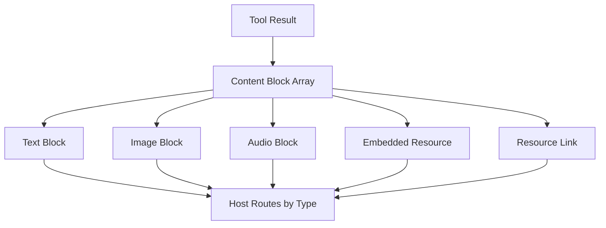

# Content Blocks and Structured Data: How MCP Carries Rich Payloads

## English

MCP does not pass raw strings around for tool results and messages. Instead it uses content blocks — typed JSON objects that say what kind of payload they hold. The common types are text (a plain string), image (base64 data plus a MIME type), audio (same shape), embedded resource (a resource object inlined into the result), and resource link (a reference to a resource by URI). A single result can be an array of these blocks, so a tool can return a paragraph of explanation, a chart image, and a link to a supporting file all in one reply. This is the difference between handing someone a note and handing them a folder.

Why bother with types instead of just text? Because hosts need to know what to do with each part. A text block goes into the model's context as-is; an image block can be shown to a vision-capable model or rendered in the UI; a resource link tells the host 'there is more here, fetch it if the user wants detail'. Without typed blocks, the host would have to guess from string contents whether a base64 blob is an image or a PDF, which is exactly the kind of ambiguity that breaks at scale. The type tag is a small piece of metadata that buys a lot of reliable behavior.

The image and audio blocks carry base64-encoded data with an explicit MIME type (for example image/png or audio/wav). That explicit type matters: a host can decide whether the current model can consume that media and, if not, fall back to a textual description or refuse gracefully. Base64 inflates payload size by roughly a third, so large media is a real cost over a network transport, and some servers prefer to return a resource link instead and let the client fetch the bytes lazily. That trade-off — inline versus referenced — is a recurring design decision when building servers.

Structured tool output is a related but distinct idea. MCP tools can declare an output schema, and servers can return structured results (typically a JSON object) alongside or instead of free text. The benefit is that the model or the host can parse fields reliably rather than scraping a sentence. If a tool returns a weather report, a structured result like {temperature, unit, conditions} is far more useful downstream than 'It is 21 degrees and cloudy.' Hosts that support structured output can validate it against the schema and surface errors early, which is the same discipline as a typed API response. The trade-off is rigidity: a schema that is too narrow forces awkward encodings, while one that is too loose gives up the benefit.

In practice, the skill is choosing the right shape for each job. Use a text block for human-readable summaries and reasoning traces; use structured output when the result will be consumed programmatically or fed into another tool; use resource links when the payload is large or changes often; use embedded resources when the client needs the content immediately and self-contained. A common mistake is stuffing everything into a text block because it is easiest, which forces downstream consumers to parse prose and defeats the point of a typed protocol. Thinking in terms of content blocks from the start makes a server easier to consume, easier to test, and more robust when models or UIs change.

## 中文

MCP 在傳遞工具結果與訊息時，並不是把原始字串丟來丟去，而是使用內容區塊（content blocks）——帶型別的 JSON 物件，說明自己裝的是哪種載荷。常見型別有：text（純字串）、image（base64 資料加 MIME 型別）、audio（同樣形狀）、embedded resource（把資源物件內嵌進結果），以及 resource link（以 URI 指向某個資源）。單一結果可以是這些區塊的陣列，所以一個工具能在一次回覆中同時回傳一段說明文字、一張圖表，以及一個指向佐證檔案的連結。這就像差別在於：遞給人一張便條，還是遞給他一個資料夾。

為什麼要費心用型別，而不乾脆全用文字？因為宿主需要知道每一部分該怎麼處理。文字區塊原封不動進入模型上下文；圖片區塊可以展示給具視覺能力的模型，或在介面中渲染；資源連結則告訴宿主「這裡還有更多，使用者想要細節時再去抓」。沒有具型別的區塊，宿主就得從字串內容去猜一段 base64 是圖片還是 PDF，而這正是那種在大規模下必然出錯的模糊地帶。型別標籤只是一小片中介資料，卻換來大量可靠行為。

圖片與音訊區塊攜帶 base64 編碼的資料，並附上明確的 MIME 型別（例如 image/png 或 audio/wav）。明確的型別很重要：宿主可以判斷當前模型能否消化這種媒體，若不能，就退回文字描述或優雅地拒絕。base64 會讓載荷膨脹約三分之一，所以大型媒體在網路傳輸上是實實在在的成本，有些伺服器寧可回傳資源連結，讓客戶端延遲抓取位元組。這種「內嵌對參照」的取捨，是建置伺服器時反覆出現的設計決策。

結構化工具輸出是相關但不同的概念。MCP 工具可以宣告輸出綱要（output schema），伺服器可以連同自由文字、或取代自由文字，回傳結構化結果（通常是一個 JSON 物件）。好處是模型或宿主能可靠地解析欄位，而不是從一句話裡刮取資訊。若某工具回傳天氣報告，像 {temperature, unit, conditions} 這樣的結構化結果，在下游遠比「現在 21 度、多雲」有用。支援結構化輸出的宿主可以依綱要驗證，並提早浮現錯誤，這與具型別 API 回應的自律如出一轍。取捨在於僵化：綱要太窄會逼出彆扭的編碼，太寬又放棄了全部好處。

實務上，功夫在於為每件工作選對形狀。人類可讀的摘要與推理軌跡用文字區塊；結果要被程式消費或餵進另一個工具時用結構化輸出；載荷龐大或經常變動時用資源連結；客戶端需要立即且自足的內容時用內嵌資源。常見的錯誤是把一切塞進文字區塊，因為那最省事，結果逼得下游消費者去解析散文，也讓具型別協定的意義蕩然無存。從一開始就以內容區塊思考，能讓伺服器更容易被消費、更容易測試，並在模型或介面改變時更穩健。

## Key Takeaway

Typed content blocks and optional structured output let MCP carry text, media, references, and machine-parseable data unambiguously, so hosts can act on each part correctly instead of guessing from strings.

## Related Concepts
- Content blocks
- Structured tool output

## Diagram

