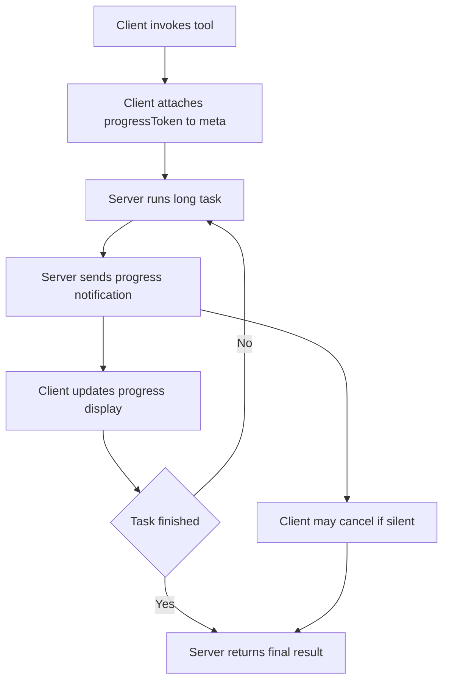

# Progress Tokens and Long-Running Tool Calls

## English

Most tool-call protocols assume a tool finishes quickly: you send a request, you get an answer. But real work often takes minutes — a database migration, a web crawl, a build. MCP handles this with progress notifications. When a client invokes a tool, it can attach a `progressToken` to the request's `_meta` field. That token is an opaque value (a string or integer) chosen by the caller, and it exists purely so the server can tag its updates with the same identifier. The server then sends `notifications/progress` messages, each carrying the token, a numeric `progress` value, and optionally a `total` and a human-readable `message`. Because these are JSON-RPC notifications rather than responses, they do not consume a request ID and the original call stays open until the server finally returns its result.

The design has an important subtlety: the `progress` value must increase monotonically, but the protocol deliberately does not define units. A server can count bytes, files, or abstract steps — whatever makes sense for that tool. If the client supplied a `total`, the receiver can render a percentage; if not, it can only show a spinner and the latest message. This is a deliberate trade-off: MCP keeps the wire format simple and pushes presentation decisions to the host application, which knows its own UI.

Progress notifications also serve as a liveness signal. A long-running server that sends nothing for minutes looks identical to a hung one. By emitting periodic progress — even coarse ones — a server lets the client distinguish 'working hard' from 'stuck'. Some implementations pair this with timeouts: if no progress arrives within a window, the client may cancel the request. MCP defines a `notifications/cancelled` message for exactly this purpose, letting either side abandon an in-flight request without waiting for completion.

There is a practical caveat about transports. Progress notifications flow over the same channel as the request, so they only work if that channel is bidirectional and stays open. On stdio, that is trivially true. On HTTP-based transports, the mechanism depends on the transport's ability to stream server-to-client messages — which is why streaming transports matter for long tasks. A fire-and-forget HTTP POST that closes immediately cannot deliver progress.

For tool authors, the lesson is to emit progress early and often, and to treat the token as optional. A well-behaved server checks whether the request included a `progressToken` before sending anything; if absent, it simply skips the notifications and does the work silently. This keeps the same tool usable by simple clients that do not care about progress and by rich clients that render live status bars.

## 中文

大部分工具呼叫協定都假設工具很快完成：送出請求，拿回答案。但真實工作往往要幾分鐘——資料庫遷移、網絡爬蟲、建置。MCP 用進度通知（progress notifications）處理這種情況。當客戶端呼叫工具時，可以在請求的 `_meta` 欄位附加一個 `progressToken`。這個 token 是由呼叫方挑選的不透明值（字串或整數），純粹是讓伺服器在更新訊息上貼同一個識別碼。伺服器隨後送出 `notifications/progress` 訊息，每則都帶著該 token、一個數值 `progress`，並可選帶 `total` 與人類可讀的 `message`。因為這些是 JSON-RPC 通知而非回應，它們不佔用請求 ID，原本的呼叫會一直開著，直到伺服器最終回傳結果。

這個設計有個重要細節：`progress` 必須單調遞增，但協定刻意不定義單位。伺服器可以數位元組、檔案或抽象步驟——只要對該工具有意義即可。若客戶端提供了 `total`，接收方可以算出百分比；若沒有，就只能顯示轉圈圈和最新訊息。這是刻意的取捨：MCP 保持線路格式簡單，把呈現決策推給最了解自己介面的宿主應用程式。

進度通知同時是存活訊號。長時間執行卻幾分鐘不吭聲的伺服器，看起來跟卡死的一模一樣。藉由定期發出進度——即使很粗略——伺服器讓客戶端能分辨「正在努力」與「卡住了」。有些實作會搭配逾時：若某段時間內沒有進度，客戶端可以取消請求。MCP 定義了 `notifications/cancelled` 訊息正是為此，讓任一方放棄進行中的請求而不必等它完成。

實務上要注意傳輸層。進度通知與請求走同一條通道，所以只有當該通道是雙向且保持開啟時才可行。在 stdio 上這理所當然。在 HTTP 類傳輸上，機制取決於該傳輸能否串流伺服器到客戶端的訊息——這正是串流傳輸對長任務如此重要的原因。一個送完就關的 HTTP POST 無法傳遞進度。

對工具作者而言，教訓是及早且頻繁地發出進度，並把 token 當作可選。行為良好的伺服器會先檢查請求是否帶了 `progressToken`，沒有就跳過通知、默默完成工作。這讓同一個工具既能給不在乎進度的簡單客戶端用，也能給會畫即時狀態條的豐富客戶端用。

## Key Takeaway

Progress tokens let a server stream liveness and completion data for long tool calls while keeping the original request open, and servers should treat the token as optional.

## Related Concepts
- JSON-RPC notifications
- Request cancellation

## Diagram

