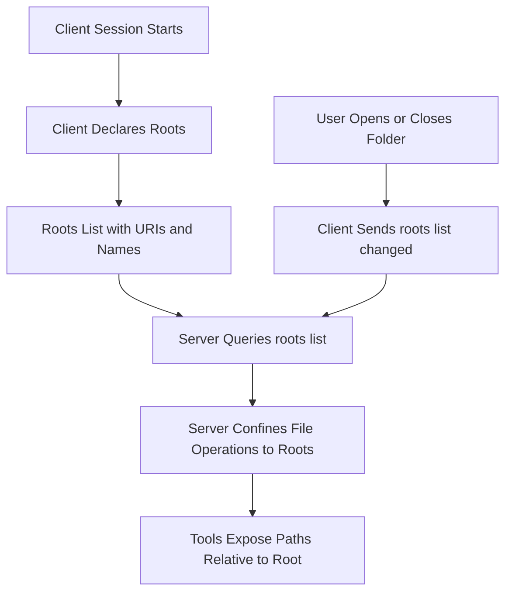

# Roots: Telling a Server Which Parts of the Filesystem It May Touch

## English

A filesystem server has a problem: it can technically read any path the process can access, but it should only work within the project the user actually cares about. MCP solves this with roots — a client-side concept that declares which directories (or other URI-addressable locations) a server is allowed to operate on. Roots are not a security sandbox enforced by the protocol; they are a cooperative boundary. The client tells the server 'here are my roots', and a well-behaved server confines its file operations to those paths. The protocol cannot stop a malicious server from ignoring them, which is why roots belong to the trust-and-consent story rather than to authentication.

Roots are declared as a list of objects, each with a `uri` (typically a `file://` URI) and an optional human-readable `name`. A client exposes them during the session, and the server can query them via the `roots/list` request. Critically, roots are dynamic. A user might open a new folder in their editor, or close a project. MCP handles this with a `notifications/roots/list_changed` notification from client to server, prompting the server to re-fetch the list. This is the same change-tracking philosophy used elsewhere in the protocol: rather than polling, the client pushes a signal and the server refreshes.

The value of roots becomes clear when you imagine a coding assistant with a filesystem server. Without roots, the server would have to guess which directory is 'the project', or expose an unbounded `read_file(path)` tool that the model could point anywhere. With roots, the host can say 'the open workspace is /home/user/proj', and the server's tools can present paths relative to that root, reject traversal outside it, and list only files the user can see. It turns an unbounded capability into a scoped one.

Roots also shape how tools are described to the model. If a server knows its roots, it can advertise tools like 'list files in the current project' rather than 'list files anywhere on disk'. Smaller, scoped tools are easier for a model to use correctly and safer to grant. This mirrors a broader principle in agent design: capability scoping reduces both accidental errors and the blast radius of prompt-injection attacks.

One common misconception is that roots replace user consent. They do not. Roots express intent — 'this is the workspace' — while consent is a separate UX layer where the human approves specific actions. A robust host uses both: roots to keep the server oriented, and confirmation prompts for destructive operations. Roots are the map; consent is the brake pedal.

## 中文

檔案系統伺服器有個難題：技術上它能讀取行程可存取的所有路徑，但它應該只在使用者真正關心的專案內工作。MCP 用 roots 解決——這是客戶端的概念，宣告伺服器被允許操作哪些目錄（或其他可用 URI 定址的位置）。Roots 不是協定強制的安全沙箱，而是合作式的邊界。客戶端告訴伺服器「這些是我的 roots」，行為良好的伺服器便把檔案操作限制在這些路徑內。協定無法阻止惡意伺服器忽略它們，這正是 roots 屬於信任與同意範疇、而非身分驗證的原因。

Roots 以一串物件宣告，每個物件有 `uri`（通常是 `file://` URI）與可選的人類可讀 `name`。客戶端在會話中揭露它們，伺服器可透過 `roots/list` 請求查詢。關鍵是 roots 是動態的。使用者可能在編輯器開啟新資料夾，或關閉專案。MCP 用客戶端到伺服器的 `notifications/roots/list_changed` 通知處理，促使伺服器重新抓取清單。這與協定其他地方的變更追蹤哲學一致：不輪詢，客戶端推一個訊號，伺服器重新整理。

想像一個搭配檔案系統伺服器的程式助理，roots 的價值就清楚了。沒有 roots，伺服器得猜哪個目錄是「專案」，或暴露一個無界線的 `read_file(path)` 工具，模型可以指向任何地方。有了 roots，宿主可以說「開啟的工作區是 /home/user/proj」，伺服器的工具便能以該 root 為基準呈現相對路徑、拒絕越界穿越、只列出使用者看得到的檔案。它把無界線的能力變成有範圍的能力。

Roots 也影響工具如何向模型描述。若伺服器知道自己的 roots，它可以宣傳「列出目前專案的檔案」而不是「列出磁碟上任何地方的檔案」。範圍更小、更聚焦的工具對模型更容易正確使用，授予起來也更安全。這呼應代理設計的更大原則：能力範圍化同時降低意外錯誤與提示注入攻擊的爆炸半徑。

常見誤解是 roots 取代了使用者同意。並沒有。Roots 表達意圖——「這是工作區」——而同意是另一層使用者體驗，由人類核准具體動作。穩健的宿主兩者並用：roots 讓伺服器保持方向感，破壞性操作則用確認提示。Roots 是地圖；同意是煞車踏板。

## Key Takeaway

Roots let a client declare which filesystem locations a server should treat as its workspace, and they are a cooperative scoping mechanism, not an enforced sandbox.

## Related Concepts
- Capability scoping
- Client-side consent UX

## Diagram

