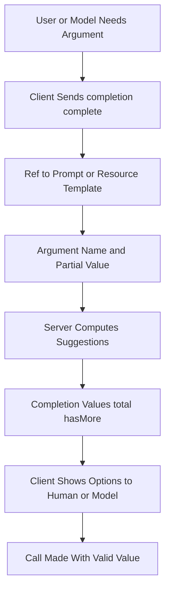

# Completions: Helping the Model (and the Human) Fill in Arguments

## English

Many MCP primitives take arguments: a prompt template has parameters, a resource has a URI template, a tool has an input schema. Users and models alike often need help choosing valid values. MCP addresses this with completions — a request the client sends to the server asking 'given this argument so far, what are plausible values?' The request is `completion/complete`, and it references the thing being completed: a `ref` pointing at a prompt or resource template, plus an `argument` with a name and the partial value typed so far.

The server responds with a `completion` object containing a list of `values` and an optional `total` and `hasMore` flag for pagination. This is deliberately modest: it is not a search engine, and it does not require the server to understand natural language. A resource template like `file:///{path}` can offer completions by listing directory entries that match the partial path. A prompt argument named `language` can offer a fixed list of supported languages. The mechanism is general enough to cover both dynamic and static suggestions.

Why does this matter for an LLM-driven workflow? Because argument errors are a common failure mode. If a model guesses a resource URI that does not exist, the tool call fails and the model must retry, burning tokens and time. Completions let the client surface valid options before the call is made — either by feeding suggestions to the model as context, or by presenting them to a human in an editor-style dropdown. The same server logic serves both audiences, which is an elegant reuse.

There is an important boundary: completions are advisory. The server is not obligated to validate that the final value came from its suggestions, and the client is not obligated to use them. They are hints, not contracts. This keeps the protocol flexible — a server can implement completions for its most error-prone arguments and skip the rest. It also means completions should never be treated as a security control; the server must still validate every argument it receives.

Practically, completions shine in interactive hosts. Imagine typing `/review-pr ` in a chat client and seeing a dropdown of open pull requests, each backed by a live API call the server makes on demand. The human picks one, the argument is filled correctly, and the model never had to guess. For autonomous agents, the client can inject the top few completions into the model's context as 'valid values include…', nudging it toward success. In both cases, the win is the same: fewer failed calls, less guessing, and a tighter feedback loop between the server that knows the data and the interface that presents it.

## 中文

許多 MCP 原語都吃引數：提示模板有引數、資源有 URI 模板、工具有輸入結構。使用者與模型往往需要幫忙挑選合法值。MCP 用 completions 處理——客戶端向伺服器發請求，問「根據目前這個引數，有哪些合理值？」請求是 `completion/complete`，並引用被補全的物件：一個 `ref` 指向提示或資源模板，加上一個 `argument`，含名稱與目前已輸入的部分值。

伺服器回應一個 `completion` 物件，內含 `values` 清單，並可選帶 `total` 與 `hasMore` 旗標以供分頁。這刻意很樸素：它不是搜尋引擎，也不要求伺服器懂自然語言。像 `file:///{path}` 的資源模板可以列出符合部分路徑的目錄專案來提供補全。名為 `language` 的提示引數可以給出支援語言的固定清單。機制足夠通用，兼顧動態與靜態建議。

這對 LLM 驅動的工作流程為何重要？因為引數錯誤是常見的失敗模式。若模型猜了一個不存在的資源 URI，工具呼叫就失敗，模型得重試，燒掉 token 與時間。Completions 讓客戶端在呼叫前就呈現合法選項——無論是把建議當上下文餵給模型，或在編輯器式下拉選單中呈現給人。同一套伺服器邏輯服務兩種受眾，這是優雅的複用。

有個重要界線：completions 只是建議。伺服器沒有義務驗證最終值是否來自它的建議，客戶端也沒有義務採用。它們是提示，不是契約。這讓協定保持彈性——伺服器可以只為最容易出錯的引數實作補全，其餘略過。這也意味著 completions 絕不該被當成安全控制；伺服器仍必須驗證收到的每個引數。

實務上，completions 在互動式宿主最亮眼。想像在聊天客戶端輸入 `/review-pr `，看到開啟中的 pull request 下拉選單，每個都由伺服器按需即時呼叫 API 支撐。人選了一個，引數正確填入，模型從頭到尾不必猜。對自主代理，客戶端可以把前幾個補全注入模型上下文，寫成「合法值包括……」，把它推向成功。兩種情況下收穫相同：更少失敗呼叫、更少猜測，以及知道資料的伺服器與呈現資料的介面之間更緊密的回饋迴路。

## Key Takeaway

The completion/complete request lets servers suggest valid argument values for prompts, resources, and tools, reducing failed calls while remaining purely advisory.

## Related Concepts
- URI templates
- Argument validation

## Diagram

