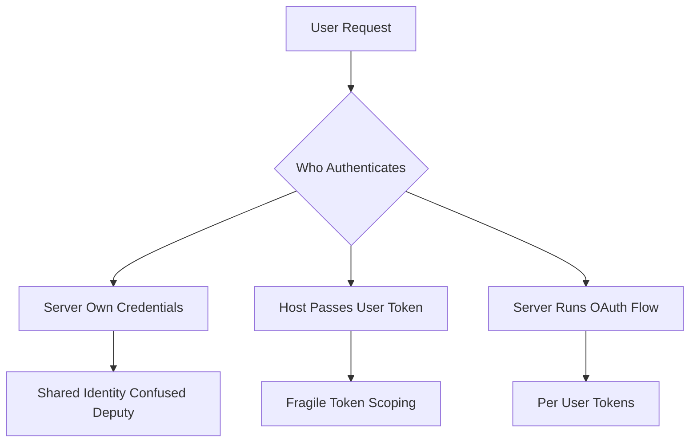

# MCP and the Authority Problem: Whose Credentials Does a Tool Use?

## English

When an MCP server calls an external API on the model's behalf, someone has to authenticate. There are three broad patterns, and they have wildly different security consequences. In the first, the server holds its own long-lived credentials (a service account, an API key in an environment variable) and every user of the host shares that identity. In the second, the host passes the end-user's token through to the server, so the server acts as that user. In the third, the server runs an OAuth flow and keeps per-user tokens itself, keyed to a session.

The first pattern is what people build by accident. It is simple: set an API key, ship the server, done. But it collapses the distinction between users. If two people use the same host, the tool's audit log shows one identity, and any permission the tool has, every user has. This is the classic "confused deputy" problem: the server is a deputy with real authority, and it cannot tell whether the request it is fulfilling genuinely came from someone entitled to it.

Passing user tokens through is better in principle but fragile in practice. The host must obtain the token, decide how much of it to forward, and ensure the server does not log it. Token scoping matters enormously here: if the host forwards a token with broad scopes, the server can do anything the user can, which is usually far more than the tool needs. Narrow, per-tool scopes are the mitigation, but they require the identity provider to support fine-grained consent.

The third pattern, where the MCP server itself is an OAuth client, is the one that scales to remote servers shared by many users. The server registers with the identity provider, runs the authorization code flow, and stores refresh tokens per user session. The MCP specification has evolved to describe authorization for HTTP-based transports, but the details are version-sensitive, so treat any specific endpoint or metadata field as something to verify against the current spec rather than memorise.

A useful mental model: ask "who is the principal?" for every tool call. If the answer is "the server," you have a shared identity and shared blast radius. If it is "the user," you have per-user audit trails and revocation. Most production incidents in this space come from quietly sliding from the second answer to the first because it is easier to implement.

## 中文

當 MCP 伺服器代模型呼叫外部 API 時，總得有人去認證。大致有三種模式，而它們的安全後果差異極大。第一種：伺服器自己持有長期憑證（服務帳戶、環境變數裡的 API key），主機的每個使用者共用同一個身分。第二種：主機把終端使用者的 token 傳給伺服器，伺服器以該使用者的身分行事。第三種：伺服器自己跑 OAuth 流程，按工作階段保存每位使用者的 token。

第一種模式往往是無意間建出來的。它很簡單：設一個 API key、把伺服器發佈出去、完事。但它抹平了使用者之間的區別。若兩個人用同一個主機，工具的稽核記錄只會顯示一個身分，而工具擁有什麼權限，每個使用者就擁有什麼權限。這就是典型的「混淆代理」(confused deputy) 問題：伺服器是一個握有真實權限的代理，卻分不清它正在服務的請求，是否真的來自一個有資格提出該請求的人。

把使用者 token 轉發出去，原則上較好，實務上卻很脆弱。主機必須取得 token、決定要轉發多少、並確保伺服器不會把它寫進日誌。這裡 token 的範圍 (scope) 至關重要：若主機轉發的是範圍很廣的 token，伺服器就能做使用者能做的一切，通常遠超工具所需。收窄的、按工具劃分的 scope 是緩解手段，但這要求身分提供者支援細緻的同意機制。

第三種模式——MCP 伺服器本身就是 OAuth 客戶端——才能擴展到由多人共用的遠端伺服器。伺服器向身分提供者註冊、跑授權碼流程、按使用者工作階段保存 refresh token。MCP 規格已逐步描述 HTTP 傳輸下的授權方式，但細節對版本很敏感，所以任何具體端點或 metadata 欄位，都應對照當前規格查證，而非死記。

一個好用的心智模型：對每次工具呼叫都問「主體 (principal) 是誰？」。若答案是「伺服器」，你就有共用身分與共用的爆炸半徑。若是「使用者」，你就有按使用者劃分的稽核軌跡與撤銷能力。這領域的生產事故，大多來自悄悄從第二個答案滑向第一個答案，因為它比較容易實作。

## Key Takeaway

For every MCP tool call, identify the principal: a server-owned credential means a shared identity and shared blast radius, while per-user tokens give you real audit trails and revocation.

## Related Concepts
- Confused deputy problem
- OAuth scopes

## Diagram

