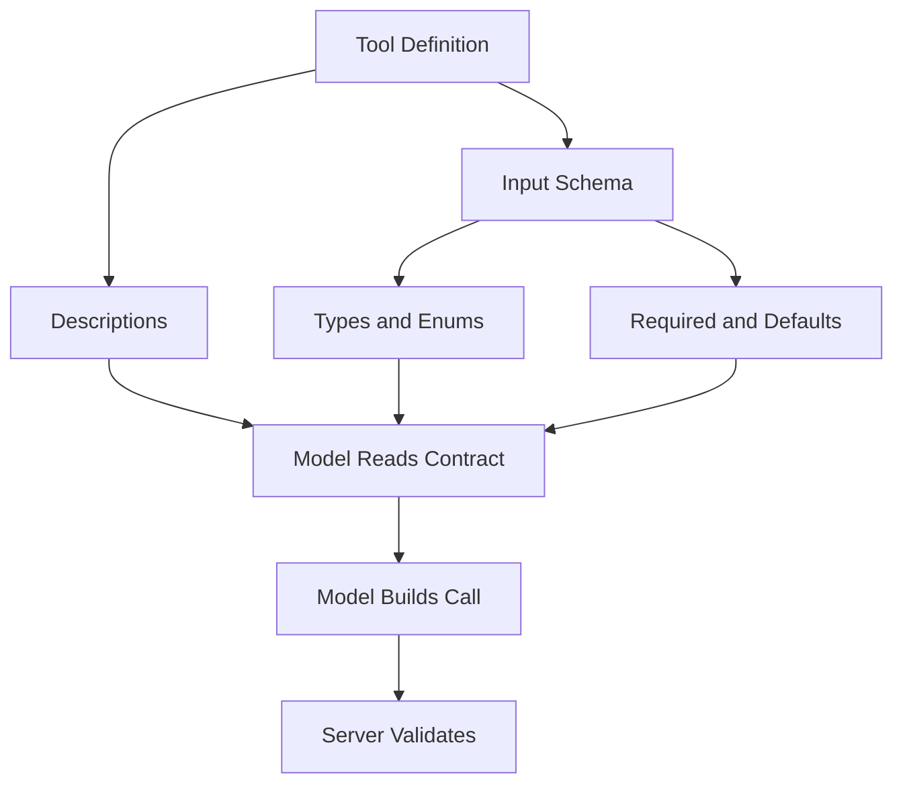

# How MCP Servers Describe Themselves: Schemas as the Contract

## English

Every MCP tool advertises an input schema, conventionally expressed as JSON Schema. This is not decoration. It is the contract the model reads when deciding whether and how to call the tool, and it is the contract the server should validate against when a call arrives. The quality of that schema is arguably the single biggest determinant of whether a tool gets used correctly.

Consider a tool called `search` with a schema saying only that it takes an object. The model has no idea what keys to supply. A better schema names `query` (a string), `limit` (an integer, minimum 1, maximum 50, default 10), and `sort` (an enum of `relevance` or `date`). Now the model can construct a valid call without guessing, and a validator can reject malformed ones before any work happens. Enums are especially valuable: they turn an open-ended string into a closed set the model can pick from, which dramatically reduces hallucinated values.

Descriptions matter as much as types. Each property can carry a description string, and the tool itself can carry one. These are prompt text in disguise: they are read by the model and steer its behaviour. A description like "the search query; supports quoted phrases and field:value filters" teaches the model capabilities it would otherwise never discover. Conversely, a terse or misleading description produces calls that look reasonable but fail.

There is a tension between expressiveness and reliability. Very permissive schemas (everything optional, everything a string) push the burden onto the server, which must then parse and reject. Very strict schemas can make the tool hard to call for legitimate cases. A practical middle ground is to make the common path easy — required fields for the essentials, sensible defaults for the rest, and enums wherever the set of valid values is genuinely finite.

Finally, remember that schema validation is a defence, not just a convenience. A server that trusts its inputs because the model "usually" sends the right shape is one malformed call away from a crash or worse. Validating against the declared schema, rejecting unknown properties, and returning a clear error message teaches the model to correct itself on the next attempt.

## 中文

每個 MCP 工具都會宣告一份輸入 schema，慣例上以 JSON Schema 表達。這不是裝飾。它是模型在決定要不要呼叫、以及如何呼叫該工具時所讀的契約，也是伺服器在收到呼叫時應該據以驗證的契約。這份 schema 的品質，可說是工具能否被正確使用的最大單一決定因素。

設想一個叫 `search` 的工具，schema 只說它接受一個物件。模型完全不知道該填哪些鍵。更好的 schema 會寫明 `query`（字串）、`limit`（整數，最小 1、最大 50、預設 10），以及 `sort`（`relevance` 或 `date` 的列舉）。現在模型不必猜就能組出合法的呼叫，驗證器也能在任何實際工作開始前就擋掉格式錯誤的請求。列舉 (enum) 特別有價值：它把開放式字串變成模型可以從中挑選的封閉集合，大幅減少憑空捏造的值。

描述和型別一樣重要。每個屬性都可以帶一段描述字串，工具本身也可以。這些其實是偽裝成 metadata 的提示文字：模型會讀它們，並據此調整行為。像「搜尋查詢；支援引號片語與 field:value 篩選」這樣的描述，等於教會模型它原本永遠不會發現的能力。反過來說，簡略或誤導性的描述，會產生看起來合理卻失敗的呼叫。

表達力與可靠性之間存在張力。過於寬鬆的 schema（全部選填、全部是字串）把負擔推給伺服器，伺服器隨後得自行解析與拒絕。過於嚴格的 schema 又可能讓合法情境難以呼叫。實務上的折衷是讓常見路徑變簡單——必要欄位設為必填、其餘給合理預設值、凡是合法值確實有限的地方就用列舉。

最後，記住 schema 驗證是一種防禦，不只是便利。一個因為「模型通常」會送對形狀就信任輸入的伺服器，離一次格式錯誤呼叫造成的崩潰（或更糟）只有一步之遙。依宣告的 schema 驗證、拒絕未知屬性、回傳清楚的錯誤訊息，能教會模型在下一次嘗試時自我修正。

## Key Takeaway

A tool's input schema and descriptions are the prompt the model reads before calling it, so invest in precise types, enums, defaults, and descriptive text — and validate against them on the server side.

## Related Concepts
- JSON Schema
- Prompt engineering

## Diagram

