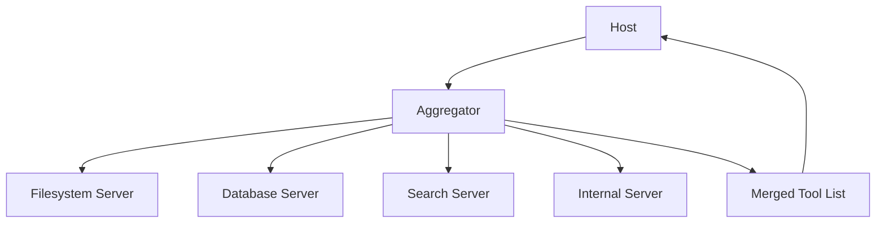

# Composing MCP Servers: Aggregators, Proxies, and Tool Namespace Collisions

## English

A single host rarely talks to one server. It might connect to a filesystem server, a database server, a search server, and a couple of internal ones. Each brings its own tool list, and nothing in the protocol guarantees that names are unique across servers. Two servers can both expose a tool called `search`, and the host must decide what the model sees.

This is where composition patterns appear. An aggregator (sometimes called a proxy or gateway) is itself an MCP server that connects to several downstream servers and presents their tools as one merged list. To the host it looks like a single server; behind it, the aggregator fans out calls. This is attractive because it centralises concerns the host would otherwise repeat: authentication to each backend, rate limiting, logging, and name disambiguation.

Disambiguation is the hard part. A common approach is prefixing, so `search` from the docs server becomes something like `docs__search`. The exact separator is a convention, not a protocol rule, but consistency matters because the model learns the pattern and uses it. Prefixing has a cost: names get longer, and very long names can be awkward for the model to reproduce exactly. It also leaks the internal topology into the visible tool list, which may or may not be desirable.

Aggregation introduces failure modes that a single server does not have. If one downstream server is slow, does the aggregator block the whole listing? If one is down at startup, does the merged list silently omit its tools, causing the model to conclude a capability does not exist? Good aggregators degrade gracefully: they list what they have, mark unavailable backends, and return a clear error when a call targets a dead server rather than hanging.

There is also a policy dimension. An aggregator is the natural place to enforce "this user may only see these tools" or "this tool requires confirmation." Because it sits between the host and the backends, it can filter, rewrite, or wrap tool definitions before the model ever sees them. That makes it both a convenience layer and a control point — and, like any control point, something that deserves its own careful testing.

## 中文

單一主機很少只跟一個伺服器對話。它可能連上檔案系統伺服器、資料庫伺服器、搜尋伺服器，還有幾個內部伺服器。每一個都帶來自己的工具清單，而協定本身並不保證名稱在不同伺服器之間是唯一的。兩個伺服器可以都提供一個叫 `search` 的工具，主機必須決定模型看到什麼。

組合模式就在這裡出現。聚合器（有時叫代理或閘道）本身是一個 MCP 伺服器，它連上數個下游伺服器，把它們的工具合併成一份清單呈現。對主機而言它像單一伺服器；在它背後，聚合器把呼叫分送到各處。這很吸引人，因為它集中了主機否則得重複處理的事：對每個後端的認證、速率限制、日誌，以及名稱消歧。

消歧是難的部分。常見做法是加前綴，於是文件伺服器的 `search` 會變成類似 `docs__search`。確切的分隔符是慣例而非協定規則，但一致性很重要，因為模型會學會這個模式並加以使用。加前綴有代價：名稱變長，而極長的名稱會讓模型難以一字不差地重現。它也會把內部拓撲洩漏到可見的工具清單裡，這是否可取見仁見智。

聚合會引入單一伺服器沒有的失效模式。若某個下游伺服器很慢，聚合器要因此卡住整份清單嗎？若某個在啟動時就掛了，合併清單會不會默默略過它的工具，讓模型誤以為某項能力不存在？好的聚合器會優雅降級：列出它有的、標示不可用的後端，並在呼叫指向死掉的伺服器時回傳清楚的錯誤，而不是掛住。

另外還有政策層面。聚合器是執行「這位使用者只能看到這些工具」或「這個工具需要確認」的天然位置。因為它夾在主機與後端之間，它可以在模型看到之前就過濾、改寫或包裝工具定義。這使它既是便利層，也是控制點——而一如任何控制點，它值得自己的一套仔細測試。

## Key Takeaway

Aggregator servers let one host compose many MCP backends, but they must handle name collisions, partial failures, and policy filtering explicitly rather than hiding them.

## Related Concepts
- API gateway pattern
- Namespace collision

## Diagram

