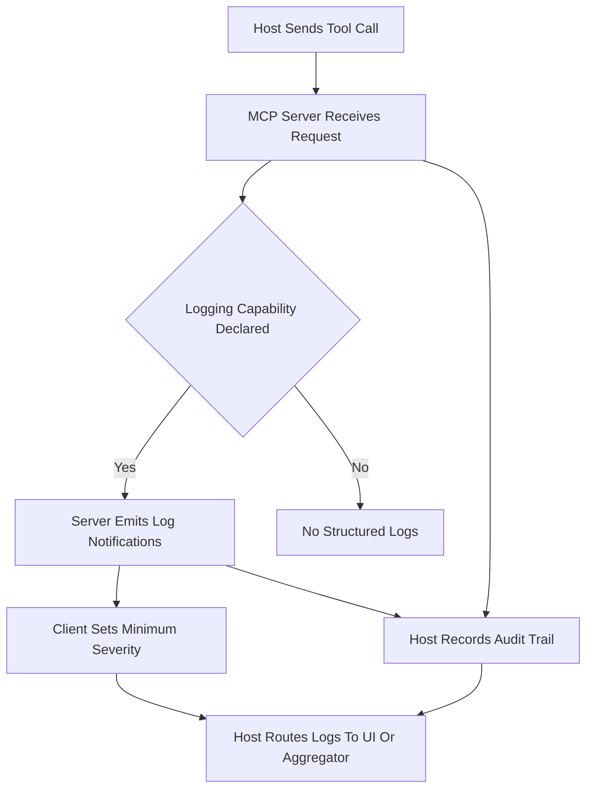

# Logging, Audit Trails, and Observability in MCP

## English

An MCP server is a black box from the host's point of view: a tool call goes in, a result comes out, and everything in between is invisible unless the server deliberately reports it. The protocol gives servers a structured way to do this through log messages. A server that declares the logging capability during the initialize handshake can emit log notifications to the client, each carrying a severity level (debug, info, warning, error, and so on) plus a free-form JSON data payload. Because these are notifications rather than responses, they are not tied to any single request ID and can arrive at any time, interleaved with normal traffic. The client can also send a request to set the minimum severity level it cares about, so a production host can silence debug chatter while a developer host sees everything. This is meaningfully different from writing to stderr: stderr is a transport-level escape hatch for crashes and startup errors, whereas MCP log notifications are semantic, structured, and addressed to the host application, which can route them to a UI, a log aggregator, or a policy engine.

For auditing, the interesting question is not just what the server logged but what the host observed. A well-instrumented host records every tool invocation: which server, which tool name, the arguments (carefully redacted), the latency, whether it succeeded, and the identity of the human or agent that triggered it. This is the layer where you answer questions like 'did anything touch the production database yesterday?' or 'which tool calls failed repeatedly before the incident?' The server's own logs complement this by describing internal decisions: why a query was rejected, which upstream API returned a 429, how long a retry took. Neither side alone tells the full story, because the host knows intent and the server knows execution.

A concrete example: a filesystem server receives a read request for a path outside its allowed roots. It should not silently fail. It emits a warning-level log notification explaining the refusal and returns a structured error to the caller. The host logs the attempt with the requesting user's identity. Later, a security review can correlate the two records and see both the policy decision and the human behind it. Without the log notification, the host would only see a generic error and might not distinguish a typo from a probing attempt.

There are practical pitfalls. Log payloads can accidentally leak secrets if developers dump entire request objects, so redaction has to happen at the server before emission, not after. High-frequency tools can flood the client with notifications, so rate limiting or sampling at the server is wise. And because notifications are fire-and-forget in JSON-RPC 2.0, a server cannot assume the client received or stored them; if durability matters, the server should also write to its own persistent log. Treat MCP logging as the real-time channel and your own storage as the durable record.

Finally, observability is more than logs. Latency histograms, error-rate counters, and trace identifiers that propagate from host to server to downstream service all matter. If the host generates a correlation ID per tool call and the server includes it in its log payloads, you can reconstruct a single user action across multiple servers and services. That is the difference between 'something broke' and 'this specific request took 4.2 seconds because server B retried twice against a slow upstream.'

## 中文

從主機（host）的角度看，一個 MCP 伺服器基本上是黑盒：工具呼叫送進去，結果送出來，中間發生什麼事完全看不見，除非伺服器主動回報。協議提供了結構化的方式做到這件事，就是日誌訊息。若伺服器在 initialize 握手時宣告了 logging 能力，它就可以向客戶端發出日誌通知，每則通知帶有嚴重程度（debug、info、warning、error 等）以及一段自由格式的 JSON 資料。因為這些是通知（notification）而非回應（response），它們不綁定任何單一請求 ID，可以隨時抵達，與正常流量交錯。客戶端亦可發送請求設定它關心的最低嚴重程度，於是正式環境的主機可以關掉 debug 雜訊，而開發環境的主機則全開。這與單純寫 stderr 有本質差別：stderr 是傳輸層的逃生出口，用於崩潰與啟動錯誤；而 MCP 日誌通知是有語意的、結構化的、面向主機應用程式的，主機可以把它導向介面、日誌聚合器或政策引擎。

就稽核而言，關鍵問題不只是伺服器記錄了什麼，還有主機觀察到什麼。一個有良好觀測能力的主機會記錄每次工具呼叫：哪個伺服器、哪個工具名稱、參數（小心去識別化）、延遲、成功與否，以及觸發它的人類或代理身份。這一層能回答「昨天有沒有任何東西碰過正式資料庫？」或「事故前哪些工具呼叫反覆失敗？」伺服器自身的日誌則補上內部決策：為何查詢被拒、哪個上游 API 回了 429、重試花了多久。單看任何一邊都不完整，因為主機知道意圖，伺服器知道執行。

具體例子：一個檔案系統伺服器收到讀取某個超出允許 roots 的路徑的請求。它不應該默默失敗。它發出一則 warning 級別的日誌通知解釋拒絕原因，並向呼叫方回傳結構化錯誤。主機則記錄這次嘗試以及發起請求的使用者身份。日後安全審查可以把兩份紀錄對照，同時看到政策決定與背後的人。沒有日誌通知的話，主機只會看到一個籠統錯誤，無法區分是打錯字還是在探測。

實務上有幾個陷阱。日誌內容若把整個請求物件倒出來，可能意外洩漏機密，所以去識別化必須在伺服器端、發出之前完成，而不是之後。高頻工具可能用通知淹沒客戶端，因此在伺服器端做限流或取樣是明智的。而且因為通知在 JSON-RPC 2.0 中是射後不理，伺服器不能假設客戶端收到或保存了它們；若需要持久性，伺服器應同時寫入自己的持久日誌。把 MCP logging 當作即時通道，把自己的儲存當作耐久紀錄。

最後，可觀測性不只是日誌。延遲直方圖、錯誤率計數器，以及從主機傳到伺服器再到下游服務的追蹤識別碼都很重要。若主機為每次工具呼叫產生一個關聯 ID，而伺服器把它放進日誌內容，你就能跨多個伺服器與服務重建單一使用者動作。這就是「有東西壞了」與「這個特定請求花了 4.2 秒，因為伺服器 B 對慢速上游重試了兩次」之間的差別。

## Key Takeaway

MCP logging turns a server from a black box into an observable component, but durable audit trails require the host to record intent alongside the server's structured notifications.

## Related Concepts
- JSON-RPC notifications
- Distributed tracing

## Diagram

