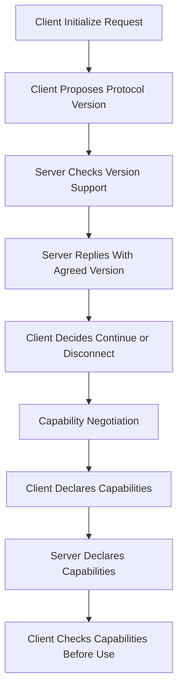

# Versioning and Backward Compatibility in MCP Servers

## English

Protocols that live for years have to answer a deceptively hard question: what happens when a new client meets an old server, or an old client meets a new server? MCP handles this at two levels. The first is protocol version negotiation during the initialize handshake. The client proposes a protocol version it supports, and the server replies with the version it will use. If the server does not support the proposed version, it responds with one it does support, and the client decides whether to continue or disconnect. This is a deliberate design choice: rather than guessing at compatibility, the two sides explicitly agree on a version before any other traffic flows. Everything after that handshake is interpreted under the agreed rules.

The second level is capability negotiation, which is finer-grained. Even if both sides speak the same protocol version, they may not support the same optional features. The client declares what it can do (for example, whether it can handle sampling requests or elicitation), and the server declares what it offers (tools, resources, prompts, logging, and so on). A well-behaved client checks the server's declared capabilities before assuming a feature exists. This means a server can add a new optional capability in a later release without breaking older clients, because those clients simply never see or use it. The rule of thumb is: never assume, always check the capability list.

Backward compatibility gets harder at the schema level, inside individual tools. Tool input schemas are contracts, and changing them carelessly breaks callers. Adding a new optional property is usually safe, because existing callers simply omit it and the server applies a default. Renaming a property is not safe, because old callers will send the old name and the server will reject or misinterpret it. Making a previously optional property required is a breaking change, because callers that relied on the default will suddenly fail validation. Removing a tool entirely is the most disruptive change of all, since any prompt or workflow that referenced it will break. A disciplined server treats its tool schemas like a public API: additive changes are preferred, deprecations are announced, and removals happen only after a long overlap period where both old and new forms work.

A practical pattern is to keep old tool names as aliases while introducing new ones. If you must rename `get_user` to `fetch_user_profile`, register both for a release cycle, have the old one emit a deprecation warning through a log notification, and only remove it once you are confident no caller depends on it. Similarly, if a tool's output shape changes, consider returning both the old and new fields for a transition period rather than switching abruptly. This costs a little code but buys enormous goodwill and prevents silent breakage in downstream agents.

There is also a subtle compatibility issue around error semantics. If a server previously returned a generic error for a missing record and now returns a structured 'not found' error, callers that parsed the old message may misbehave. Document the change, and if possible keep the old error code available under a flag. The same applies to pagination: if a list operation previously returned everything and now paginates, callers that never followed cursors will silently see truncated results. Introducing pagination is therefore a breaking change unless you default to returning everything when no cursor is supplied, which is not always feasible. In short, versioning in MCP is not just a handshake detail; it is an ongoing discipline of treating schemas, capabilities, and error shapes as contracts that other people's software depends on.

## 中文

一個要活上多年的協議，必須回答一個看似簡單卻很難的問題：新客戶端遇上舊伺服器，或舊客戶端遇上新伺服器，會怎樣？MCP 在兩個層面處理。第一層是 initialize 握手期間的協議版本協商。客戶端提出它支援的協議版本，伺服器回覆它將使用的版本。若伺服器不支援客戶端提出的版本，它會回覆一個它支援的版本，由客戶端決定要繼續還是斷線。這是刻意的設計選擇：與其猜測相容性，雙方在任何其他流量之前先明確同意一個版本。握手之後的一切，都按同意的規則解讀。

第二層是能力協商，顆粒度更細。即使雙方講同一個協議版本，也未必支援同樣的選用功能。客戶端宣告它會做什麼（例如能否處理 sampling 請求或 elicitation），伺服器宣告它提供什麼（工具、資源、提示、日誌等）。行為良好的客戶端會先檢查伺服器宣告的能力，再假設某功能存在。這意味著伺服器可以在後續版本加入新的選用能力而不破壞舊客戶端，因為那些客戶端根本不會看到或用到它。經驗法則是：永不假設，永遠檢查能力清單。

向後相容在單一工具內的 schema 層面更難。工具輸入 schema 是契約，隨意改動會弄壞呼叫方。新增一個選用屬性的改動通常是安全的，因為既有呼叫方直接省略它，伺服器套用預設值。重新命名屬性則不安全，因為舊呼叫方會送舊名稱，伺服器會拒絕或誤解。把原本選用的屬性改成必填是破壞性變更，因為依賴預設值的呼叫方會突然驗證失敗。整個移除工具是最具破壞性的，因為任何引用它的提示或工作流程都會壞掉。有紀律的伺服器把工具 schema 當公開 API 對待：偏好新增式改動、公告棄用、只有在長時間重疊期（新舊形式並存）之後才移除。

一個實用模式是保留舊工具名稱作為別名，同時引入新名稱。若你必須把 `get_user` 改名為 `fetch_user_profile`，就在一個版本週期內同時註冊兩者，讓舊的透過日誌通知發出棄用警告，等到確信沒有呼叫方依賴它之後才移除。同樣地，若工具輸出形狀改變，考慮在過渡期同時回傳舊欄位與新欄位，而不是突然切換。這多花一點程式碼，卻換來極大善意，並避免下游代理無聲損壞。

還有一個微妙的相容問題關於錯誤語意。若伺服器以前對找不到的紀錄回傳籠統錯誤，現在回傳結構化的「找不到」錯誤，曾解析舊訊息的呼叫方可能行為失常。記錄這個變更，若可行就在旗標下保留舊錯誤碼。分頁同理：若某列表操作以前回傳全部，現在改為分頁，從不跟隨游標的呼叫方會無聲地只看到截斷的結果。因此引入分頁是破壞性變更，除非你在沒有提供游標時預設回傳全部，而這未必可行。總之，MCP 的版本管理不只是握手細節，而是持續把 schema、能力、錯誤形狀當作別人軟體所依賴的契約來對待的紀律。

## Key Takeaway

MCP compatibility is a two-layer discipline: negotiate protocol version and capabilities at the handshake, then treat tool schemas and error shapes as long-lived contracts that only change additively.

## Related Concepts
- Semantic versioning
- Capability negotiation

## Diagram

