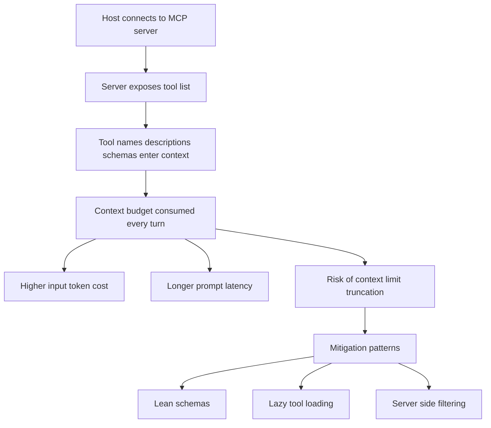

# Cost, Latency, and Context Budget: The Hidden Economics of MCP Tools

## English

Every MCP tool a server exposes is not free. The moment a host connects to a server and learns its tool list, those tool definitions—names, descriptions, and full JSON schemas—become part of the model's context on every turn where tools are offered. A handful of tools is negligible. But an aggregator that proxies twenty servers exposing two hundred tools can easily consume tens of thousands of tokens before the user has typed a single word. That is context budget spent on capability advertising rather than on the actual task. It also costs money, because input tokens are billed, and it costs latency, because larger prompts take longer to process and are more likely to hit context limits that force truncation or summarization.

This creates a real design tension. Exposing more tools gives the model more options, but each option is a tax on every request. The practical responses fall into a few patterns. One is to keep tool descriptions short and schemas lean: avoid sprawling docstrings, use tight enums, and do not include fields the model will never fill. Another is lazy or on-demand tool loading, where the host initially exposes only a small set of meta-tools (for example, a search-tools tool and an invoke-tool tool) and fetches the full schema only when the model decides it needs a particular capability. This trades an extra round trip for a much smaller baseline context. A third is server-side filtering, where the host or an aggregator hides tools that are irrelevant to the current session based on user role, project, or declared intent.

Latency has its own economics. A tool call is not one step but several: the model generates a call, the host validates and routes it, the server executes (possibly hitting a database or external API), the result travels back, and the model generates a follow-up. Each hop adds time, and a chatty workflow that chains five tool calls can turn a two-second answer into a twenty-second one. Long-running tools make this worse, which is why progress notifications and the ability to stream partial results matter: they let the host show activity and decide whether to wait or cancel. But streaming does not reduce total wall-clock time; it only improves perceived responsiveness. The real win comes from reducing the number of round trips, issuing independent calls in parallel where the host allows it, and caching results that are expensive but stable.

Caching deserves special attention because it interacts with correctness. If a tool returns the current weather, caching for a minute is fine. If it returns a user's account balance, caching for a minute might be unacceptable. MCP itself does not mandate a caching policy; that is a decision for the server and the host. A sensible approach is for the server to indicate freshness where it can (for example, via resource metadata or documented behavior) and for the host to cache only where staleness is tolerable. Blindly caching everything is as dangerous as never caching anything.

Finally, there is the question of what the model actually sees. A tool result that dumps a hundred kilobytes of JSON into the context is expensive and often counterproductive, because the model has to sift through noise to find the relevant part. Well-designed tools return compact, structured results with the important fields first and verbose detail behind a reference (for example, a resource URI the model can fetch only if needed). This is the same principle as pagination: return enough to make progress, not everything that exists. Treating context as a scarce resource—like memory in an embedded system—leads to tools that are cheaper, faster, and paradoxically more useful, because the model spends its attention on the task rather than on parsing irrelevant payloads.

## 中文

伺服器暴露的每一個 MCP 工具都不是免費的。主機一連上伺服器、得知工具清單的那一刻，那些工具定義——名稱、描述、完整 JSON schema——在每次提供工具的回合中都成為模型上下文的一部分。幾個工具微不足道。但一個代理二十個伺服器、暴露兩百個工具的聚合器，很容易在使用者還沒打半個字之前就吃掉數萬個 token。那是花在能力廣告而非實際任務上的上下文預算。它也要錢，因為輸入 token 要計費；也要延遲，因為更大的提示處理更久，也更容易撞上上下文上限而被迫截斷或摘要。

這造成真實的設計張力。暴露更多工具給模型更多選擇，但每個選擇都是對每次請求的稅。實務上的應對有幾種模式。其一是讓工具描述簡短、schema 精簡：避免冗長的說明文字、使用緊湊的 enum、不要包含模型永遠不會填的欄位。其二是延遲或按需載入工具，主機初始只暴露一小組 meta 工具（例如搜尋工具的工具、呼叫工具的工具），只有當模型決定需要某項能力時才抓取完整 schema。這以額外一次往返換取小得多的基準上下文。其三是伺服器端過濾，主機或聚合器依使用者角色、專案或宣告的意圖，隱藏與當前工作階段無關的工具。

延遲有它自己的經濟學。一次工具呼叫不是一步而是好幾步：模型產生呼叫、主機驗證並路由、伺服器執行（可能打到資料庫或外部 API）、結果送回、模型產生後續。每一跳都加時間，一個串接五次工具呼叫的嘮叨工作流程，可以把兩秒的答案變成二十秒。長時間執行的工具讓情況更糟，這正是進度通知與串流部分結果重要的原因：它們讓主機顯示活動狀態，並決定要等待還是取消。但串流不會減少總牆鐘時間，只改善感知上的反應速度。真正的收益來自減少往返次數、在主機容許時並行發出獨立呼叫，以及快取昂貴但穩定的結果。

快取值得特別注意，因為它與正確性互動。若工具回傳當前天氣，快取一分鐘沒問題。若它回傳使用者的帳戶餘額，快取一分鐘可能不可接受。MCP 本身不強制快取政策；那是伺服器與主機的決定。合理的做法是伺服器在能的時候標示新鮮度（例如透過資源中介資料或文件化的行為），主機只在可容忍過時之處快取。盲目快取一切與從不快取一樣危險。

最後，還有模型實際看到什麼的問題。一個把一百 KB JSON 倒進上下文的工具結果既昂貴又往往適得其反，因為模型得在雜訊中翻找相關部分。設計良好的工具回傳緊湊、結構化的結果，重要欄位在前，冗長細節藏在引用之後（例如一個資源 URI，模型只在需要時才去抓）。這與分頁是同一個原則：回傳足以推進的內容，而不是所有存在的東西。把上下文當作稀缺資源——像嵌入式系統裡的記憶體——會導向更便宜、更快、而且說來矛盾地更有用的工具，因為模型把注意力花在任務上，而不是解析無關的負載。

## Key Takeaway

Tool definitions consume context, money, and latency on every request, so good MCP design treats context as a scarce resource and returns compact results rather than exhaustive payloads.

## Related Concepts
- Context window management
- Prompt caching

## Diagram

