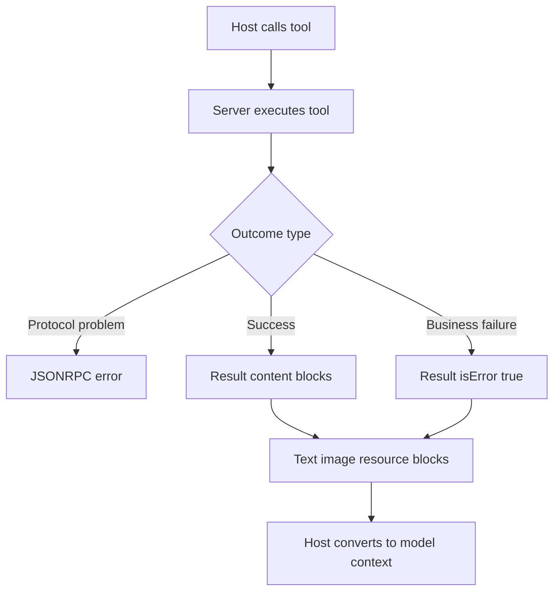

# The Tool Result Contract: What the Model Actually Sees After a Call

## English

When a host calls an MCP tool, the server does not reply with a plain string — it replies with a structured result object. In the specification, a tool's result carries a `content` array of content blocks (text, images, embedded resources, and similar), and may also carry an `isError` boolean flag. This distinction matters enormously: `isError: true` is a protocol-level signal that says "the tool ran, but the outcome was a failure the model should see and reason about" — it is not the same as a JSON-RPC error. A JSON-RPC error means the request itself was malformed or the tool does not exist; an `isError` result means the tool executed and produced a meaningful failure message that belongs in the model's context. Good servers reserve JSON-RPC errors for protocol problems and use `isError` for business logic failures like "file not found" or "query returned zero rows".

The content blocks are what the host ultimately converts into model-visible material. A text block becomes text in the conversation; an image block becomes an image part if the model is multimodal; an embedded resource block lets the server hand back a whole document by reference. This is why the shape of the result is a design decision, not an afterthought: a server that dumps a 40 KB JSON blob into a single text block forces the host to either truncate it or burn context budget. A server that returns a compact summary plus a resource link lets the model decide whether to fetch the full payload.

There is also the question of structured output. Many servers return machine-readable data that the host wants to parse programmatically — an order ID, a status code, a list of records. Some MCP implementations support declaring an output schema alongside the input schema, so the host can validate and route the result rather than scraping it out of prose. Even without output schemas, a well-behaved server returns data in a predictable layout and puts human-readable explanation in a separate text block, so the host can show one to the user and feed the other to the model.

Think of it like a restaurant kitchen. The JSON-RPC layer is the waiter carrying the order ticket — if the ticket is unreadable, that is a protocol failure. The `isError` flag is the kitchen writing "out of salmon" on the ticket — the order was understood and attempted, but the answer is a failure the customer needs to hear. The content blocks are the plate itself: you choose what goes on it, and a plate piled with everything in the fridge is not helpful even if it is technically complete. Designing the plate — summary first, detail on request, errors clearly labelled — is most of the craft of a good MCP server.

Finally, remember the host is the final editor. It may reorder, truncate, or summarise content blocks before the model sees them, and it may render images or resources differently depending on model capabilities. Your server cannot assume its output arrives verbatim. The safest habit is to make every result self-describing: state what was done, state the outcome, and put bulky data behind a resource reference so the host can decide how much of it to pull in.

## 中文

當 host 呼叫一個 MCP 工具時，server 並不是回傳一段純字串，而是回傳一個結構化的結果物件。在規範中，工具的結果帶有一個 `content` 陣列，裡面是各種內容區塊（文字、圖片、內嵌資源等），另外還可能帶有一個 `isError` 布林旗標。這個區分極其重要：`isError: true` 是協定層級的訊號，意思是「工具確實執行了，但結果是失敗，而這個失敗應該讓模型看見並加以推理」——它跟 JSON-RPC 錯誤完全是兩回事。JSON-RPC 錯誤代表請求本身格式有問題，或者工具根本不存在；而 `isError` 結果代表工具已執行並產生了有意義的失敗訊息，這訊息屬於模型的上下文。良好的 server 會把 JSON-RPC 錯誤保留給協定問題，並用 `isError` 處理業務邏輯上的失敗，例如「找不到檔案」或「查詢回傳零筆資料」。

內容區塊才是 host 最終轉換成模型可見素材的東西。文字區塊會變成對話中的文字；圖片區塊在模型支援多模態時會變成圖片部分；內嵌資源區塊則讓 server 以引用的方式交回整份文件。這就是為何結果的形狀是設計決策而非事後補救：一個把 40 KB JSON 大物件塞進單一文字區塊的 server，會逼 host 要麼截斷它，要麼燒掉上下文預算。相反，一個回傳精簡摘要加上資源連結的 server，則讓模型自行決定是否要抓取完整內容。

還有結構化輸出的問題。許多 server 回傳的是 host 想以程式方式解析的機器可讀資料——訂單編號、狀態碼、一列記錄。部分 MCP 實作支援在輸入 schema 之外再宣告輸出 schema，讓 host 能驗證並路由結果，而不是從散文裡刮資料。即使沒有輸出 schema，行為良好的 server 也會用可預測的佈局回傳資料，並把給人看的說明放在另一個文字區塊，這樣 host 就能把一個顯示給使用者、另一個餵給模型。

可以想像成餐廳廚房。JSON-RPC 層是服務生傳遞點菜單——如果單子看不清，那是協定失敗。`isError` 旗標則是廚房在單子上寫「鮭魚賣完了」——訂單被理解也被嘗試了，但答案是顧客需要聽到的失敗。內容區塊則是盤子本身：你決定盤上放什麼，而把冰箱裡所有東西堆在盤上，即使技術上「完整」，也毫無幫助。設計這個盤子——摘要優先、細節隨需、錯誤清楚標示——就是寫好一個 MCP server 的大半功夫。

最後要記得，host 才是最終的編輯。它可能在模型看到之前就重排、截斷或摘要內容區塊，也可能依模型能力以不同方式呈現圖片或資源。你的 server 不能假設輸出會原封不動送達。最安全的習慣是讓每個結果都能自我描述：說明做了什麼、說明結果如何，並把龐大資料放在資源引用後面，讓 host 自行決定要拉進多少。

## Key Takeaway

An MCP tool result is a structured plate, not a string: use isError for business failures, JSON-RPC errors for protocol failures, and keep bulky data behind resource references.

## Related Concepts
- Content Blocks and Structured Data
- JSON-RPC 2.0 Under the Hood

## Diagram

